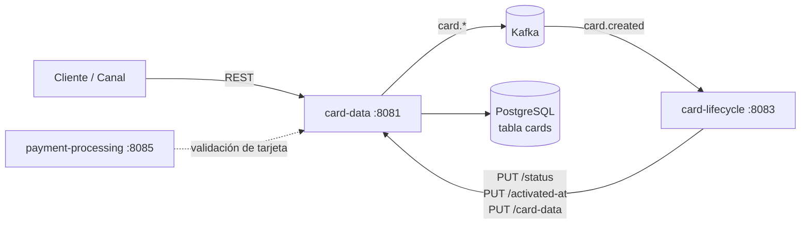
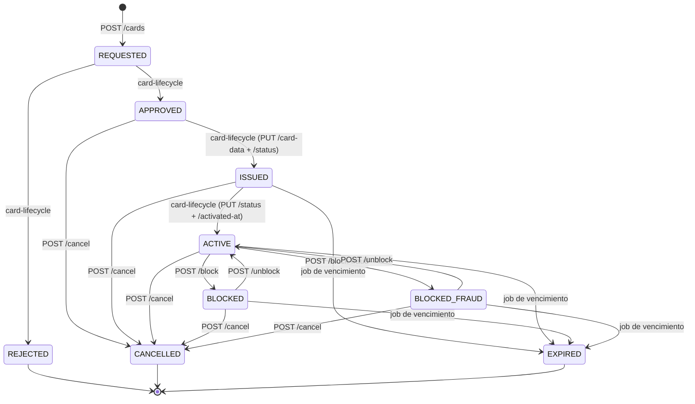
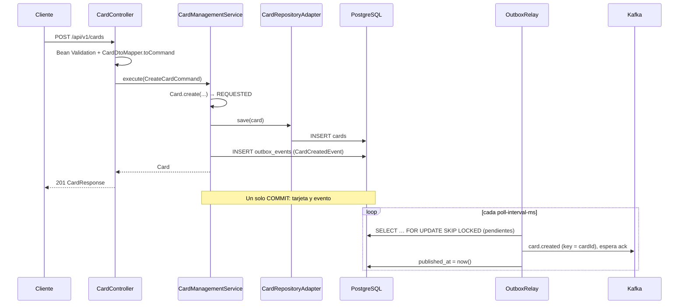

# card-data — Documentación técnica funcional

> Microservicio dueño del **Aggregate Root `Card`**: alta de solicitudes de tarjeta, datos del titular, datos sensibles (PAN, CVV, PIN), bloqueo/desbloqueo y consultas.

| Atributo | Valor |
|---|---|
| Artefacto Maven | `com.unisono.card:card-data` (`1.0.0-SNAPSHOT`) |
| Clase principal | `com.unisono.card.data.CardDataApplication` |
| Puerto | `8081` |
| Base path REST | `/api/v1/cards` |
| Base de datos | PostgreSQL `card_management_db`, tabla `cards` |
| Mensajería | Kafka (productor, vía outbox) — topics `card.*` |
| Dependencias internas | `card-shared` (Value Objects, excepciones, cifrado), `card-events` (eventos y topics) |
| Swagger UI | `http://localhost:8081/swagger-ui.html` |

---

## 1. Responsabilidad dentro del sistema

`card-data` es la **fuente de verdad de la tarjeta**. El resto de los módulos no persisten la tarjeta: la consultan o la modifican a través de este servicio.



- **Crea** la tarjeta en estado `REQUESTED` y **notifica cada cambio de estado** al ecosistema vía Kafka (§8).
- **card-lifecycle** consume `card.created`, gestiona aprobación, rechazo, emisión, activación, bloqueo y cancelación, y escribe de vuelta en `card-data` el nuevo estado, la fecha de activación, los datos generados en la emisión (PAN, CVV, PIN, vencimiento) y los motivos de bloqueo y cancelación. No escribe la tabla `cards` directamente.
- **Expone** operaciones de seguridad (bloqueo, bloqueo por fraude, desbloqueo) y de PIN (validación y cambio).
- **Bloquea por fraude** la tarjeta cuando payment-processing rechaza un pago con `responseCode` `59`: consume `payment.processing.declined` (§5.6).

---

## 2. Arquitectura

El módulo sigue **arquitectura hexagonal (Ports & Adapters)**:

```
com.unisono.card.data
├── domain
│   ├── model          Card (aggregate root), CardHolder, CardType, CardCategory
│   ├── port.input     Casos de uso (CreateCard, GetCard, BlockCard, UnblockCard,
│   │                  ValidatePIN, ResetPIN, UpdateCardStatus)
│   ├── port.output    CardRepository, EncryptionPort, EventOutboxPort
│   └── service        CardManagementService, CardSecurityService,
│                      PINManagementService, CardEventEmitter
├── application
│   ├── dto            Requests / Responses de la API
│   └── mapper         CardDtoMapper (DTO ⇄ dominio)
└── infrastructure
    ├── adapter.input.rest           CardController, CardSecurityController,
    │                                PINController, GlobalExceptionHandler
    ├── adapter.output.persistence   CardRepositoryAdapter, JpaCardRepository,
    │                                CardEntity, CardEntityMapper,
    │                                OutboxEventAdapter, OutboxEventEntity,
    │                                JpaOutboxEventRepository
    ├── adapter.output.encryption    CardEncryptionAdapter
    ├── adapter.output.event         OutboxRelay, OutboxCleaner
    └── config                       DataSource (Hikari), Kafka producer,
                                     Use cases, Swagger
```

### Mapa de casos de uso → servicios → endpoints

| Caso de uso (port input) | Implementación | Endpoint |
|---|---|---|
| `CreateCardUseCase` | `CardManagementService` | `POST /api/v1/cards` |
| `GetCardUseCase` | `CardManagementService` | `GET /{cardId}`, `GET /client/{clientId}`, `GET /search` |
| `BlockCardUseCase` | `CardSecurityService` | `POST /{cardId}/block`, `POST /{cardId}/block-fraud` |
| `UnblockCardUseCase` | `CardSecurityService` | `POST /{cardId}/unblock` |
| `UpdateCardStatusUseCase` + métodos de `CardManagementService` | `CardManagementService` | `PUT /{cardId}/status`, `PUT /{cardId}/activated-at`, `PUT /{cardId}/card-data`, `POST /{cardId}/cancel` |
| `ValidatePINUseCase` | `PINManagementService` | `POST /{cardId}/validate-pin` |
| `ResetPINUseCase` | `PINManagementService` | `POST /{cardId}/reset-pin` |
| `ValidateCVVUseCase` | `CVVValidationService` | `POST /{cardId}/validate-cvv` |
| `UpdateCardStatusUseCase` | `CardManagementService` | `PUT /{cardId}/status` |
| *(métodos directos, sin port)* | `CardManagementService` | `PUT /{cardId}/activated-at`, `PUT /{cardId}/card-data` |

---

## 3. Modelo de dominio

### 3.1 `Card` (Aggregate Root)

| Campo | Tipo | Descripción |
|---|---|---|
| `id` | `CardId` (UUID) | Generado en `Card.create(...)` |
| `clientId` | `ClientId` | DNI/CUIL del cliente (7–11 dígitos) |
| `holder` | `CardHolder` | Titular |
| `type` | `CardType` | Red de pago |
| `category` | `CardCategory` | Categoría comercial |
| `status` | `CardStatus` | Estado del ciclo de vida (definido en `card-shared`) |
| `cardNumber` | `CardNumber` | PAN — se completa en la emisión |
| `cvv` | `CVV` | Se completa en la emisión |
| `pin` | `PIN` | **Transitorio**, solo en memoria; nunca se persiste en claro |
| `pinHash` | `String` | Hash BCrypt del PIN (persistido) |
| `pinFailedAttempts` | `int` | Intentos fallidos de PIN consecutivos (bloqueo automático al llegar a `MAX_PIN_ATTEMPTS` = 3) |
| `expirationDate` | `ExpirationDate` | Mes/año de vencimiento |
| `createdAt`, `updatedAt` | `LocalDateTime` | Auditoría |
| `issuedAt`, `activatedAt`, `blockedAt`, `cancelledAt`, `expiredAt` | `LocalDateTime` | Hitos del ciclo de vida |
| `blockReason`, `cancelledReason` | `String` | Motivos |
| `deleted`, `deletedAt` | `Boolean`, `LocalDateTime` | Soft delete |

**Comportamiento del aggregate**

| Método | Efecto |
|---|---|
| `create(clientId, holder, type, category)` | Valida no-nulos; nueva tarjeta en `REQUESTED` |
| `updateStatus(status)` | Valida la transición con `CardStatus.canTransitionTo` y asigna el estado |
| `updateCardData(pan, cvv, pin, exp)` | Carga datos de emisión; setea `issuedAt` |
| `block(reason)` | Exige `CardStatus.canBlock()` (`ACTIVE` o `ISSUED`); → `BLOCKED`, guarda motivo y `blockedAt` |
| `blockForFraud(reason)` | Igual que `block`; → `BLOCKED_FRAUD` |
| `unblock()` | Exige estado bloqueado; → `ACTIVE`, limpia motivo y fecha y reinicia `pinFailedAttempts` |
| `cancel(reason)` / `expire()` / `delete()` | → `CANCELLED` / `EXPIRED` (validando la transición) / soft delete |

Una transición no permitida lanza `BusinessRuleException` (→ **422**).
| `updatePIN(hash)` / `resetPIN(hash)` | Reemplaza `pinHash`, limpia el PIN en claro y reinicia `pinFailedAttempts` |
| `registerFailedPinAttempt()` | Suma un intento; al llegar a 3 bloquea la tarjeta si `canBlock()` (motivo `"Bloqueo automático: 3 intentos fallidos de PIN"`) |
| `resetPinFailedAttempts()` | Reinicia el contador (PIN correcto) |

**Consultas derivadas**

- `isOperational()` → estado `ACTIVE` o `ISSUED` **y** no vencida.
- `isBlocked()` → `BLOCKED` o `BLOCKED_FRAUD`.
- `requiresRenewal()` → el último día del mes de vencimiento cae dentro de los próximos **60 días**.
- `canBeActivated()` → estado `ISSUED`. `canBeIssued()` → estado `APPROVED`.
- `getMaskedCardNumber()` → `**** **** **** NNNN`.
- `isPINSet()` / `hasCompleteCardData()`.

### 3.2 `CardHolder`

Datos personales del titular: `firstName`, `lastName`, `documentNumber`, `email`, `phoneNumber`, `birthDate`, `address` (opcional).

Reglas aplicadas en `CardHolder.create(...)`:

- Todos los campos obligatorios salvo `address`.
- Email con formato válido; se normaliza a minúsculas. Strings con `trim()`.
- Fecha de nacimiento no futura y **titular mayor de 18 años**.
- Igualdad por `documentNumber`.

### 3.3 `CardType`

| Valor | Nombre | Patrón BIN |
|---|---|---|
| `VISA` | Visa | `^4[0-9]{12}(?:[0-9]{3})?$` |
| `MASTERCARD` | Mastercard | `^5[1-5][0-9]{14}$` |
| `AMEX` | American Express | `^3[47][0-9]{13}$` |
| `CABAL` | Cabal | `^(6042\|6043\|5896)[0-9]{12}$` |
| `NARANJA` | Naranja | `^(5895\|5218\|5234)[0-9]{12}$` |

`CardType.detectFromNumber(pan)` devuelve `VISA` si ningún patrón coincide.

### 3.4 `CardCategory`

| Valor | Nombre | Límite de crédito por defecto (ARS) |
|---|---|---|
| `CLASSIC` | Clásica | 50.000 |
| `GOLD` | Gold | 150.000 |
| `PLATINUM` | Platinum | 300.000 |
| `BLACK` | Black | 1.000.000 |
| `INFINITE` | Infinite | 5.000.000 |

### 3.5 `CardStatus` (de `card-shared`)

`REQUESTED` → `APPROVED` / `REJECTED` → `ISSUED` → `ACTIVE` ⇄ `BLOCKED` / `BLOCKED_FRAUD` → `CANCELLED` / `EXPIRED`



El detalle de las transiciones y quién las orquesta está en [LIFECYCLE.md](LIFECYCLE.md). `card-data` valida las transiciones con `CardStatus.canTransitionTo` (card-shared):

| Desde | Hacia |
|---|---|
| `REQUESTED` | `APPROVED`, `REJECTED` |
| `APPROVED` | `ISSUED`, `CANCELLED` |
| `ISSUED` | `ACTIVE`, `BLOCKED`, `BLOCKED_FRAUD`, `EXPIRED`, `CANCELLED` |
| `ACTIVE` | `BLOCKED`, `BLOCKED_FRAUD`, `EXPIRED`, `CANCELLED` |
| `BLOCKED`, `BLOCKED_FRAUD` | `ACTIVE`, `EXPIRED`, `CANCELLED` |
| `REJECTED`, `CANCELLED`, `EXPIRED` | — (finales) |

El bloqueo desde `ISSUED` sigue a `CardStatus.canBlock()`; la state machine de card-lifecycle solo lo prevé desde `ACTIVE`.

---

## 4. API REST

Todos los endpoints cuelgan de `/api/v1/cards`. Formato JSON.

### 4.1 Gestión de tarjetas (`CardController`)

#### `POST /api/v1/cards` — Crear tarjeta

Crea una solicitud en estado `REQUESTED` y dispara el evento `card.created`.

```json
{
  "clientId": "12345678",
  "firstName": "Juan",
  "lastName": "Pérez",
  "documentNumber": "12345678",
  "email": "juan.perez@example.com",
  "phoneNumber": "+5491123456789",
  "birthDate": "1990-01-15",
  "address": "Av. Corrientes 1234, CABA",
  "type": "VISA",
  "category": "CLASSIC"
}
```

| Campo | Validación |
|---|---|
| `clientId` | Obligatorio, 7–11 caracteres |
| `firstName`, `lastName` | Obligatorios, máx. 100 |
| `documentNumber` | Obligatorio |
| `email` | Obligatorio, formato email |
| `phoneNumber` | Obligatorio, `^\+?[0-9]{10,15}$` |
| `birthDate` | Obligatoria, en el pasado (+ mayor de 18 en dominio) |
| `address` | Opcional, máx. 500 |
| `type`, `category` | Obligatorios, valores de los enums |

Respuesta **201** → `CardResponse`.

#### `GET /api/v1/cards/{cardId}` — Detalle

Respuesta **200** → `CardDetailResponse`. **404** si no existe o está eliminada.

#### `GET /api/v1/cards/client/{clientId}` — Tarjetas de un cliente

Respuesta **200** → `CardResponse[]` (lista vacía si no tiene tarjetas; nunca 404).

#### `GET /api/v1/cards/search?lastFourDigits=1234&clientId=12345678`

Busca por últimos 4 dígitos **acotado al cliente**. Respuesta **200** → `CardDetailResponse`, **404** si no hay coincidencia.

#### Endpoints internos (consumidos por `card-lifecycle`)

Reciben DTOs validados con Bean Validation (`UpdateCardStatusRequest`, `UpdateActivatedAtRequest`, `UpdateCardDataRequest`) y responden **200** sin cuerpo. Errores: **400** si falta un campo o tiene formato inválido (incluido un estado inexistente o una fecha mal formada), **404** si la tarjeta no existe y **422** si la transición de estado no está permitida.

| Método y ruta | Body | Efecto |
|---|---|---|
| `PUT /{cardId}/status` | `{ "status": "APPROVED", "reason": "…", "performedBy": "…" }` (`reason` opcional, máx. 500; `performedBy` opcional, máx. 100) | Cambia el estado validando la transición y publica el evento (§8) |
| `PUT /{cardId}/activated-at` | `{ "activatedAt": "2026-11-02T10:15:30" }` | Fecha de activación (ISO-8601) |
| `PUT /{cardId}/card-data` | `{ "cardNumber": "...", "cvv": "...", "pin": "...", "expirationMonth": 12, "expirationYear": 2030 }` | Carga datos de emisión; el PAN y el CVV se cifran y el PIN se hashea al persistir. PAN de 13–19 dígitos (+ Luhn), CVV de 3–4, PIN de 4, mes 1–12; el vencimiento no puede estar en el pasado ni a más de 10 años |
| `POST /{cardId}/cancel` | `{ "reason": "Cliente solicitó cancelación", "performedBy": "…" }` (`reason` obligatorio, máx. 500; `performedBy` opcional) | → `CANCELLED` validando la transición; guarda `cancelled_reason` y `cancelled_at`. A diferencia del resto de la tabla, responde **200** `CardResponse` |

### 4.2 Seguridad (`CardSecurityController`)

`/block` y `/block-fraud` los consume `card-lifecycle` (que valida la transición y registra el historial antes de llamarlos). Llamarlos directamente cambia el estado **sin dejar historial** en `state_transitions`: la puerta de entrada para bloquear es `card-lifecycle` `POST /{cardId}/block`.

| Método y ruta | Body | Resultado |
|---|---|---|
| `POST /{cardId}/block` | `{ "reason": "Tarjeta perdida", "performedBy": "…" }` (`reason` obligatorio) | → `BLOCKED`, **200** `CardResponse` |
| `POST /{cardId}/block-fraud` | `{ "reason": "...", "performedBy": "…" }` (`reason` obligatorio) | → `BLOCKED_FRAUD`, **200** `CardResponse` |
| `POST /{cardId}/unblock` | Opcional: `{ "reason": "…", "performedBy": "…" }` | → `ACTIVE`, **200** `CardResponse`. Si no estaba bloqueada → **422** |

`performedBy` (opcional, máx. 100) es el autor que se publica en el evento; si falta, es `"system"`.

### 4.3 PIN (`PINController`)

#### `POST /{cardId}/validate-pin`

```json
{ "pinBlock": "22A82BAE1D1C1E16F1502C988540787E", "pinKeyId": "pek-v1" }
```

Respuesta **200** `{ "valid": true | false }`. Devuelve `false` también si la tarjeta no tiene PIN configurado.

- **`pinBlock`:** PIN cifrado por el terminal en un PIN block **ISO 9564 formato 4** (AES), 32 caracteres hexadecimales. `pinKeyId` es el id de la clave de cifrado de PIN (PEK) que usó el terminal (`pin-encryption.keys`). card-data lo descifra en memoria con esa clave y el PAN de la tarjeta, y compara el PIN contra el hash BCrypt. El PIN nunca se guarda ni se loguea.
- Si el bloque no se puede descifrar (clave desconocida, formato inválido, o bloque cifrado para otra tarjeta o con otra clave) → **400**, **sin** contar un intento fallido: no se llegó a comparar ningún PIN.
- **`pin`** (en claro, 4 dígitos): se acepta todavía solo para la activación desde card-lifecycle, que no cifra. Se envía `pinBlock` + `pinKeyId` **o** `pin`, nunca ambos (400 si no).

- Un PIN incorrecto suma un intento fallido; al tercero consecutivo la tarjeta pasa a `BLOCKED`.
- Un PIN correcto reinicia el contador.
- Sobre una tarjeta bloqueada responde **422** `"La tarjeta está bloqueada. Razón: …"`, aunque el PIN sea correcto.

#### `POST /{cardId}/reset-pin`

```json
{ "oldPin": "1234", "newPin": "5678" }
```

- Si la tarjeta tiene PIN, `oldPin` debe coincidir; si no → **422** `"El PIN actual es incorrecto. Intentos restantes: N"`. El intento fallido cuenta igual que en `validate-pin` y se persiste aunque la operación falle (`noRollbackFor`); al tercero, la tarjeta se bloquea.
- Sobre una tarjeta bloqueada responde **422**.
- `newPin` se valida con `PIN.of(...)`, se hashea con BCrypt y se guarda.
- Respuesta **200** `CardResponse`.

### 4.3 bis CVV (`CVVController`)

#### `POST /{cardId}/validate-cvv`

```json
{ "cvv": "123" }
```

Respuesta **200** `{ "valid": true | false }`. La usa `payment-processing` en pagos con tarjeta no presente (`ONLINE`/`MANUAL`).

- El CVV tiene 3 o 4 dígitos (400 si no).
- Devuelve `false` si no coincide o si la tarjeta todavía no tiene CVV asignado (`PUT /{cardId}/card-data`).
- La comparación contra el CVV descifrado es de tiempo constante (`MessageDigest.isEqual`).
- Sobre una tarjeta bloqueada responde **422**. Tarjeta inexistente → **404**.
- A diferencia del PIN, un CVV incorrecto **no** suma intentos ni bloquea la tarjeta.

### 4.4 DTOs de respuesta

**`CardResponse`** (vista resumida): `id`, `clientId`, `maskedCardNumber`, `lastFourDigits`, `type`, `category`, `status`, `expirationDate` (MM/YY), `holderName`, `createdAt`, `activatedAt`, `isBlocked`, `blockReason`.

**`CardDetailResponse`** (vista detallada): todo lo anterior más `isExpired`, `requiresRenewal`, `holderEmail`, `holderPhone`, `holderDocument`, `holderBirthDate`, `holderAddress`, `updatedAt`, `blockedAt`, `isOperational`, `hasPinSet`.

Ninguna respuesta expone el PAN completo, el CVV ni el hash del PIN.

### 4.5 Errores (`GlobalExceptionHandler`)

```json
{
  "timestamp": "2026-11-02T10:15:30",
  "status": 400,
  "error": "Validation Error",
  "message": "Invalid request parameters",
  "fieldErrors": { "email": "El formato del email es inválido" }
}
```

| Excepción | HTTP | `error` |
|---|---|---|
| `NotFoundException` | 404 | `Not Found` |
| `ValidationException` (dominio / Value Objects) | 400 | `Validation Error` |
| `MethodArgumentNotValidException` (Bean Validation) | 400 | `Validation Error` + `fieldErrors` |
| `InvalidValueObjectException` | 400 | `Validation Error` |
| `HttpMessageNotReadableException` (JSON mal formado, enum inexistente, fecha inválida) | 400 | `Validation Error` |
| `BusinessRuleException` | 422 | `Business Rule Violation` |
| `OptimisticLockingFailureException` (otra operación cambió la tarjeta, §6.4) | 409 | `Conflict` |
| Cualquier otra | 500 | `Internal Server Error` |

---

## 5. Flujos funcionales

### 5.1 Alta de tarjeta



**Transactional outbox:** la tarjeta y el evento se guardan en la misma transacción, así que nunca hay una tarjeta sin evento ni un evento sin tarjeta. `OutboxRelay` publica los pendientes en orden de inserción y espera la confirmación del broker. Ante un error:

| Tipo de error | Ejemplos | Qué hace el relay |
|---|---|---|
| **Transitorio** | Broker caído, timeout (`RetriableException` de Kafka) | Registra `attempts`/`last_error`, corta el lote para no publicar fuera de orden y reintenta en la próxima pasada, **sin límite** |
| **Permanente** | Payload inválido, mensaje demasiado grande, topic inválido | Marca el evento con `failed_at` (no se reintenta) y **sigue con los siguientes** |

- **Si Kafka no responde:** el alta igual devuelve 201; el evento queda pendiente hasta que el broker vuelva.
- **Eventos fallidos:** quedan en la tabla para revisión. Para reintentar uno: `UPDATE outbox_events SET failed_at = NULL WHERE id = …`.
- **Orden:** si un evento falla de forma permanente, los eventos posteriores del mismo aggregate se publican igual, aunque ese quede atrás.
- **Garantía:** la entrega es *at-least-once*. Un evento puede publicarse dos veces, por ejemplo si un envío ya estaba en vuelo cuando el productor lo dio por vencido, o si la instancia cae entre el envío y el commit. Los consumidores deben ser idempotentes; card-lifecycle lo es (§8).
- **Limpieza:** `OutboxCleaner` borra a diario los eventos publicados con más de `retention-days` (7). Los fallidos se conservan y se avisan por log.

### 5.2 Emisión y activación (orquestadas por `card-lifecycle`)

1. `card-lifecycle` recibe `card.created` y, al aprobar, llama `PUT /{id}/status` con `APPROVED`.
2. En la emisión genera PAN, CVV, PIN y vencimiento → `PUT /{id}/card-data` y luego `PUT /{id}/status` con `ISSUED`.
3. En la activación → `POST /{id}/validate-pin`, `PUT /{id}/status` con `ACTIVE` y `PUT /{id}/activated-at`.
4. Rechazo → `PUT /{id}/status` con `REJECTED`; bloqueo → `POST /{id}/block` o `/block-fraud`; cancelación → `POST /{id}/cancel`.

### 5.3 Bloqueo / desbloqueo

`CardSecurityService` carga la tarjeta (404 si no existe), aplica `block` / `blockForFraud` / `unblock` en el aggregate y persiste. El bloqueo por fraude se loguea en nivel `WARN`. El desbloqueo siempre devuelve la tarjeta a `ACTIVE`.

### 5.4 PIN

- **Validación**: `BCrypt.verify(pinPlano, pinHash)`. Cada fallo suma en `pin_failed_attempts`; al tercero consecutivo la tarjeta se bloquea automáticamente y se publica `card.blocked` con autor `system`. Un PIN correcto reinicia el contador.
- **Cambio**: verifica el PIN actual (si existe; un fallo cuenta como intento), hashea el nuevo, reemplaza `pinHash` y reinicia el contador.
- **Desbloqueo**: `POST /{cardId}/unblock` también reinicia el contador, para que la tarjeta no se vuelva a bloquear con el primer error.
- Con la tarjeta bloqueada, validar o cambiar el PIN responde **422**.

### 5.5 Vencimiento por fecha

`CardExpirationScheduler` corre todos los días a las 00:05 (hora de Argentina) y vence las tarjetas cuyo mes de vencimiento ya pasó. Una tarjeta 11/26 es válida hasta el 30/11/2026 inclusive y vence en la ejecución del 1/12.

1. `CardExpirationService.expireBatch` abre una transacción y toma hasta `batch-size` tarjetas con `lockExpiredBatch`: no eliminadas, con estado `ISSUED`, `ACTIVE`, `BLOCKED` o `BLOCKED_FRAUD` (los que `CardStatus` deja pasar a `EXPIRED`) y `expiration_year × 12 + expiration_month` menor que el mes en curso. Usa `FOR UPDATE SKIP LOCKED`, así que varias instancias no vencen dos veces la misma tarjeta.
2. Por cada una: `Card.expire()` (registra `expiredAt`), guarda y encola `card.expired` en el outbox, en la misma transacción. Motivo `Vencimiento por fecha (MM/YY)`, autor `system`.
3. Repite con lotes nuevos hasta que uno sale incompleto. Si un lote falla, se revierte entero y el job se detiene hasta la próxima ejecución.

- **Atrasadas:** si el job no corre un día (servicio caído), la ejecución siguiente vence también las del día anterior: la condición es "antes del mes en curso", no "el mes pasado".
- **Zona horaria:** `card.data.expiration.zone` define tanto el horario del cron como el mes en curso.
- **Métrica:** `card.data.cards.expired` (contador de tarjetas vencidas por el job).
- **Desactivarlo:** `card.data.expiration.cron: "-"`.


### 5.6 Bloqueo por fraude desde los pagos

`PaymentDeclinedConsumer` consume `payment.processing.declined` (grupo `card-data-payment-consumer`). Si el `responseCode` es `59` (fraude), `FraudDeclineService` hace todo en una transacción:

1. Registra el `eventId` en `card_data_processed_events` (§6.6). Si ya estaba, no hace nada más.
2. Si la tarjeta está `ACTIVE` o `ISSUED`, la bloquea como `BLOCKED_FRAUD`, con el motivo `Bloqueo automático por pago rechazado por fraude (transacción …)`.
3. Encola `card.blocked` (`FRAUD`, autor `system`, `previousStatus`).

- En otro estado (ya bloqueada, cancelada, vencida) o si la tarjeta no existe, solo registra el evento.
- Los demás rechazos (`51`, `55`…) se ignoran.
- Errores: reintentos y después `dlq.payment-events`, sin reproceso automático.
- Métrica: `card.data.fraud.declines{outcome}`.
- Detalle en [EVENTS.md §6.1](EVENTS.md).

---

## 6. Persistencia

### 6.1 Tabla `cards`

| Columna | Tipo | Nulo | Notas |
|---|---|---|---|
| `id` | `varchar(36)` | no | PK, UUID |
| `client_id` | `varchar(20)` | no | índice `idx_client_id` |
| `holder_first_name` / `holder_last_name` | `varchar(100)` | no | |
| `holder_document_number` | `varchar(20)` | no | |
| `holder_email` | `varchar(100)` | no | |
| `holder_phone_number` | `varchar(20)` | sí | |
| `holder_birth_date` | `date` | sí | |
| `holder_address` | `varchar(500)` | sí | |
| `card_number_encrypted` | `text` | sí | PAN cifrado AES; índice `idx_card_number_encrypted` |
| `last_four_digits` | `varchar(4)` | sí | En claro, para búsqueda y display; índice `idx_last_four_digits` |
| `cvv_encrypted` | `text` | sí | CVV cifrado AES |
| `pin_hash` | `text` | sí | Hash BCrypt |
| `pin_failed_attempts` | `int` | no | default `0`, `CHECK >= 0` (V9) |
| `type` / `category` / `status` | `varchar(20)` | no | Enums como `STRING`; índice `idx_status` |
| `expiration_month` / `expiration_year` | `int` | sí | |
| `created_at` / `updated_at` | `timestamp` | no | `@CreationTimestamp` / `@UpdateTimestamp` |
| `activated_at`, `blocked_at`, `issued_at`, `cancelled_at`, `expired_at` | `timestamp` | sí | |
| `block_reason` / `cancelled_reason` | `varchar(500)` | sí | |
| `deleted` | `boolean` | no | default `false` |
| `deleted_at` | `timestamp` | sí | |
| `version` | `bigint` | no | default `0`, `@Version` (V13, §6.4) |

Los datos del titular se guardan en la misma tabla (no hay tabla de titulares).

> **Esquema**: lo crea Flyway desde el repo `card-management-database`: `cards` en V1, ajustada por V8 (`INFINITE`, longitudes) V9 (`pin_failed_attempts`) y V13 (`version`), y `outbox_events` en V9, ajustada por V10 (`failed_at`). Este módulo usa `ddl-auto: validate` con Flyway deshabilitado, así que las tablas deben existir antes de levantar el servicio.

#### 6.1.1 Diferencias entre el esquema y `CardEntity`

Diferencias de declaración sin efecto práctico:

| Columna | Migración | `CardEntity` | Por qué no impacta |
|---|---|---|---|
| `client_id` | `varchar(11)` | `length 20` | El dominio limita a 7–11 dígitos |
| `holder_birth_date` | `NOT NULL` | Nullable | El dominio la exige |
| `pin_hash` | `varchar(100)` | `TEXT` | Un hash BCrypt tiene 60 caracteres |

La migración también define `CHECK` para `status`, `type` y `category` (coinciden con los enums), índices parciales sobre `deleted = false` y la tabla `card_audit` (V3), que ningún módulo usa.

### 6.2 Tabla `outbox_events`

Eventos de integración pendientes de publicar (ver §5.1 y §8).

| Columna | Tipo | Nulo | Notas |
|---|---|---|---|
| `id` | `bigserial` | no | PK; define el orden de publicación |
| `event_id` | `varchar(36)` | no | `UNIQUE`; el `eventId` del `DomainEvent` |
| `aggregate_id` | `varchar(36)` | no | Key del mensaje en Kafka (`cardId`) |
| `topic` | `varchar(100)` | no | Topic destino |
| `event_type` | `varchar(100)` | no | `CardCreatedEvent`, … |
| `payload` | `text` | no | JSON del evento; se publica sin modificaciones |
| `created_at` | `timestamp` | no | |
| `published_at` | `timestamp` | sí | `null` = no publicado; índice parcial para la limpieza |
| `failed_at` | `timestamp` | sí | Error permanente: no se reintenta (V10) |
| `attempts` | `int` | no | Envíos intentados (exitoso incluido) |
| `last_error` | `varchar(1000)` | sí | Último error de publicación |

Un evento está **pendiente** si `published_at` y `failed_at` son nulos; el índice parcial `idx_outbox_events_pending` cubre exactamente esos.

### 6.3 Soft delete

Todas las consultas de `JpaCardRepository` (incluido el `findById` sobrescrito) filtran `deleted = false`. `CardRepository.delete(...)` marca `deleted = true` y `deleted_at`; no hay borrado físico.

### 6.4 Concurrencia (`@Version`)

`CardEntity.version` es la versión de la fila. Cada `UPDATE` exige la versión que se leyó y la incrementa, así que dos operaciones sobre la misma tarjeta no se pisan.

- **Conflicto:** si otra transacción cambió la tarjeta entre la lectura y el guardado (por ejemplo, un `PUT /status` que leyó la tarjeta mientras el job de vencimiento la vencía), el guardado falla con `ObjectOptimisticLockingFailureException`. La transacción se revierte entera, sin eventos en el outbox, y la API responde **409**. El cliente puede volver a leer la tarjeta y reintentar.
- **Flujo:** `Card.version` viaja del entity al dominio y de vuelta (`CardEntityMapper`). Una tarjeta nueva tiene versión nula (INSERT, arranca en `0`).
- **Guardado:** `CardRepositoryAdapter.save` usa `saveAndFlush`: el chequeo se hace en el momento, antes de encolar el evento, y la versión nueva vuelve a la instancia (`Card.syncVersion`). Por eso la misma instancia se puede guardar dos veces en una operación, como el intento fallido de PIN que además bloquea.
- **Job de vencimiento:** toma las tarjetas con `FOR UPDATE`, así que nunca entra en conflicto. El que falla es el request que las había leído antes.

### 6.5 Consultas disponibles

| Método | Uso |
|---|---|
| `findById` | Detalle (excluye eliminadas) |
| `findByClientId` | Listado por cliente |
| `findByLastFourDigitsAndClientId` | Búsqueda acotada a cliente |
| `findByCardNumberEncrypted` | Búsqueda por PAN cifrado |
| `findByStatus` | Por estado (sin endpoint) |
| `findCardsRequiringRenewal` | `ACTIVE` que vencen este mes o el siguiente (sin endpoint) |
| `lockExpiredBatch` | Lote de tarjetas vencidas por fecha que todavía no están en `EXPIRED`, con `FOR UPDATE SKIP LOCKED` (job de vencimiento, §5.5) |

### 6.6 Tabla `card_data_processed_events`

Eventos de Kafka que card-data ya procesó (V16): `event_id` (PK), `topic` y `processed_at`. `ProcessedEventAdapter` registra el `eventId` en la misma transacción que el efecto del evento (`MANDATORY`). Si ya estaba, el evento se descarta (§5.6).

---

## 7. Seguridad de datos sensibles

| Dato | Tratamiento | Dónde |
|---|---|---|
| PAN | Cifrado AES (`AesEncryptionService` de `card-shared`) al guardar; descifrado al leer | `CardRepositoryAdapter` vía `EncryptionPort` |
| Últimos 4 dígitos | En claro | `CardEntityMapper` |
| CVV | Cifrado AES | `CardRepositoryAdapter` |
| PIN | Hash BCrypt (`BCryptHashingService`); el PIN en claro solo vive en memoria y está excluido de `toString()` | `CardEntityMapper` / `PINManagementService` |
| PIN en tránsito (`validate-pin`) | PIN block ISO 9564 formato 4, descifrado en memoria (`Iso9564Format4PinBlock` de `card-shared`) con la clave `pin-encryption.keys.<pinKeyId>` y el PAN | `PinBlockAdapter` vía `PinBlockPort` |

- **Llavero de claves versionadas** (ver `SHARED.md` §4.1). El PAN y el CVV se guardan como `k1:<Base64>`, donde el prefijo indica con qué clave se cifró.
  - Variables: `ENCRYPTION_ACTIVE_KEY_ID` (por defecto `k1`) y `ENCRYPTION_KEY_K1` (Base64 de 32 bytes, `openssl rand -base64 32`). Los defaults son de desarrollo; **deben definirse en producción**.
  - Si la configuración es inválida (falta la clave activa, la clave no es Base64 o no mide 32 bytes), el servicio no arranca.
- **Rotación:** agregar `encryption.keys.k2`, apuntar `active-key-id` a `k2` y conservar `k1` para leer lo ya guardado. Cada vez que se guarda una tarjeta, su PAN y su CVV se vuelven a cifrar con la clave activa.
- **Datos anteriores al llavero** (sin prefijo): se descifran con `encryption.legacy-secret-key` (`ENCRYPTION_KEY`, la clave de 32 caracteres de antes) y pasan a la clave activa al volver a guardarse.
- **Claves de cifrado de PIN (PEK):** `pin-encryption.keys.<id>`, Base64 de 16, 24 o 32 bytes (`openssl rand -base64 16`). Es la clave que comparte card-data con los terminales; por defecto `pek-v1` (`PIN_ENCRYPTION_KEY_V1`) con una clave de desarrollo, que **debe definirse en producción** (idealmente en un HSM). Si una clave no es válida, el servicio no arranca. Para rotar: agregar `pek-v2`, pasar los terminales a esa clave y después quitar `pek-v1`.
- **Generar un PIN block para probar** (con la clave de desarrollo y el PAN de la tarjeta):
  ```bash
  mvn -q -pl services/card-shared install -DskipTests
  jshell --class-path services/card-shared/target/card-shared-1.0.0-SNAPSHOT.jar
  jshell> com.unisono.card.shared.infrastructure.security.Iso9564Format4PinBlock.encrypt("4821", "<PAN>",
     ...>     java.util.Base64.getDecoder().decode("+ep2jpFqFwl6KCzkw+qerg=="))
  ```
- Las respuestas REST solo devuelven el número enmascarado.
- Los endpoints no tienen autenticación ni autorización (no hay Spring Security en el módulo).

---

## 8. Eventos

`CardEventEmitter` encola el evento en la misma transacción que guarda el cambio: si la operación falla o se rechaza, no se publica nada. Todos usan el outbox (§5.1) y la key `cardId`.

| Evento | Topic | Cuándo | Consumidor |
|---|---|---|---|
| `CardCreatedEvent` | `card.created` | Alta de tarjeta | `card-lifecycle` (`CardEventConsumer`, idempotente: una sola transición `CREATE` por tarjeta) |
| `CardApprovedEvent` | `card.approved` | → `APPROVED` | `card-lifecycle` (`CardStatusEventConsumer`: historial en `state_transitions`, idempotente por `eventId`) |
| `CardRejectedEvent` | `card.rejected` | → `REJECTED` | `card-lifecycle` (`CardStatusEventConsumer`: historial en `state_transitions`, idempotente por `eventId`) |
| `CardIssuedEvent` | `card.issued` | → `ISSUED` (solo últimos 4 dígitos y vencimiento) | `card-lifecycle` (`CardStatusEventConsumer`: historial en `state_transitions`, idempotente por `eventId`) |
| `CardActivatedEvent` | `card.activated` | `ISSUED` → `ACTIVE` | `card-lifecycle` (`CardStatusEventConsumer`: historial en `state_transitions`, idempotente por `eventId`) |
| `CardBlockedEvent` | `card.blocked` | → `BLOCKED` / `BLOCKED_FRAUD`, incluido el bloqueo automático por PIN | `card-lifecycle` (`CardStatusEventConsumer`: historial en `state_transitions`, idempotente por `eventId`) |
| `CardUnblockedEvent` | `card.unblocked` | Bloqueada → `ACTIVE` | `card-lifecycle` (`CardStatusEventConsumer`: historial en `state_transitions`, idempotente por `eventId`) |
| `CardCancelledEvent` | `card.cancelled` | → `CANCELLED` | `card-lifecycle` (`CardStatusEventConsumer`: historial en `state_transitions`, idempotente por `eventId`) |
| `CardExpiredEvent` | `card.expired` | → `EXPIRED` (job diario de vencimiento, autor `system`, o `PUT /status`; registra `expiredAt`) | `card-lifecycle` (`CardStatusEventConsumer`: historial en `state_transitions`, idempotente por `eventId`) |

Los eventos de cambio de estado llevan `previousStatus`, el estado desde el que se llegó, que `CardEventEmitter` toma del caso de uso. Los contratos están en [EVENTS.md §4](EVENTS.md). Ejemplo de payload (JSON, sin headers de tipo):

```json
{
  "eventId": "…uuid…",
  "occurredOn": "2026-11-02T10:15:30",
  "eventType": "CardCreatedEvent",
  "cardId": "550e8400-e29b-41d4-a716-446655440000",
  "clientId": "12345678",
  "holderFullName": "Juan Pérez",
  "cardType": "VISA",
  "cardCategory": "CLASSIC",
  "createdBy": "system"
}
```

**Productor (`KafkaProducerConfig`):**
- `acks=all`, `retries=3`, idempotencia habilitada, `max.in.flight=5`.
- Compresión `lz4` (snappy necesita glibc para su librería nativa; lz4 tiene respaldo en Java puro), `linger.ms=10`, `batch.size=16384`.
- Timeouts acotados: `request.timeout.ms=5000`, `delivery.timeout.ms=10000` y `max.block.ms=5000`. El productor resuelve cada envío antes de que `OutboxRelay` deje de esperar (`send-timeout-ms`, 15 s). Así un envío fallido no queda en el buffer para entregarse más tarde y duplicarse con el reintento.

**`OutboxRelay`:**
- Lee lotes de pendientes con `FOR UPDATE SKIP LOCKED`, lo que permite varias instancias.
- Publica el JSON almacenado tal cual y espera el ack del broker.
- Ante un error transitorio registra `attempts` y `last_error` y corta el lote, para no publicar fuera de orden; ante uno permanente marca `failed_at` y sigue (§5.1).

Cambiar el PIN no publica ningún evento.

---

## 9. Configuración y despliegue

### 9.1 Propiedades principales (`application.yml`)

| Propiedad | Valor por defecto |
|---|---|
| `server.port` | `8081` |
| `spring.datasource.url` | `jdbc:postgresql://localhost:5432/card_management_db` |
| `spring.datasource.username` / `password` | `card_user` / `card_pass` |
| `spring.datasource.hikari.*` | pool 10, min idle 5, pool `CardManagementHikariCP` |
| `spring.jpa.hibernate.ddl-auto` | `validate` |
| `spring.flyway.enabled` | `false` |
| `spring.kafka.bootstrap-servers` | `localhost:9092` |
| `encryption.active-key-id` | `${ENCRYPTION_ACTIVE_KEY_ID:k1}` |
| `encryption.keys.k1` | `${ENCRYPTION_KEY_K1}`, por defecto una clave de desarrollo (Base64 de 32 bytes) |
| `encryption.legacy-secret-key` | `${ENCRYPTION_KEY}`, clave anterior (32 caracteres), solo para leer datos sin prefijo |
| `pin-encryption.keys.pek-v1` | `${PIN_ENCRYPTION_KEY_V1}`, por defecto una clave de desarrollo (Base64 de 16 bytes). Descifra los PIN blocks de `validate-pin` |
| `card.data.outbox.poll-interval-ms` | `1000` (frecuencia del relay) |
| `card.data.outbox.batch-size` | `50` (eventos por pasada) |
| `card.data.outbox.send-timeout-ms` | `15000` (debe superar `delivery.timeout.ms` + `max.block.ms`) |
| `card.data.outbox.retention-days` | `7` (días que se conservan los eventos publicados) |
| `card.data.outbox.cleanup-cron` | `0 0 3 * * *` (limpieza diaria) |
| `card.data.expiration.cron` | `0 5 0 * * *` (job de vencimiento, §5.5; `-` lo desactiva) |
| `card.data.expiration.zone` | `America/Argentina/Buenos_Aires` (zona del cron y del mes en curso) |
| `card.data.expiration.batch-size` | `100` (tarjetas por transacción) |
| `card.data.payments.consumer.enabled` | `true` (bloqueo por fraude, §5.6) |
| `card.data.payments.consumer.group-id` | `card-data-payment-consumer` |
| `card.data.payments.consumer.auto-offset-reset` | `latest` (primer arranque: no reprocesa rechazos viejos) |
| `card.data.payments.consumer.max-retries` / `initial-interval-ms` | `4` / `1000` (1 s, 2 s, 4 s, 8 s; después `dlq.payment-events`) |
| `management.endpoints.web.exposure.include` | `health,info,metrics` |

El perfil `card-data` (`application-card-data.yml`) agrega logging a archivo (`logs/card-data.log`), métricas Prometheus y la configuración de SpringDoc. Es el perfil que activa `docker-compose`.

### 9.2 Docker

- `services/card-data/Dockerfile`: build multi-stage (Maven 3.9.6 + Temurin 17 → `eclipse-temurin:17-jre`, base Ubuntu, igual en todos los módulos), usuario no root, `JAVA_OPTS` con G1GC y `MaxRAMPercentage=75`. El contexto de build es la raíz del repo.
- `deploy/docker/docker-compose.yml`: servicio `card-data-service`, puerto `8081`, perfil `card-data`, conectado a `postgres` y Kafka en la red `card-network`. Sobrescribe `SPRING_KAFKA_BOOTSTRAP_SERVERS=kafka:9092` (dentro de Docker `localhost` es el propio contenedor) y espera a que `kafka` esté *healthy*.

```bash
docker compose -f deploy/docker/docker-compose.yml up -d card-data-service
```

### 9.3 Observabilidad

- Health: `GET /actuator/health` (incluye estado de la base).
- Métricas: `GET /actuator/metrics` (y `/actuator/prometheus` con el perfil `card-data`).
- Logs: `com.unisono.card` en `DEBUG`. El SQL de Hibernate está apagado: el relay consulta cada segundo y el log de parámetros (`BasicBinder` en `TRACE`) expondría datos sensibles. Para depurar consultas: `LOGGING_LEVEL_ORG_HIBERNATE_SQL=DEBUG`; nunca activar `BasicBinder`.

---

## 10. Limitaciones conocidas y deuda técnica

Comportamientos actuales del código que conviene tener presentes:

1. **Tests incompletos.** Hay tests de dominio, servicios, endpoints (MockMvc) y del relay; de persistencia, solo los del vencimiento y la concurrencia contra PostgreSQL (`CardExpirationPersistenceTest`, `CardOptimisticLockingPersistenceTest`, Testcontainers). `CardTest` y `CardManagementServiceTest` tienen todos sus tests comentados.
2. `services/card-data/README.md` contiene la documentación de `card-shared`, no la de este módulo.
3. **PIN en claro en tránsito fuera de los adelantos.** La emisión (`PUT /card-data`), el cambio de PIN (`reset-pin`) y la activación desde card-lifecycle (`validate-pin` con `pin`) siguen recibiendo el PIN en claro. Solo los adelantos (payment-processing) usan PIN block.

