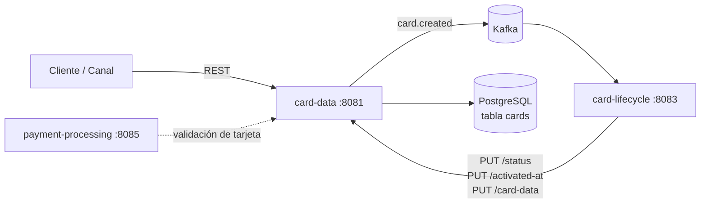
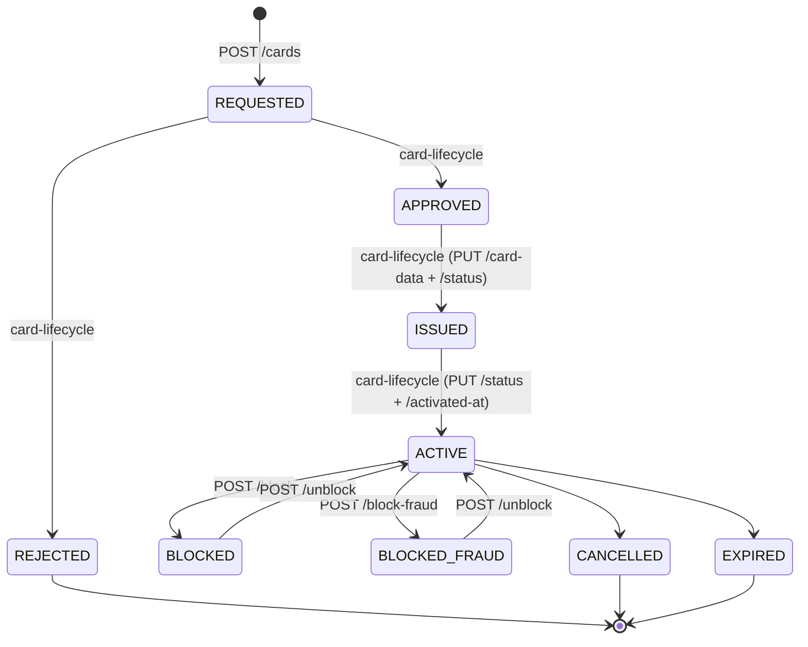
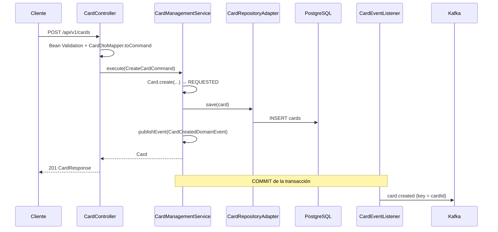

# card-data — Documentación técnica funcional

> Microservicio dueño del **Aggregate Root `Card`**: alta de solicitudes de tarjeta, datos del titular, datos sensibles (PAN, CVV, PIN), bloqueo/desbloqueo y consultas.

| Atributo | Valor |
|---|---|
| Artefacto Maven | `com.unisono.card:card-data` (`1.0.0-SNAPSHOT`) |
| Clase principal | `com.unisono.card.data.CardDataApplication` |
| Puerto | `8081` |
| Base path REST | `/api/v1/cards` |
| Base de datos | PostgreSQL `card_management_db`, tabla `cards` |
| Mensajería | Kafka (productor) — topic `card.created` |
| Dependencias internas | `card-shared` (Value Objects, excepciones, cifrado), `card-events` (eventos y topics) |
| Swagger UI | `http://localhost:8081/swagger-ui.html` |

---

## 1. Responsabilidad dentro del sistema

`card-data` es la **fuente de verdad de la tarjeta**. El resto de los módulos no persisten la tarjeta: la consultan o la modifican a través de este servicio.



- **Crea** la tarjeta en estado `REQUESTED` y notifica al ecosistema vía Kafka.
- **card-lifecycle** consume `card.created`, gestiona aprobación/emisión/activación y escribe de vuelta en `card-data` el nuevo estado, la fecha de activación y los datos generados en la emisión (PAN, CVV, PIN, vencimiento).
- **Expone** operaciones de seguridad (bloqueo, bloqueo por fraude, desbloqueo) y de PIN (validación y cambio).

---

## 2. Arquitectura

El módulo sigue **arquitectura hexagonal (Ports & Adapters)**:

```
com.unisono.card.data
├── domain
│   ├── model          Card (aggregate root), CardHolder, CardType, CardCategory
│   ├── port.input     Casos de uso (CreateCard, GetCard, BlockCard, UnblockCard,
│   │                  ValidatePIN, ResetPIN, UpdateCardStatus)
│   ├── port.output    CardRepository, EncryptionPort
│   ├── service        CardManagementService, CardSecurityService,
│   │                  PINManagementService, CardValidationService, CreateCardService
│   └── event          CardCreatedDomainEvent (evento interno de Spring)
├── application
│   ├── dto            Requests / Responses de la API
│   └── mapper         CardDtoMapper (DTO ⇄ dominio)
└── infrastructure
    ├── adapter.input.rest           CardController, CardSecurityController,
    │                                PINController, GlobalExceptionHandler
    ├── adapter.output.persistence   CardRepositoryAdapter, JpaCardRepository,
    │                                CardEntity, CardEntityMapper
    ├── adapter.output.encryption    CardEncryptionAdapter
    ├── adapter.output.event         CardEventListener, KafkaEventPublisher
    └── config                       DataSource (Hikari), Kafka producer,
                                     Use cases, Swagger
```

### Mapa de casos de uso → servicios → endpoints

| Caso de uso (port input) | Implementación | Endpoint |
|---|---|---|
| `CreateCardUseCase` | `CardManagementService` | `POST /api/v1/cards` |
| `GetCardUseCase` | `CardManagementService` | `GET /{cardId}`, `GET /client/{clientId}`, `GET /search` |
| `BlockCardUseCase` | `CardSecurityService` | `POST /{cardId}/block`, `POST /{cardId}/block-fraud` |
| `UnblockCardUseCase` | `CardSecurityService` | `POST /{cardId}/unblock` |
| `ValidatePINUseCase` | `PINManagementService` | `POST /{cardId}/validate-pin` |
| `ResetPINUseCase` | `PINManagementService` | `POST /{cardId}/reset-pin` |
| `UpdateCardStatusUseCase` | `CardManagementService` | `PUT /{cardId}/status` |
| *(métodos directos, sin port)* | `CardManagementService` | `PUT /{cardId}/activated-at`, `PUT /{cardId}/card-data` |

---

## 3. Modelo de dominio

### 3.1 `Card` (Aggregate Root)

| Campo | Tipo | Descripción |
|---|---|---|
| `id` | `CardId` (UUID) | Generado en `Card.create(...)` |
| `clientId` | `ClientId` | DNI/CUIL del cliente (7–11 dígitos) |
| `holder` | `CardHolder` | Titular |
| `type` | `CardType` | Red de pago |
| `category` | `CardCategory` | Categoría comercial |
| `status` | `CardStatus` | Estado del ciclo de vida (definido en `card-shared`) |
| `cardNumber` | `CardNumber` | PAN — se completa en la emisión |
| `cvv` | `CVV` | Se completa en la emisión |
| `pin` | `PIN` | **Transitorio**, solo en memoria; nunca se persiste en claro |
| `pinHash` | `String` | Hash BCrypt del PIN (persistido) |
| `expirationDate` | `ExpirationDate` | Mes/año de vencimiento |
| `createdAt`, `updatedAt` | `LocalDateTime` | Auditoría |
| `issuedAt`, `activatedAt`, `blockedAt`, `cancelledAt`, `expiredAt` | `LocalDateTime` | Hitos del ciclo de vida |
| `blockReason`, `cancelledReason` | `String` | Motivos |
| `deleted`, `deletedAt` | `Boolean`, `LocalDateTime` | Soft delete |

**Comportamiento del aggregate**

| Método | Efecto |
|---|---|
| `create(clientId, holder, type, category)` | Valida no-nulos; nueva tarjeta en `REQUESTED` |
| `updateStatus(status)` | Valida la transición con `CardStatus.canTransitionTo` y asigna el estado |
| `updateCardData(pan, cvv, pin, exp)` | Carga datos de emisión; setea `issuedAt` |
| `block(reason)` | Exige `CardStatus.canBlock()` (`ACTIVE` o `ISSUED`); → `BLOCKED`, guarda motivo y `blockedAt` |
| `blockForFraud(reason)` | Igual que `block`; → `BLOCKED_FRAUD` |
| `unblock()` | Exige estado bloqueado; → `ACTIVE`, limpia motivo y fecha |
| `cancel(reason)` / `expire()` / `delete()` | → `CANCELLED` / `EXPIRED` (validando la transición) / soft delete |

Una transición no permitida lanza `BusinessRuleException` (→ **422**).
| `updatePIN(hash)` / `resetPIN(hash)` | Reemplaza `pinHash` y limpia el PIN en claro |

**Consultas derivadas**

- `isOperational()` → estado `ACTIVE` o `ISSUED` **y** no vencida.
- `isBlocked()` → `BLOCKED` o `BLOCKED_FRAUD`.
- `requiresRenewal()` → el último día del mes de vencimiento cae dentro de los próximos **60 días**.
- `canBeActivated()` → estado `ISSUED`. `canBeIssued()` → estado `APPROVED`.
- `getMaskedCardNumber()` → `**** **** **** NNNN`.
- `isPINSet()` / `hasCompleteCardData()`.

### 3.2 `CardHolder`

Datos personales del titular: `firstName`, `lastName`, `documentNumber`, `email`, `phoneNumber`, `birthDate`, `address` (opcional).

Reglas aplicadas en `CardHolder.create(...)`:

- Todos los campos obligatorios salvo `address`.
- Email con formato válido; se normaliza a minúsculas. Strings con `trim()`.
- Fecha de nacimiento no futura y **titular mayor de 18 años**.
- Igualdad por `documentNumber`.

### 3.3 `CardType`

| Valor | Nombre | Patrón BIN |
|---|---|---|
| `VISA` | Visa | `^4[0-9]{12}(?:[0-9]{3})?$` |
| `MASTERCARD` | Mastercard | `^5[1-5][0-9]{14}$` |
| `AMEX` | American Express | `^3[47][0-9]{13}$` |
| `CABAL` | Cabal | `^(6042\|6043\|5896)[0-9]{12}$` |
| `NARANJA` | Naranja | `^(5895\|5218\|5234)[0-9]{12}$` |

`CardType.detectFromNumber(pan)` devuelve `VISA` si ningún patrón coincide.

### 3.4 `CardCategory`

| Valor | Nombre | Límite de crédito por defecto (ARS) |
|---|---|---|
| `CLASSIC` | Clásica | 50.000 |
| `GOLD` | Gold | 150.000 |
| `PLATINUM` | Platinum | 300.000 |
| `BLACK` | Black | 1.000.000 |
| `INFINITE` | Infinite | 5.000.000 |

### 3.5 `CardStatus` (de `card-shared`)

`REQUESTED` → `APPROVED` / `REJECTED` → `ISSUED` → `ACTIVE` ⇄ `BLOCKED` / `BLOCKED_FRAUD` → `CANCELLED` / `EXPIRED`



El detalle de las transiciones y quién las orquesta está en [LIFECYCLE.md](LIFECYCLE.md). `card-data` valida las transiciones con `CardStatus.canTransitionTo` (card-shared):

| Desde | Hacia |
|---|---|
| `REQUESTED` | `APPROVED`, `REJECTED` |
| `APPROVED` | `ISSUED`, `CANCELLED` |
| `ISSUED` | `ACTIVE`, `BLOCKED`, `BLOCKED_FRAUD`, `CANCELLED` |
| `ACTIVE` | `BLOCKED`, `BLOCKED_FRAUD`, `EXPIRED`, `CANCELLED` |
| `BLOCKED`, `BLOCKED_FRAUD` | `ACTIVE`, `CANCELLED` |
| `REJECTED`, `CANCELLED`, `EXPIRED` | — (finales) |

El bloqueo desde `ISSUED` sigue a `CardStatus.canBlock()`; la state machine de card-lifecycle solo lo prevé desde `ACTIVE`.

---

## 4. API REST

Todos los endpoints cuelgan de `/api/v1/cards`. Formato JSON.

### 4.1 Gestión de tarjetas (`CardController`)

#### `POST /api/v1/cards` — Crear tarjeta

Crea una solicitud en estado `REQUESTED` y dispara el evento `card.created`.

```json
{
  "clientId": "12345678",
  "firstName": "Juan",
  "lastName": "Pérez",
  "documentNumber": "12345678",
  "email": "juan.perez@example.com",
  "phoneNumber": "+5491123456789",
  "birthDate": "1990-01-15",
  "address": "Av. Corrientes 1234, CABA",
  "type": "VISA",
  "category": "CLASSIC"
}
```

| Campo | Validación |
|---|---|
| `clientId` | Obligatorio, 7–11 caracteres |
| `firstName`, `lastName` | Obligatorios, máx. 100 |
| `documentNumber` | Obligatorio |
| `email` | Obligatorio, formato email |
| `phoneNumber` | Obligatorio, `^\+?[0-9]{10,15}$` |
| `birthDate` | Obligatoria, en el pasado (+ mayor de 18 en dominio) |
| `address` | Opcional, máx. 500 |
| `type`, `category` | Obligatorios, valores de los enums |

Respuesta **201** → `CardResponse`.

#### `GET /api/v1/cards/{cardId}` — Detalle

Respuesta **200** → `CardDetailResponse`. **404** si no existe o está eliminada.

#### `GET /api/v1/cards/client/{clientId}` — Tarjetas de un cliente

Respuesta **200** → `CardResponse[]` (lista vacía si no tiene tarjetas; nunca 404).

#### `GET /api/v1/cards/search?lastFourDigits=1234&clientId=12345678`

Busca por últimos 4 dígitos **acotado al cliente**. Respuesta **200** → `CardDetailResponse`, **404** si no hay coincidencia.

#### Endpoints internos (consumidos por `card-lifecycle`)

Reciben DTOs validados con Bean Validation (`UpdateCardStatusRequest`, `UpdateActivatedAtRequest`, `UpdateCardDataRequest`) y responden **200** sin cuerpo. Errores: **400** si falta un campo o tiene formato inválido (incluido un estado inexistente o una fecha mal formada), **404** si la tarjeta no existe y **422** si la transición de estado no está permitida.

| Método y ruta | Body | Efecto |
|---|---|---|
| `PUT /{cardId}/status` | `{ "status": "APPROVED", "reason": "…" }` (`reason` opcional, máx. 500) | Cambia el estado validando la transición |
| `PUT /{cardId}/activated-at` | `{ "activatedAt": "2026-11-02T10:15:30" }` | Fecha de activación (ISO-8601) |
| `PUT /{cardId}/card-data` | `{ "cardNumber": "...", "cvv": "...", "pin": "...", "expirationMonth": 12, "expirationYear": 2030 }` | Carga datos de emisión; el PAN y el CVV se cifran y el PIN se hashea al persistir. PAN de 13–19 dígitos (+ Luhn), CVV de 3–4, PIN de 4, mes 1–12; el vencimiento no puede estar en el pasado ni a más de 10 años |

### 4.2 Seguridad (`CardSecurityController`)

| Método y ruta | Body | Resultado |
|---|---|---|
| `POST /{cardId}/block` | `{ "reason": "Tarjeta perdida" }` (obligatorio) | → `BLOCKED`, **200** `CardResponse` |
| `POST /{cardId}/block-fraud` | `{ "reason": "..." }` (obligatorio) | → `BLOCKED_FRAUD`, **200** `CardResponse` |
| `POST /{cardId}/unblock` | — | → `ACTIVE`, **200** `CardResponse`. Si no estaba bloqueada → **422** |

### 4.3 PIN (`PINController`)

#### `POST /{cardId}/validate-pin`

```json
{ "pin": "1234" }
```

Respuesta **200** `{ "valid": true | false }`. Devuelve `false` también si la tarjeta no tiene PIN configurado. PIN de exactamente 4 dígitos.

#### `POST /{cardId}/reset-pin`

```json
{ "oldPin": "1234", "newPin": "5678" }
```

- Si la tarjeta tiene PIN, `oldPin` debe coincidir; si no → **422** `"El PIN actual es incorrecto"`.
- `newPin` se valida con `PIN.of(...)`, se hashea con BCrypt y se guarda.
- Respuesta **200** `CardResponse`.

### 4.4 DTOs de respuesta

**`CardResponse`** (vista resumida): `id`, `clientId`, `maskedCardNumber`, `lastFourDigits`, `type`, `category`, `status`, `expirationDate` (MM/YY), `holderName`, `createdAt`, `activatedAt`, `isBlocked`, `blockReason`.

**`CardDetailResponse`** (vista detallada): todo lo anterior más `isExpired`, `requiresRenewal`, `holderEmail`, `holderPhone`, `holderDocument`, `holderBirthDate`, `holderAddress`, `updatedAt`, `blockedAt`, `isOperational`, `hasPinSet`.

Ninguna respuesta expone el PAN completo, el CVV ni el hash del PIN.

### 4.5 Errores (`GlobalExceptionHandler`)

```json
{
  "timestamp": "2026-11-02T10:15:30",
  "status": 400,
  "error": "Validation Error",
  "message": "Invalid request parameters",
  "fieldErrors": { "email": "El formato del email es inválido" }
}
```

| Excepción | HTTP | `error` |
|---|---|---|
| `NotFoundException` | 404 | `Not Found` |
| `ValidationException` (dominio / Value Objects) | 400 | `Validation Error` |
| `MethodArgumentNotValidException` (Bean Validation) | 400 | `Validation Error` + `fieldErrors` |
| `InvalidValueObjectException` | 400 | `Validation Error` |
| `HttpMessageNotReadableException` (JSON mal formado, enum inexistente, fecha inválida) | 400 | `Validation Error` |
| `BusinessRuleException` | 422 | `Business Rule Violation` |
| Cualquier otra | 500 | `Internal Server Error` |

---

## 5. Flujos funcionales

### 5.1 Alta de tarjeta



El evento a Kafka se emite con `@TransactionalEventListener(phase = AFTER_COMMIT)`: **solo se publica si la tarjeta quedó persistida**. Si Kafka falla, el error se loguea y la tarjeta queda creada igual (no hay reintento ni outbox).

### 5.2 Emisión y activación (orquestadas por `card-lifecycle`)

1. `card-lifecycle` recibe `card.created` y, al aprobar, llama `PUT /{id}/status` con `APPROVED`.
2. En la emisión genera PAN, CVV, PIN y vencimiento → `PUT /{id}/card-data` y luego `PUT /{id}/status` con `ISSUED`.
3. En la activación → `PUT /{id}/status` con `ACTIVE` y `PUT /{id}/activated-at`.

### 5.3 Bloqueo / desbloqueo

`CardSecurityService` carga la tarjeta (404 si no existe), aplica `block` / `blockForFraud` / `unblock` en el aggregate y persiste. El bloqueo por fraude se loguea en nivel `WARN`. El desbloqueo siempre devuelve la tarjeta a `ACTIVE`.

### 5.4 PIN

- **Validación**: `BCrypt.verify(pinPlano, pinHash)`. Los intentos fallidos se loguean en `WARN`; no hay contador de intentos ni bloqueo automático.
- **Cambio**: verifica el PIN actual (si existe), hashea el nuevo y reemplaza `pinHash`.

---

## 6. Persistencia

### 6.1 Tabla `cards`

| Columna | Tipo | Nulo | Notas |
|---|---|---|---|
| `id` | `varchar(36)` | no | PK, UUID |
| `client_id` | `varchar(20)` | no | índice `idx_client_id` |
| `holder_first_name` / `holder_last_name` | `varchar(100)` | no | |
| `holder_document_number` | `varchar(20)` | no | |
| `holder_email` | `varchar(100)` | no | |
| `holder_phone_number` | `varchar(20)` | sí | |
| `holder_birth_date` | `date` | sí | |
| `holder_address` | `varchar(500)` | sí | |
| `card_number_encrypted` | `text` | sí | PAN cifrado AES; índice `idx_card_number_encrypted` |
| `last_four_digits` | `varchar(4)` | sí | En claro, para búsqueda y display; índice `idx_last_four_digits` |
| `cvv_encrypted` | `text` | sí | CVV cifrado AES |
| `pin_hash` | `text` | sí | Hash BCrypt |
| `type` / `category` / `status` | `varchar(20)` | no | Enums como `STRING`; índice `idx_status` |
| `expiration_month` / `expiration_year` | `int` | sí | |
| `created_at` / `updated_at` | `timestamp` | no | `@CreationTimestamp` / `@UpdateTimestamp` |
| `activated_at`, `blocked_at`, `issued_at`, `cancelled_at`, `expired_at` | `timestamp` | sí | |
| `block_reason` / `cancelled_reason` | `varchar(500)` | sí | |
| `deleted` | `boolean` | no | default `false` |
| `deleted_at` | `timestamp` | sí | |

Los datos del titular se guardan en la misma tabla (no hay tabla de titulares).

> **Esquema**: lo crea Flyway desde el repo `card-management-database`: `cards` en V1, ajustada por V8 (`INFINITE`, longitudes) y V9 (`pin_failed_attempts`), y `outbox_events` en V9. Este módulo usa `ddl-auto: validate` con Flyway deshabilitado, así que las tablas deben existir antes de levantar el servicio.

#### 6.1.1 Diferencias entre el esquema y `CardEntity`

Diferencias de declaración sin efecto práctico:

| Columna | Migración | `CardEntity` | Por qué no impacta |
|---|---|---|---|
| `client_id` | `varchar(11)` | `length 20` | El dominio limita a 7–11 dígitos |
| `holder_birth_date` | `NOT NULL` | Nullable | El dominio la exige |
| `pin_hash` | `varchar(100)` | `TEXT` | Un hash BCrypt tiene 60 caracteres |

La migración también define `CHECK` para `status`, `type` y `category` (coinciden con los enums), índices parciales sobre `deleted = false` y la tabla `card_audit` (V3), que ningún módulo usa.

### 6.2 Tabla `outbox_events`

Eventos de integración pendientes de publicar (ver §5.1 y §8).

| Columna | Tipo | Nulo | Notas |
|---|---|---|---|
| `id` | `bigserial` | no | PK; define el orden de publicación |
| `event_id` | `varchar(36)` | no | `UNIQUE`; el `eventId` del `DomainEvent` |
| `aggregate_id` | `varchar(36)` | no | Key del mensaje en Kafka (`cardId`) |
| `topic` | `varchar(100)` | no | Topic destino |
| `event_type` | `varchar(100)` | no | `CardCreatedEvent`, … |
| `payload` | `text` | no | JSON del evento; se publica sin modificaciones |
| `created_at` | `timestamp` | no | |
| `published_at` | `timestamp` | sí | `null` = pendiente; índice parcial `idx_outbox_events_pending` |
| `attempts` | `int` | no | Envíos intentados (exitoso incluido) |
| `last_error` | `varchar(1000)` | sí | Último error de publicación |

### 6.3 Soft delete

Todas las consultas de `JpaCardRepository` (incluido el `findById` sobrescrito) filtran `deleted = false`. `CardRepository.delete(...)` marca `deleted = true` y `deleted_at`; no hay borrado físico.

### 6.4 Consultas disponibles

| Método | Uso |
|---|---|
| `findById` | Detalle (excluye eliminadas) |
| `findByClientId` | Listado por cliente |
| `findByLastFourDigitsAndClientId` | Búsqueda acotada a cliente |
| `findByCardNumberEncrypted` | Búsqueda por PAN cifrado |
| `findByStatus` | Por estado (sin endpoint) |
| `findCardsRequiringRenewal` | `ACTIVE` que vencen este mes o el siguiente (sin endpoint) |

---

## 7. Seguridad de datos sensibles

| Dato | Tratamiento | Dónde |
|---|---|---|
| PAN | Cifrado AES (`AesEncryptionService` de `card-shared`) al guardar; descifrado al leer | `CardRepositoryAdapter` vía `EncryptionPort` |
| Últimos 4 dígitos | En claro | `CardEntityMapper` |
| CVV | Cifrado AES | `CardRepositoryAdapter` |
| PIN | Hash BCrypt (`BCryptHashingService`); el PIN en claro solo vive en memoria y está excluido de `toString()` | `CardEntityMapper` / `PINManagementService` |

- La clave AES se lee de `encryption.secret-key` (por defecto un valor de desarrollo de 32 caracteres). **Debe sobrescribirse en producción.**
- Las respuestas REST solo devuelven el número enmascarado.
- Los endpoints no tienen autenticación ni autorización (no hay Spring Security en el módulo).

---

## 8. Eventos

| Evento | Topic | Key | Cuándo | Consumidor |
|---|---|---|---|---|
| `CardCreatedEvent` | `card.created` | `cardId` | Alta de tarjeta, vía outbox (§5.1) | `card-lifecycle` (`CardEventConsumer`) |

Payload (JSON, sin headers de tipo):

```json
{
  "eventId": "…uuid…",
  "occurredOn": "2026-11-02T10:15:30",
  "eventType": "CardCreatedEvent",
  "cardId": "550e8400-e29b-41d4-a716-446655440000",
  "clientId": "12345678",
  "holderFullName": "Juan Pérez",
  "cardType": "VISA",
  "cardCategory": "CLASSIC",
  "createdBy": "system"
}
```

**Productor (`KafkaProducerConfig`):**
- `acks=all`, `retries=3`, idempotencia habilitada, `max.in.flight=5`.
- Compresión `snappy`, `linger.ms=10`, `batch.size=16384`.
- Timeouts acotados: `request.timeout.ms=5000`, `delivery.timeout.ms=10000` y `max.block.ms=5000`. El productor resuelve cada envío antes de que `OutboxRelay` deje de esperar (`send-timeout-ms`, 15 s). Así un envío fallido no queda en el buffer para entregarse más tarde y duplicarse con el reintento.

**`OutboxRelay`:**
- Lee lotes de pendientes con `FOR UPDATE SKIP LOCKED`, lo que permite varias instancias.
- Publica el JSON almacenado tal cual y espera el ack del broker.
- Ante un error registra `attempts` y `last_error` y corta el lote, para no publicar fuera de orden.

`KafkaEventPublisher` solo lo usa `CreateCardService`, que no está en uso (§10).

Las clases `CardBlockedEvent`, `CardUnblockedEvent` y `PINResetEvent` existen vacías: hoy **no se publican eventos** de bloqueo, desbloqueo ni cambio de PIN, aunque `card-events` ya define los topics `card.blocked` y `card.unblocked`. Ver [EVENTS.md](EVENTS.md).

---

## 9. Configuración y despliegue

### 9.1 Propiedades principales (`application.yml`)

| Propiedad | Valor por defecto |
|---|---|
| `server.port` | `8081` |
| `spring.datasource.url` | `jdbc:postgresql://localhost:5432/card_management_db` |
| `spring.datasource.username` / `password` | `card_user` / `card_pass` |
| `spring.datasource.hikari.*` | pool 10, min idle 5, pool `CardManagementHikariCP` |
| `spring.jpa.hibernate.ddl-auto` | `validate` |
| `spring.flyway.enabled` | `false` |
| `spring.kafka.bootstrap-servers` | `localhost:9092` |
| `encryption.secret-key` | clave de desarrollo (32 caracteres) |
| `card.data.outbox.poll-interval-ms` | `1000` (frecuencia del relay) |
| `card.data.outbox.batch-size` | `50` (eventos por pasada) |
| `card.data.outbox.send-timeout-ms` | `15000` (debe superar `delivery.timeout.ms` + `max.block.ms`) |
| `management.endpoints.web.exposure.include` | `health,info,metrics` |

El perfil `card-data` (`application-card-data.yml`) agrega logging a archivo (`logs/card-data.log`), métricas Prometheus y la configuración de SpringDoc. Es el perfil que activa `docker-compose`.

### 9.2 Docker

- `services/card-data/Dockerfile`: build multi-stage (Maven 3.9.6 + Temurin 17 → `eclipse-temurin:17-jre-alpine`), usuario no root, `JAVA_OPTS` con G1GC y `MaxRAMPercentage=75`. El contexto de build es la raíz del repo.
- `deploy/docker/docker-compose.yml`: servicio `card-data-service`, puerto `8081`, perfil `card-data`, conectado a `postgres` y Kafka en la red `card-network`.

```bash
docker compose -f deploy/docker/docker-compose.yml up -d card-data-service
```

### 9.3 Observabilidad

- Health: `GET /actuator/health` (incluye estado de la base).
- Métricas: `GET /actuator/metrics` (y `/actuator/prometheus` con el perfil `card-data`).
- Logs: `com.unisono.card` en `DEBUG`; SQL de Hibernate en `DEBUG`.

---

## 10. Limitaciones conocidas y deuda técnica

Comportamientos actuales del código que conviene tener presentes:

1. **Consumidores sin deduplicación.** El outbox entrega *at-least-once*: si la instancia cae entre el envío y el commit, el evento se vuelve a publicar con el mismo `eventId`. `card-lifecycle` no deduplica, así que registraría dos veces la transición `CREATE` ([EVENTS.md](EVENTS.md)).
2. **El outbox no se purga.** Los eventos publicados quedan en `outbox_events` indefinidamente; falta un job de limpieza (por ejemplo, borrar los publicados hace más de N días).
3. **Un evento que siempre falla frena a los siguientes.** El relay corta el lote ante el primer error para mantener el orden, pero no hay límite de intentos ni DLQ: un evento que nunca se puede publicar bloquea la cola. `attempts` y `last_error` permiten detectarlo.
4. **Logs de SQL del relay.** Con `org.hibernate.SQL` en `DEBUG` (configuración actual), el relay loguea su consulta cada segundo aunque no haya eventos.
5. **Código duplicado o sin uso:** `CreateCardService` (camino alternativo de alta que publica directo a Kafka sin pasar por el outbox; no lo usa ningún controller), `CardHolderEmbeddable` (con longitudes distintas a `CardEntity`), `CardHolderEntity`, `CardJpaConfig`, `application/config/CardUseCaseConfig` y las excepciones de `domain/exception` (clases vacías). `CardEntityMapper` tiene además las sobrecargas `toEntity(Card)` / `toDomain(CardEntity)` que cifran por su cuenta y no se usan.
6. **Clave de cifrado en docker-compose ignorada.** El compose define `ENCRYPTION_KEY`, pero la propiedad que lee `AesEncryptionService` es `encryption.secret-key` (variable de entorno equivalente: `ENCRYPTION_SECRET_KEY`), así que el contenedor usa la clave por defecto.
7. **URL de card-data en payment-processing.** Su default es `http://localhost:8080`, mientras que card-data escucha en `8081`.
8. **El esquema vive en otro repo.** Las migraciones están en `card-management-database` y no se versionan con el código: cualquier cambio en `CardEntity` requiere una migración nueva allá.
9. **Sin autenticación/autorización** en la API, incluidos los endpoints que modifican datos sensibles.
10. **Tests incompletos.** Hay tests de dominio, servicios, endpoints (MockMvc) y del relay, pero ninguno de persistencia ni de integración, aunque Testcontainers ya está declarado en el `pom.xml`. `CardTest` y `CardManagementServiceTest` tienen todos sus tests comentados.
11. `services/card-data/README.md` contiene la documentación de `card-shared`, no la de este módulo.
