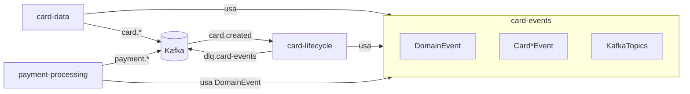
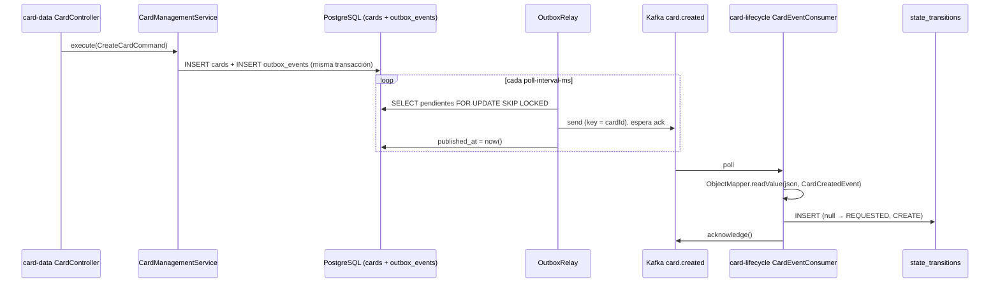
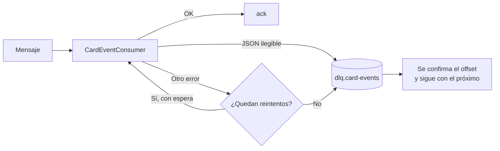

# card-events — Documentación técnica funcional

> Librería compartida con el **contrato de eventos de dominio** (clase base, eventos de tarjeta y nombres de topics) y descripción de la **mensajería Kafka** entre los servicios del sistema.

| Atributo | Valor |
|---|---|
| Artefacto Maven | `com.unisono.card:card-events` (`1.0.0-SNAPSHOT`) |
| Tipo | Librería `jar` (sin Spring Boot, sin contenedor propio) |
| Dependencias | `jackson-databind`, `jackson-datatype-jsr310`, `lombok` (optional) |
| Paquetes | `com.unisono.card.events.domain` (eventos), `com.unisono.card.events.config` (`KafkaTopics`, `EventSerializationConfig`) |
| Usada por | `card-data` (productor), `card-lifecycle` (consumidor de `card.created` y productor de la DLQ), `payment-processing` (productor, solo `DomainEvent`) |
| Broker | Kafka `confluentinc/cp-kafka:7.6.0` + Zookeeper (ver `deploy/docker/docker-compose.yml`) |

---

## 1. Propósito

`card-events` es un **kernel compartido de contratos**: los productores y consumidores dependen de las mismas clases Java para serializar y deserializar eventos, de las mismas constantes para los nombres de topics y del mismo `ObjectMapper` (`EventSerializationConfig.objectMapper()`: soporte de `java.time` y fechas ISO). No contiene lógica de Kafka: cada servicio configura su propio productor o consumidor.



---

## 2. Contrato base: `DomainEvent`

Clase abstracta de la que heredan todos los eventos (los de tarjeta y también los de `payment-processing`).

| Campo | Tipo | Descripción |
|---|---|---|
| `eventId` | `String` (UUID) | Identificador único del evento, generado al construirlo |
| `occurredOn` | `LocalDateTime` | Momento de creación, formato `yyyy-MM-dd'T'HH:mm:ss`, **sin zona horaria** |
| `eventType` | `String` | Nombre simple de la clase (`CardCreatedEvent`, `PaymentAuthorized`, …) |

Constructores:

- `DomainEvent()` — para **publicar**: genera `eventId` y `occurredOn = now()`.
- `DomainEvent(eventId, occurredOn)` — para **reconstruir** al deserializar, preservando los valores originales.

Cada evento concreto sigue el mismo patrón: campos `final`, un constructor `@JsonCreator` con `@JsonProperty` para Jackson (incluye `eventId` y `occurredOn`) y un constructor “de negocio” sin esos dos campos para el productor.

---

## 3. Catálogo de topics (`KafkaTopics`)

Estado según el código actual de los servicios:

| Constante | Topic | Clase de evento | Productor | Consumidor | Estado |
|---|---|---|---|---|---|
| `CARD_CREATED` | `card.created` | `CardCreatedEvent` | card-data | card-lifecycle | ✅ En uso |
| `CARD_APPROVED` | `card.approved` | `CardApprovedEvent` | card-data | — | ✅ Se publica |
| `CARD_REJECTED` | `card.rejected` | `CardRejectedEvent` | card-data | — | ✅ Se publica |
| `CARD_ISSUED` | `card.issued` | `CardIssuedEvent` | card-data | — | ✅ Se publica |
| `CARD_ACTIVATED` | `card.activated` | `CardActivatedEvent` | card-data | — | ✅ Se publica |
| `CARD_BLOCKED` | `card.blocked` | `CardBlockedEvent` | card-data | — | ✅ Se publica |
| `CARD_UNBLOCKED` | `card.unblocked` | `CardUnblockedEvent` | card-data | — | ✅ Se publica |
| `CARD_CANCELLED` | `card.cancelled` | `CardCancelledEvent` | card-data | — | ✅ Se publica |
| `CARD_EXPIRED` | `card.expired` | `CardExpiredEvent` | card-data | — | ✅ Se publica (job diario de vencimiento o `PUT /status`) |
| `CREDIT_LIMIT_ASSIGNED` | `credit-limit.assigned` | `CreditLimitAssignedEvent` | — | — | Contrato definido, sin uso |
| `CREDIT_LIMIT_UPDATED` | `credit-limit.updated` | `CreditLimitUpdatedEvent` | — | — | Contrato definido, sin uso |
| `CREDIT_LIMIT_CONSUMED` | `credit-limit.consumed` | `CreditLimitConsumedEvent` | — | — | Contrato definido, sin uso |
| `CREDIT_LIMIT_RELEASED` | `credit-limit.released` | — | — | — | Solo topic |
| `PAYMENT_INITIATED` | `payment.processing.initiated` | `PaymentInitiatedEvent` | payment-processing | — | ✅ Se publica, ver §6 |
| `PAYMENT_AUTHORIZED` | `payment.processing.authorized` | `PaymentAuthorizedEvent` | payment-processing | — | ✅ Se publica |
| `PAYMENT_PROCESSED` | `payment.processing.completed` | `PaymentProcessedEvent` | payment-processing | — | ✅ Se publica |
| `PAYMENT_DECLINED` | `payment.processing.declined` | `PaymentDeclinedEvent` | payment-processing | — | ✅ Se publica |
| `PAYMENT_REVERSED` | `payment.reversal.completed` | `PaymentReversedEvent` | payment-processing | — | ✅ Se publica |
| `REFUND_INITIATED` | `payment.refund.initiated` | `RefundInitiatedEvent` | payment-processing | — | ✅ Se publica |
| `REFUND_PROCESSED` | `payment.refund.processed` | `RefundProcessedEvent` | payment-processing | — | ✅ Se publica |
| `TRANSACTION_SETTLED` | `payment.settlement.completed` | `TransactionSettledEvent` | payment-processing | — | ✅ Se publica |
| `PAYMENT_DEFAULT` | `payment.events` | — | — | — | Destino de un evento de pago sin topic propio (no debería usarse) |
| `DLQ_CARD_EVENTS` | `dlq.card-events` | Mensaje original, sin modificar | card-lifecycle | — | ✅ En uso, ver §5.3 |
| `DLQ_LIMIT_EVENTS` | `dlq.limit-events` | — | — | — | Reservado: nadie consume eventos de límites |

**Convención de nombres:** `<dominio>.<hecho-en-pasado>` en minúsculas, separado por punto (`card.created`, `credit-limit.assigned`). Los topics de pagos usan tres niveles (`payment.processing.authorized`), ver §6. `KafkaTopics` es el catálogo de todos los topics que existen: payment-processing toma de ahí los nombres de los suyos.

---

## 4. Eventos de tarjeta

Todos los ejemplos incluyen los campos heredados de `DomainEvent`. Los produce `card-data` por el outbox, con key `cardId`; cuándo se publica cada uno está en §5.1.

En todos los eventos de cambio de estado, el autor (`approvedBy`, `blockedBy`, …) es el `performedBy` que recibe `card-data`, o `"system"` si no se informó. `reason` puede ser `null` si el cambio no llegó con motivo.

### 4.1 `CardCreatedEvent` — `card.created` ✅

Se publica cuando `card-data` persiste una nueva solicitud de tarjeta (estado `REQUESTED`).

| Campo | Tipo | Descripción |
|---|---|---|
| `cardId` | `String` | UUID de la tarjeta |
| `clientId` | `String` | DNI/CUIL del cliente |
| `holderFullName` | `String` | Nombre y apellido del titular |
| `cardType` | `String` | `VISA`, `MASTERCARD`, `AMEX`, `CABAL`, `NARANJA` |
| `cardCategory` | `String` | `CLASSIC`, `GOLD`, `PLATINUM`, `BLACK`, `INFINITE` |
| `createdBy` | `String` | Hoy siempre `"system"` |

```json
{
  "eventId": "2f1c3a4e-8d7b-4c8e-9a51-0b6f3e2d1c90",
  "occurredOn": "2026-11-02T10:15:30",
  "eventType": "CardCreatedEvent",
  "cardId": "550e8400-e29b-41d4-a716-446655440000",
  "clientId": "12345678",
  "holderFullName": "Juan Pérez",
  "cardType": "VISA",
  "cardCategory": "CLASSIC",
  "createdBy": "system"
}
```

### 4.2 `CardApprovedEvent` — `card.approved`

| Campo | Tipo |
|---|---|
| `cardId` | `String` |
| `reason` | `String` |
| `approvedBy` | `String` |

### 4.3 `CardIssuedEvent` — `card.issued`

| Campo | Tipo | Nota |
|---|---|---|
| `cardId` | `String` | |
| `lastFourDigits` | `String` | Solo los últimos 4; el PAN, el CVV y el PIN **no viajan** en el evento |
| `expirationMonth` | `Integer` | |
| `expirationYear` | `Integer` | |
| `reason` | `String` | |
| `issuedBy` | `String` | |

### 4.4 `CardActivatedEvent` — `card.activated`

| Campo | Tipo | Nota |
|---|---|---|
| `cardId` | `String` | |
| `activatedAt` | `LocalDateTime` (`yyyy-MM-dd'T'HH:mm:ss`) | Hora del cambio de estado en card-data. `cards.activated_at` lo informa card-lifecycle en otra llamada, así que puede diferir por milisegundos |
| `reason` | `String` | |
| `activatedBy` | `String` | |

### 4.5 `CardBlockedEvent` — `card.blocked`

| Campo | Tipo | Nota |
|---|---|---|
| `cardId` | `String` | |
| `blockType` | `String` | `NORMAL` o `FRAUD` (un solo topic para ambos tipos) |
| `blockedAt` | `LocalDateTime` | |
| `reason` | `String` | |
| `blockedBy` | `String` | |

### 4.6 `CardRejectedEvent` — `card.rejected`

| Campo | Tipo |
|---|---|
| `cardId` | `String` |
| `reason` | `String` |
| `rejectedBy` | `String` |

### 4.7 `CardUnblockedEvent` — `card.unblocked`

| Campo | Tipo |
|---|---|
| `cardId` | `String` |
| `unblockedAt` | `LocalDateTime` |
| `reason` | `String` |
| `unblockedBy` | `String` |

### 4.8 `CardCancelledEvent` — `card.cancelled`

| Campo | Tipo |
|---|---|
| `cardId` | `String` |
| `cancelledAt` | `LocalDateTime` |
| `reason` | `String` |
| `cancelledBy` | `String` |

### 4.9 `CardExpiredEvent` — `card.expired`

| Campo | Tipo |
|---|---|
| `cardId` | `String` |
| `expiredAt` | `LocalDateTime` |
| `reason` | `String` |
| `expiredBy` | `String` |

`EXPIRED` es un estado final. Se llega desde `ISSUED`, `ACTIVE`, `BLOCKED` o `BLOCKED_FRAUD`: con el job diario de vencimiento de card-data (`reason` = `Vencimiento por fecha (MM/YY)`, `expiredBy` = `system`) o con `PUT /status`. Ver [DATA.md §5.5](DATA.md).

### 4.10 Eventos de límite de crédito (sin uso)

Contratos definidos; `card-limits` todavía no los publica ni depende de esta librería ([LIMITS.md §9](LIMITS.md)). Los montos son `BigDecimal`.

| Evento | Topic | Campos |
|---|---|---|
| `CreditLimitAssignedEvent` | `credit-limit.assigned` | `cardId`, `purchaseLimitAmount`, `cashAdvanceLimitAmount`, `currency`, `assignedBy` |
| `CreditLimitUpdatedEvent` | `credit-limit.updated` | `cardId`, `previousPurchaseLimitAmount`, `newPurchaseLimitAmount`, `currency`, `reason`, `updatedBy` |
| `CreditLimitConsumedEvent` | `credit-limit.consumed` | `cardId`, `transactionId`, `amount`, `availableAmount`, `currency` |

---

## 5. Flujos implementados

`card.created` es el único evento con consumidor. El resto se publica con el mismo mecanismo (§5.1).



1. **Transactional outbox.** `card-data` guarda la tarjeta y el `CardCreatedEvent` serializado (tabla `outbox_events`) en la misma transacción, a través de `EventOutboxPort`. `OutboxRelay` publica los pendientes en orden y los marca como publicados cuando el broker confirma. Si Kafka no responde, el evento queda pendiente y se reintenta; no se pierde. Detalle en [DATA.md §5.1](DATA.md).
2. **Key del mensaje = `cardId`.** Todos los eventos de una misma tarjeta caen en la misma partición y conservan el orden.
3. **Consumo.** `card-lifecycle` registra la transición inicial en su historial. Ver [LIFECYCLE.md §5.1](LIFECYCLE.md).

### 5.1 Eventos de cambio de estado

`card-data` encola el evento en la misma transacción que guarda el cambio (`CardEventEmitter`). Así se publican todos los cambios, también los que no pasan por card-lifecycle, como el bloqueo automático por PIN; y si la operación falla o se rechaza, no se publica nada. Comparten orden por tarjeta porque la key es el `cardId`, y la garantía *at-least-once* del outbox: los consumidores deben deduplicar por `eventId`.

| Operación en card-data | Evento |
|---|---|
| `PUT /status` → `APPROVED` / `REJECTED` / `ISSUED` | `card.approved` / `card.rejected` / `card.issued` |
| `PUT /status` → `ACTIVE`, desde `ISSUED` | `card.activated` |
| `PUT /status` → `ACTIVE`, desde un estado bloqueado | `card.unblocked` |
| `PUT /status` → `BLOCKED` / `BLOCKED_FRAUD` | `card.blocked` (`NORMAL` / `FRAUD`) |
| `POST /block`, `POST /block-fraud` | `card.blocked` (`NORMAL` / `FRAUD`) |
| Tercer PIN incorrecto (`validate-pin`, `reset-pin`) | `card.blocked` (`NORMAL`), autor `system` |
| `POST /unblock` | `card.unblocked` |
| `POST /cancel`, `PUT /status` → `CANCELLED` | `card.cancelled` |
| `PUT /status` → `EXPIRED` | `card.expired` (registra `expiredAt`) |
| Job diario de vencimiento (`CardExpirationScheduler`) | `card.expired`, autor `system` |

### 5.2 Configuración del productor (card-data)

| Parámetro | Valor |
|---|---|
| Serializer key / value | `StringSerializer` / `JsonSerializer` con `ObjectMapper` propio (`JavaTimeModule`, fechas ISO) |
| Type headers | Desactivados (`setAddTypeInfo(false)`) — el consumidor debe saber qué clase esperar |
| `acks` | `all` |
| `retries` | 3 |
| `enable.idempotence` | `true` |
| `max.in.flight.requests.per.connection` | 5 |
| Compresión / batching | `lz4`, `linger.ms=10`, `batch.size=16384` |
| Timeouts | `request.timeout.ms=5000`, `delivery.timeout.ms=10000`, `max.block.ms=5000` (acotados por debajo de la espera del relay, para que un envío fallido no se entregue más tarde y se duplique) |
| Envío | `OutboxRelay`: síncrono por evento (`send(...).get(send-timeout-ms)`), en orden de inserción |

### 5.3 Configuración del consumidor (card-lifecycle)

| Parámetro | Valor |
|---|---|
| Group id | `card-lifecycle-consumer-group` |
| Deserializer key / value | `StringDeserializer` / `StringDeserializer`; el JSON se convierte a mano con `kafkaObjectMapper` |
| `auto.offset.reset` | `earliest` |
| `enable.auto.commit` | `false` |
| Ack mode | `MANUAL` (`acknowledgment.acknowledge()` tras procesar) |
| Concurrencia | 1 |
| `max.poll.records` | 100 |
| Error handler | `DefaultErrorHandler` con espera exponencial y `DeadLetterPublishingRecoverer` |
| Reintentos | `card-lifecycle.kafka.retry.max-retries` (4) y `initial-interval-ms` (1000): 1 s, 2 s, 4 s y 8 s |
| DLQ | `dlq.card-events`, con productor propio (`acks=all`, idempotente) |
| Reproceso de la DLQ | `DeadLetterRedriver`, grupo `card-lifecycle-consumer-group-dlq-redrive` (ver abajo) |

> `KafkaConsumerConfig` define su propio `ConsumerFactory`: del `application.yml` solo lee `spring.kafka.bootstrap-servers` y `spring.kafka.consumer.group-id`. Por eso el yml no declara deserializers ni propiedades `spring.json.*`.

**Cuando un mensaje falla:**



- La partición queda detenida mientras se reintenta, para conservar el orden por tarjeta. Agotados los reintentos, el resto de los mensajes se procesa con normalidad.
- Si la publicación en la DLQ falla, el mensaje no se confirma y se vuelve a procesar: no se pierde.
- El mensaje llega a la DLQ con su key y su valor originales. Los headers `kafka_dlt-*` indican el topic, la partición y el offset de origen, y la excepción.
- Si un corte de la base dura más que los reintentos (15 s en total), los mensajes afectados también van a la DLQ, y `DeadLetterRedriver` los reprocesa solo.

**Inspeccionar la DLQ:**

```bash
docker exec -it card-management-kafka kafka-console-consumer \
  --bootstrap-server kafka:9092 --topic dlq.card-events --from-beginning \
  --property print.key=true --property print.headers=true
```

**Reproceso automático (`DeadLetterRedriver`):** un consumidor propio lee `dlq.card-events` y vuelve a publicar cada mensaje en su topic de origen (header `kafka_dlt-original-topic`), con la misma key y el mismo valor. El consumidor de `card.created` es idempotente, así que reinyectar un mensaje ya procesado no tiene efecto.

```mermaid
flowchart LR
    D[(dlq.card-events)] --> R[DeadLetterRedriver]
    R -->|JSON ilegible, topic desconocido<br/>o intentos agotados| P[Queda en la DLQ<br/>para revisión manual]
    R -->|Todavía no se cumplió la espera| W[Pausa la partición<br/>y lo vuelve a leer]
    W --> R
    R -->|Se cumplió la espera| T[(card.created)<br/>x-dlq-redrive-count + 1]
    T --> L[CardEventConsumer]
    L -->|Vuelve a fallar| D
```

- **Espera:** se cuenta desde que el mensaje entró a la DLQ: `initial-delay-ms × multiplier^intentos`, es decir, 1, 2, 4, 8 y 16 min con los valores por defecto (unos 31 min en total). Mientras tanto la partición de la DLQ queda pausada (`nack`) y los mensajes que vienen detrás esperan su turno.
- **Intentos:** el número de reproceso viaja en el header `x-dlq-redrive-count`. Si el mensaje vuelve a fallar, `DeadLetterPublishingRecoverer` copia los headers y lo devuelve a la DLQ con el contador. Al reinyectarlo se sacan los headers `kafka_dlt-*` del paso anterior.
- **No se reprocesan:** los mensajes ilegibles (el error es un `JsonProcessingException`, nunca van a funcionar), los de un topic que card-lifecycle no consume y los que agotaron `max-attempts`. Se confirman y quedan en la DLQ, con un log `ERROR` y la métrica correspondiente.
- **Si no puede publicar**, no confirma el mensaje y lo reintenta cada `retry-interval-ms`, sin límite: el contenedor no tiene DLQ propia.
- **Orden:** un mensaje reprocesado llega a `card.created` después de los que se publicaron mientras tanto. Hoy no importa, porque el único consumidor registra la transición inicial de forma idempotente.

| Propiedad (`card-lifecycle.kafka.dlq-redrive.*`) | Default |
|---|---|
| `enabled` | `true` (arranque del listener) |
| `max-attempts` | `5` |
| `initial-delay-ms` / `multiplier` | `60000` / `2` |
| `send-timeout-ms` | `10000` |
| `retry-interval-ms` | `5000` |

Métrica `card.lifecycle.dlq.redrive{outcome}`: `redriven`, `parked_unreadable`, `parked_exhausted` y `parked_unknown_topic`. Un `parked_*` que sube requiere revisión.

**Reprocesar a mano** un mensaje que quedó en la DLQ: una vez corregida la causa, volver a publicar el valor en `card.created` con la misma key. Sin el header `x-dlq-redrive-count`, si vuelve a fallar arranca de nuevo con los reprocesos automáticos. La DLQ tiene la retención del broker (7 días, §7).

---

## 6. Eventos de `payment-processing`

Hay dos capas:

- **Eventos de dominio** (`com.unisono.card.payment.domain.event`, en payment-processing): se acumulan en el aggregate `Transaction`, usan Value Objects (`TransactionId`, `CardId`, `TransactionAmount`) y nunca salen del servicio. Los servicios de aplicación los publican después de guardar (`publishAll(getDomainEvents())` + `clearDomainEvents()`).
- **Contratos de integración** (`com.unisono.card.events.domain.payment`, en esta librería): campos planos (`String`, `BigDecimal`, `LocalDateTime`), con `@JsonCreator`, igual que los de tarjeta. Son lo que se publica en Kafka. Un consumidor los lee con estas clases o como JSON, sin depender del dominio de pagos.

`OutboxPaymentEventPublisher` traduce cada evento de dominio a su contrato (`PaymentIntegrationEventMapper`), lo serializa con `EventSerializationConfig` y lo guarda en el outbox (`payment_outbox_events`) en la misma transacción. `PaymentOutboxRelay` lo envía después del commit ([PAYMENT.md §4.7](PAYMENT.md)). El contrato conserva el `eventId` y el `occurredOn` del evento de dominio.

| Contrato | Topic | Campos (además de `eventId`, `occurredOn`, `eventType`) | Cuándo |
|---|---|---|---|
| `PaymentInitiatedEvent` | `payment.processing.initiated` | `transactionId`, `cardId`, `transactionType`, montos (*), `initiatedAt` | Al crear una compra o un adelanto, también si después se rechaza |
| `PaymentAuthorizedEvent` | `payment.processing.authorized` | `transactionId`, `cardId`, `authorizationCode`, `riskScore`, `authorizedAt` | El autorizador aprobó |
| `PaymentProcessedEvent` | `payment.processing.completed` | `transactionId`, `cardId`, `status`, montos, `processedAt` | Compra o captura aprobada |
| `PaymentDeclinedEvent` | `payment.processing.declined` | `transactionId`, `cardId`, `responseCode`, `declineReason`, `declinedAt` | Rechazo. `responseCode` es el código ISO 8583: `51` fondos, `54` vencida, `55` PIN, `59` fraude, `62` restringida, `N7` CVV, o el del autorizador |
| `PaymentReversedEvent` | `payment.reversal.completed` | `transactionId`, `cardId`, montos, `reversalReason`, `reversedAt` | Reverso (incluida la expiración de una preautorización) |
| `RefundInitiatedEvent` | `payment.refund.initiated` | `refundTransactionId`, `originalTransactionId`, `cardId`, montos, `initiatedAt` | Al crear una devolución |
| `RefundProcessedEvent` | `payment.refund.processed` | `refundTransactionId`, `originalTransactionId`, `cardId`, montos, `processedAt` | Devolución aprobada |
| `TransactionSettledEvent` | `payment.settlement.completed` | `transactionId`, `cardId`, montos, `settledAt` | Liquidación |

(*) **Montos:** `amount` y `currency` son lo que se le cobra a la tarjeta (el monto efectivo, en moneda local si hubo conversión). `originalAmount`, `originalCurrency` y `exchangeRate` solo vienen informados si hubo conversión; si no, son `null`.

```json
{
  "eventId": "…", "occurredOn": "2026-11-13T10:15:30", "eventType": "PaymentDeclinedEvent",
  "transactionId": "6f1c2d3e-…", "cardId": "550e8400-…", "responseCode": "59",
  "declineReason": "Suspected fraud", "declinedAt": "2026-11-13T10:15:30"
}
```

Características propias:

- Los nombres de los topics salen de `KafkaTopics` (§3) y se pueden pisar con `spring.kafka.topics.*`. `KafkaPaymentConfig` los declara como `NewTopic` con 3 particiones y replication factor `KAFKA_TOPIC_REPLICATION_FACTOR`: 2 por defecto, 1 en docker-compose, que tiene un solo broker.
- **Key = `cardId`**: los eventos de una tarjeta, y los de cada una de sus transacciones, quedan en la misma partición y en orden. Entrega *at-least-once*: deduplicar por `eventId`.
- **Ningún servicio consume estos topics** hoy.

---

## 7. Infraestructura Kafka

Definida en `deploy/docker/docker-compose.yml`:

| Componente | Detalle |
|---|---|
| Zookeeper | `cp-zookeeper:7.6.0`, puerto `2181` |
| Kafka | `cp-kafka:7.6.0`, un solo broker (`KAFKA_BROKER_ID=1`) |
| Listeners | `kafka:9092` (red interna `card-network`), `localhost:29092` (acceso desde el host) |
| Auto-creación de topics | `KAFKA_AUTO_CREATE_TOPICS_ENABLE=true` |
| Retención | 168 h (7 días), segmentos de 1 GiB |
| Replicación interna | `offsets.topic.replication.factor=1` |

Los topics de tarjeta y las DLQ no se declaran en ningún lado: los **crea el broker automáticamente** con la configuración por defecto la primera vez que alguien publica o se suscribe.

Para inspeccionar mensajes desde el host:

```bash
docker exec -it card-management-kafka kafka-console-consumer \
  --bootstrap-server kafka:9092 --topic card.created --from-beginning
```

---

## 8. Garantías de entrega y semántica

| Aspecto | Comportamiento actual |
|---|---|
| Atomicidad DB ↔ Kafka | Garantizada con transactional outbox en card-data (`outbox_events`) y en payment-processing (`payment_outbox_events`): el evento se confirma junto con el cambio y el relay lo publica hasta lograrlo. |
| Entrega al broker | *At-least-once*: `acks=all` + idempotencia del productor + reintentos del relay. Un evento puede llegar dos veces con el mismo `eventId`: si la instancia cae entre el envío y el commit, o si un envío ya estaba en vuelo cuando el productor lo dio por vencido y el broker lo escribe igual (ocurre con cortes del broker). |
| Orden | Por tarjeta dentro de cada topic `card.*` y `payment.*` (key `cardId`). No hay orden entre topics distintos. |
| Procesamiento en el consumidor | *At-least-once*: ack manual después de procesar. |
| Idempotencia del consumidor | card-lifecycle descarta duplicados de `card.created`: cada tarjeta tiene una sola transición `CREATE` (verificación previa + índice único `uq_state_transitions_create`). |
| Errores en el consumidor | Reintentos con espera exponencial y, si no alcanza, DLQ (§5.3). Un JSON ilegible va a la DLQ sin reintentos. |
| Versionado de esquema | No hay campo de versión. `eventType` es el nombre de la clase Java, así que renombrar una clase rompe a los consumidores. |
| Zona horaria | `occurredOn` y demás fechas son `LocalDateTime` sin offset: dependen de la zona del servidor productor. |

---

## 9. Cómo agregar un nuevo evento

1. Crear la clase en `com.unisono.card.events.domain`, extendiendo `DomainEvent`, con campos `final` de tipos simples (`String`, números, `LocalDateTime`). No incluir datos sensibles (PAN, CVV, PIN).
2. Agregar dos constructores: uno `@JsonCreator` con `@JsonProperty` para todos los campos, incluidos `eventId` y `occurredOn` (llama a `super(eventId, occurredOn)`), y otro de negocio que llame a `super()`.
3. Agregar el nombre del topic a `KafkaTopics` siguiendo la convención `<dominio>.<hecho>`.
4. En el productor, encolarlo con `EventOutboxPort.enqueue(topic, aggregateId, event)` dentro de la transacción del caso de uso (card-data). En payment-processing, el contrato va en `com.unisono.card.events.domain.payment`: se agrega el evento de dominio al aggregate, su traducción a `PaymentIntegrationEventMapper` y su topic a `PaymentEventTopicResolver`. El id del aggregate (o el `cardId`) es la key del mensaje y preserva el orden.
5. En el consumidor, hacer el ack solo tras procesar con éxito, propagar las excepciones para que actúe el error handler y manejar duplicados con `eventId`.
6. Agregar el evento a `EventContractTest` y documentarlo en este archivo (§3 y §4).

---

## 10. Limitaciones conocidas y deuda técnica

1. **Eventos de tarjeta sin consumidores.** `card.created` es el único que se consume; los demás se publican, pero todavía nadie los lee. Tampoco se crea historial en `state_transitions` para los cambios que no pasan por card-lifecycle, como el bloqueo automático por PIN.
2. **Reproceso de la DLQ acotado** (ver §5.3): `DeadLetterRedriver` reinyecta los mensajes durante unos 31 min; si la causa dura más (o el mensaje es ilegible), quedan en la DLQ y hay que reinyectarlos a mano. Del lado del productor, el outbox de card-data aparta los eventos con error permanente (`failed_at`) en su propia tabla.
3. **Eventos de límite sin productor:** los contratos `CreditLimit*` existen, pero `card-limits` no los publica; `credit-limit.released` tiene topic, pero no clase.
4. **Eventos de pago sin consumidores.** Un rechazo por fraude se informa como `PaymentDeclinedEvent` con `responseCode` `59`; no hay un evento de fraude propio.
