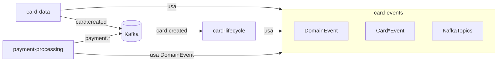
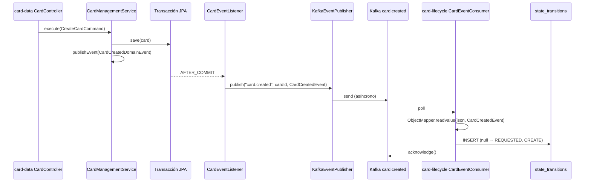

# card-events — Documentación técnica funcional

> Librería compartida con el **contrato de eventos de dominio** (clase base, eventos de tarjeta y nombres de topics) y descripción de la **mensajería Kafka** entre los servicios del sistema.

| Atributo | Valor |
|---|---|
| Artefacto Maven | `com.unisono.card:card-events` (`1.0.0-SNAPSHOT`) |
| Tipo | Librería `jar` (sin Spring Boot, sin contenedor propio) |
| Dependencias | `jackson-databind`, `jackson-datatype-jsr310`, `lombok` (optional) |
| Paquetes | `com.unisono.card.events.domain` (eventos), `com.unisono.card.events.config` (`KafkaTopics`) |
| Usada por | `card-data` (productor), `card-lifecycle` (consumidor), `payment-processing` (productor, solo `DomainEvent`) |
| Broker | Kafka `confluentinc/cp-kafka:7.6.0` + Zookeeper (ver `deploy/docker/docker-compose.yml`) |

---

## 1. Propósito

`card-events` es un **kernel compartido de contratos**: los productores y consumidores dependen de las mismas clases Java para serializar y deserializar eventos, y de las mismas constantes para los nombres de topics. No contiene lógica de Kafka: cada servicio configura su propio productor o consumidor.



---

## 2. Contrato base: `DomainEvent`

Clase abstracta de la que heredan todos los eventos (los de tarjeta y también los de `payment-processing`).

| Campo | Tipo | Descripción |
|---|---|---|
| `eventId` | `String` (UUID) | Identificador único del evento, generado al construirlo |
| `occurredOn` | `LocalDateTime` | Momento de creación, formato `yyyy-MM-dd'T'HH:mm:ss`, **sin zona horaria** |
| `eventType` | `String` | Nombre simple de la clase (`CardCreatedEvent`, `PaymentAuthorized`, …) |

Constructores:

- `DomainEvent()` — para **publicar**: genera `eventId` y `occurredOn = now()`.
- `DomainEvent(eventId, occurredOn)` — para **reconstruir** al deserializar, preservando los valores originales.

Cada evento concreto sigue el mismo patrón: campos `final`, un constructor `@JsonCreator` con `@JsonProperty` para Jackson (incluye `eventId` y `occurredOn`) y un constructor “de negocio” sin esos dos campos para el productor.

---

## 3. Catálogo de topics (`KafkaTopics`)

Estado según el código actual de los servicios:

| Constante | Topic | Clase de evento | Productor | Consumidor | Estado |
|---|---|---|---|---|---|
| `CARD_CREATED` | `card.created` | `CardCreatedEvent` | card-data | card-lifecycle | ✅ En uso |
| `CARD_APPROVED` | `card.approved` | `CardApprovedEvent` | — | — | Contrato definido, sin uso |
| `CARD_REJECTED` | `card.rejected` | `CardRejectedEvent` (vacía) | — | — | Solo topic |
| `CARD_ISSUED` | `card.issued` | `CardIssuedEvent` | — | — | Contrato definido, sin uso |
| `CARD_ACTIVATED` | `card.activated` | `CardActivatedEvent` | — | — | Contrato definido, sin uso |
| `CARD_BLOCKED` | `card.blocked` | `CardBlockedEvent` | — | — | Contrato definido, sin uso |
| `CARD_UNBLOCKED` | `card.unblocked` | `CardUnblockedEvent` (vacía) | — | — | Solo topic |
| `CARD_CANCELLED` | `card.cancelled` | `CardCancelledEvent` (vacía) | — | — | Solo topic |
| `CREDIT_LIMIT_ASSIGNED` | `credit-limit.assigned` | `CreditLimitAssignedEvent` (vacía) | — | — | Solo topic |
| `CREDIT_LIMIT_UPDATED` | `credit-limit.updated` | `CreditLimitUpdatedEvent` (vacía) | — | — | Solo topic |
| `CREDIT_LIMIT_CONSUMED` | `credit-limit.consumed` | `CreditLimitConsumedEvent` (vacía) | — | — | Solo topic |
| `CREDIT_LIMIT_RELEASED` | `credit-limit.released` | — | — | — | Solo topic |
| `TRANSACTION_AUTHORIZED` | `transaction.authorized` | — | — | — | Reservado (“futuro”) |
| `TRANSACTION_DECLINED` | `transaction.declined` | — | — | — | Reservado |
| `TRANSACTION_REVERSED` | `transaction.reversed` | — | — | — | Reservado |
| `DLQ_CARD_EVENTS` | `dlq.card-events` | — | — | — | Reservado, sin manejo de DLQ |
| `DLQ_LIMIT_EVENTS` | `dlq.limit-events` | — | — | — | Reservado |

**Convención de nombres:** `<dominio>.<hecho-en-pasado>` en minúsculas, separado por punto (`card.created`, `credit-limit.assigned`). `payment-processing` usa su propia convención de tres niveles (`payment.processing.authorized`), ver §6.

---

## 4. Eventos de tarjeta

Todos los ejemplos incluyen los campos heredados de `DomainEvent`.

### 4.1 `CardCreatedEvent` — `card.created` ✅

Se publica cuando `card-data` persiste una nueva solicitud de tarjeta (estado `REQUESTED`).

| Campo | Tipo | Descripción |
|---|---|---|
| `cardId` | `String` | UUID de la tarjeta |
| `clientId` | `String` | DNI/CUIL del cliente |
| `holderFullName` | `String` | Nombre y apellido del titular |
| `cardType` | `String` | `VISA`, `MASTERCARD`, `AMEX`, `CABAL`, `NARANJA` |
| `cardCategory` | `String` | `CLASSIC`, `GOLD`, `PLATINUM`, `BLACK`, `INFINITE` |
| `createdBy` | `String` | Hoy siempre `"system"` |

```json
{
  "eventId": "2f1c3a4e-8d7b-4c8e-9a51-0b6f3e2d1c90",
  "occurredOn": "2026-11-02T10:15:30",
  "eventType": "CardCreatedEvent",
  "cardId": "550e8400-e29b-41d4-a716-446655440000",
  "clientId": "12345678",
  "holderFullName": "Juan Pérez",
  "cardType": "VISA",
  "cardCategory": "CLASSIC",
  "createdBy": "system"
}
```

### 4.2 `CardApprovedEvent` — `card.approved` (sin uso)

| Campo | Tipo |
|---|---|
| `cardId` | `String` |
| `reason` | `String` |
| `approvedBy` | `String` |

### 4.3 `CardIssuedEvent` — `card.issued` (sin uso)

| Campo | Tipo | Nota |
|---|---|---|
| `cardId` | `String` | |
| `lastFourDigits` | `String` | Solo los últimos 4; el PAN, el CVV y el PIN **no viajan** en el evento |
| `expirationMonth` | `Integer` | |
| `expirationYear` | `Integer` | |
| `reason` | `String` | |
| `issuedBy` | `String` | |

### 4.4 `CardActivatedEvent` — `card.activated` (sin uso)

| Campo | Tipo |
|---|---|
| `cardId` | `String` |
| `activatedAt` | `LocalDateTime` (`yyyy-MM-dd'T'HH:mm:ss`) |
| `reason` | `String` |
| `activatedBy` | `String` |

### 4.5 `CardBlockedEvent` — `card.blocked` (sin uso)

| Campo | Tipo | Nota |
|---|---|---|
| `cardId` | `String` | |
| `blockType` | `String` | `NORMAL` o `FRAUD` (un solo topic para ambos tipos) |
| `blockedAt` | `LocalDateTime` | |
| `reason` | `String` | |
| `blockedBy` | `String` | |

### 4.6 Clases vacías

`CardRejectedEvent`, `CardUnblockedEvent`, `CardCancelledEvent`, `CreditLimitAssignedEvent`, `CreditLimitUpdatedEvent`, `CreditLimitConsumedEvent` y `config/EventSerializationConfig` son **archivos de 0 bytes**: existen como marcadores, pero no definen ninguna clase.

---

## 5. Flujo implementado: `card.created`



1. **Evento interno → evento de integración.** `card-data` publica primero un evento de Spring (`CardCreatedDomainEvent`, que lleva el aggregate completo). Un `@TransactionalEventListener(AFTER_COMMIT)` lo traduce a `CardCreatedEvent` y lo envía a Kafka. Así nunca se publica una tarjeta que no llegó a persistirse.
2. **Key del mensaje = `cardId`.** Todos los eventos de una misma tarjeta caen en la misma partición y conservan el orden.
3. **Consumo.** `card-lifecycle` registra la transición inicial en su historial. Ver [LIFECYCLE.md §5.1](LIFECYCLE.md).

### 5.1 Configuración del productor (card-data)

| Parámetro | Valor |
|---|---|
| Serializer key / value | `StringSerializer` / `JsonSerializer` con `ObjectMapper` propio (`JavaTimeModule`, fechas ISO) |
| Type headers | Desactivados (`setAddTypeInfo(false)`) — el consumidor debe saber qué clase esperar |
| `acks` | `all` |
| `retries` | 3 |
| `enable.idempotence` | `true` |
| `max.in.flight.requests.per.connection` | 5 |
| Compresión / batching | `snappy`, `linger.ms=10`, `batch.size=16384` |
| Envío | `publish()` asíncrono (solo loguea el resultado); `publishSync()` disponible, lanza `EventPublishingException` |

### 5.2 Configuración del consumidor (card-lifecycle)

| Parámetro | Valor |
|---|---|
| Group id | `card-lifecycle-consumer-group` |
| Deserializer key / value | `StringDeserializer` / `StringDeserializer`; el JSON se convierte a mano con `kafkaObjectMapper` |
| `auto.offset.reset` | `earliest` |
| `enable.auto.commit` | `false` |
| Ack mode | `MANUAL` (`acknowledgment.acknowledge()` tras procesar) |
| Concurrencia | 1 |
| `max.poll.records` | 100 |
| Error handler | `DefaultErrorHandler` (no actúa: el listener captura las excepciones, ver §8) |

> Las propiedades `spring.kafka.consumer.value-deserializer`, `spring.json.trusted.packages` y `spring.json.value.default.type` del `application.yml` de `card-lifecycle` **no se aplican**, porque `KafkaConsumerConfig` define su propio `ConsumerFactory`.

---

## 6. Eventos de `payment-processing`

`payment-processing` reutiliza solo la clase base `DomainEvent` de esta librería. Sus eventos viven en `com.unisono.card.payment.domain.event`: se acumulan en el aggregate `Transaction` y los servicios de aplicación los publican después de guardar (`publishAll(getDomainEvents())` + `clearDomainEvents()`).

| Evento | Topic (default) | Campos | ¿Se genera? |
|---|---|---|---|
| `PaymentInitiated` | `payment.processing.initiated` | `transactionId`, `cardId`, `amount`, `type`, `initiatedAt` | Sí |
| `PaymentAuthorized` | `payment.processing.authorized` | `transactionId`, `cardId`, `authorizationCode`, `riskScore`, `authorizedAt` | Sí |
| `PaymentProcessed` | `payment.processing.completed` | `transactionId`, `cardId`, `amount`, `status`, `processedAt` | Sí |
| `PaymentDeclined` | `payment.processing.declined` | `transactionId`, `cardId`, `declineReason`, `declinedAt` | Sí |
| `PaymentReversed` | `payment.reversal.completed` | `transactionId`, `cardId`, `amount`, `reversalReason`, `reversedAt` | Sí |
| `RefundInitiated` | `payment.refund.initiated` | `refundTransactionId`, `originalTransactionId`, `cardId`, `amount`, `initiatedAt` | Sí |
| `RefundProcessed` | `payment.refund.processed` | `refundTransactionId`, `originalTransactionId`, `cardId`, `amount`, `processedAt` | **No** (ningún código lo instancia) |
| `TransactionSettled` | `payment.settlement.completed` | `transactionId`, `cardId`, `amount`, `settledAt` | Sí |
| `TransactionCompleted` | `payment.transaction.completed` | `transactionId`, `cardId`, `finalStatus`, `completedAt` | Sí |
| `FraudDetected` | `payment.fraud.detected` | `transactionId`, `cardId`, `riskScore`, `fraudReason`, `detectionMethod`, `detectedAt` | **No** |
| *(desconocido)* | `payment.events` | — | Topic por defecto de `PaymentEventTopicResolver` |

Características propias:

- Los topics se configuran en `spring.kafka.topics.*` y `KafkaPaymentConfig` los declara como `NewTopic` (3 particiones, replication factor 2).
- **Key = `eventId`**, no el id de la transacción ni de la tarjeta.
- Los campos son Value Objects (`TransactionId`, `CardId`, `TransactionAmount`), así que en el JSON aparecen como objetos anidados (por ejemplo `"cardId": { "value": "…" }`), a diferencia de los eventos de tarjeta, que usan `String`.
- **Ningún servicio consume estos topics** hoy.

---

## 7. Infraestructura Kafka

Definida en `deploy/docker/docker-compose.yml`:

| Componente | Detalle |
|---|---|
| Zookeeper | `cp-zookeeper:7.6.0`, puerto `2181` |
| Kafka | `cp-kafka:7.6.0`, un solo broker (`KAFKA_BROKER_ID=1`) |
| Listeners | `kafka:9092` (red interna `card-network`), `localhost:29092` (acceso desde el host) |
| Auto-creación de topics | `KAFKA_AUTO_CREATE_TOPICS_ENABLE=true` |
| Retención | 168 h (7 días), segmentos de 1 GiB |
| Replicación interna | `offsets.topic.replication.factor=1` |

Los topics de tarjeta no se declaran en ningún lado: los **crea el broker automáticamente** con la configuración por defecto la primera vez que alguien publica o se suscribe.

Para inspeccionar mensajes desde el host:

```bash
docker exec -it card-management-kafka kafka-console-consumer \
  --bootstrap-server kafka:9092 --topic card.created --from-beginning
```

---

## 8. Garantías de entrega y semántica

| Aspecto | Comportamiento actual |
|---|---|
| Atomicidad DB ↔ Kafka | No garantizada. Se publica después del commit; si Kafka falla, el evento se pierde (no hay outbox ni reintento posterior). |
| Entrega al broker | `acks=all` + idempotencia + 3 reintentos del productor. |
| Orden | Por tarjeta en `card.created` (key `cardId`). Sin orden por transacción en `payment.*` (key `eventId`). |
| Procesamiento en el consumidor | Pensado como *at-least-once* (ack manual), pero ver más abajo. |
| Idempotencia del consumidor | No hay. Un mensaje reprocesado duplica la transición `CREATE`. `eventId` permitiría deduplicar. |
| Errores en el consumidor | Se loguean y no se hace ack. Como la excepción no se relanza, no hay reintento inmediato ni DLQ. Si después se procesa bien un mensaje posterior de la misma partición, su ack confirma también el offset del fallido y este se pierde. |
| Versionado de esquema | No hay campo de versión. `eventType` es el nombre de la clase Java, así que renombrar una clase rompe a los consumidores. |
| Zona horaria | `occurredOn` y demás fechas son `LocalDateTime` sin offset: dependen de la zona del servidor productor. |

---

## 9. Cómo agregar un nuevo evento

1. Crear la clase en `com.unisono.card.events.domain`, extendiendo `DomainEvent`, con campos `final` de tipos simples (`String`, números, `LocalDateTime`). No incluir datos sensibles (PAN, CVV, PIN).
2. Agregar dos constructores: uno `@JsonCreator` con `@JsonProperty` para todos los campos, incluidos `eventId` y `occurredOn` (llama a `super(eventId, occurredOn)`), y otro de negocio que llame a `super()`.
3. Agregar el nombre del topic a `KafkaTopics` siguiendo la convención `<dominio>.<hecho>`.
4. En el productor, publicar **después del commit** y usar como key el id del aggregate (por ejemplo `cardId`) para preservar el orden.
5. En el consumidor, hacer el ack solo tras procesar con éxito y manejar duplicados con `eventId`.
6. Documentar el evento en este archivo (§3 y §4).

---

## 10. Limitaciones conocidas y deuda técnica

1. **Solo `card.created` está implementado de punta a punta.** Aprobar, emitir, activar, bloquear y cancelar no publican eventos, aunque los contratos (`CardApprovedEvent`, `CardIssuedEvent`, `CardActivatedEvent`, `CardBlockedEvent`) y los topics ya existen. El resto del sistema no se entera de los cambios de estado.
2. **Archivos vacíos en la librería:** seis clases de evento y `EventSerializationConfig` tienen 0 bytes. `card-data` también tiene sus propias clases vacías `CardBlockedEvent`, `CardUnblockedEvent` y `PINResetEvent` en `domain/event`, que se confunden con las de la librería.
3. **Doble camino de publicación en card-data:** `CreateCardService` publica `card.created` directamente, dentro de la transacción (antes del commit). No lo usa ningún controller, pero si se usara, publicaría eventos de tarjetas que podrían no haberse persistido.
4. **Sin outbox ni DLQ:** los topics `dlq.*` están reservados pero no hay `DeadLetterPublishingRecoverer` ni ningún otro mecanismo que los use.
5. **Consumidor sin reintentos reales ni idempotencia** (ver §8).
6. **Eventos de pago sin consumidores**, con key `eventId` (el comentario del código dice “to ensure ordering”, pero una key única por evento no ordena nada), y `RefundProcessed` y `FraudDetected` nunca se emiten.
7. **Eventos de pago no deserializables con sus propias clases:** no tienen `@JsonCreator` ni constructor vacío, así que un consumidor Java no puede leerlos con esas clases tal como están.
8. **Replication factor 2 con un solo broker:** `KafkaPaymentConfig` declara los topics de pago con `replicas=2`, que el broker único del compose no puede satisfacer. La creación por `KafkaAdmin` falla; los topics terminan creándose por auto-creación con la configuración por defecto.
9. **Convenciones mezcladas:** `KafkaTopics.TRANSACTION_*` (`transaction.authorized`) no coincide con los topics que realmente usa `payment-processing` (`payment.processing.authorized`); los eventos de tarjeta usan `String` y los de pago usan Value Objects anidados.
10. **Bootstrap en Docker:** el compose no define `SPRING_KAFKA_BOOTSTRAP_SERVERS` para `card-data-service` ni para `card-lifecycle-service`, así que dentro de los contenedores apuntan a `localhost:9092` en lugar de `kafka:9092`. `payment-processing` sí lo resuelve, mediante el placeholder `${KAFKA_BOOTSTRAP_SERVERS}`.
11. **Configuración ignorada en card-lifecycle:** las propiedades de deserialización del `application.yml` no se aplican (ver §5.2).
12. **Sin tests de contrato** (serialización y deserialización ida y vuelta) en la librería.
