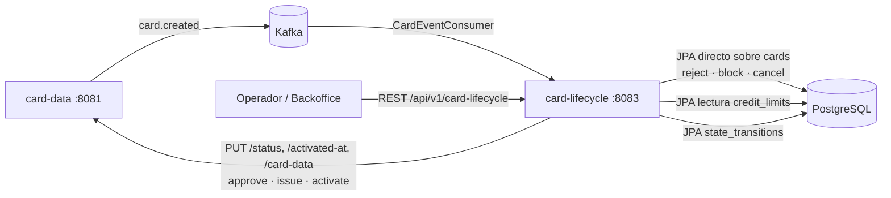
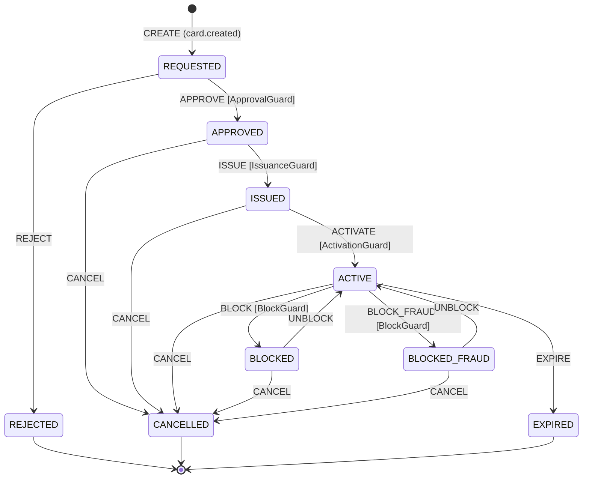
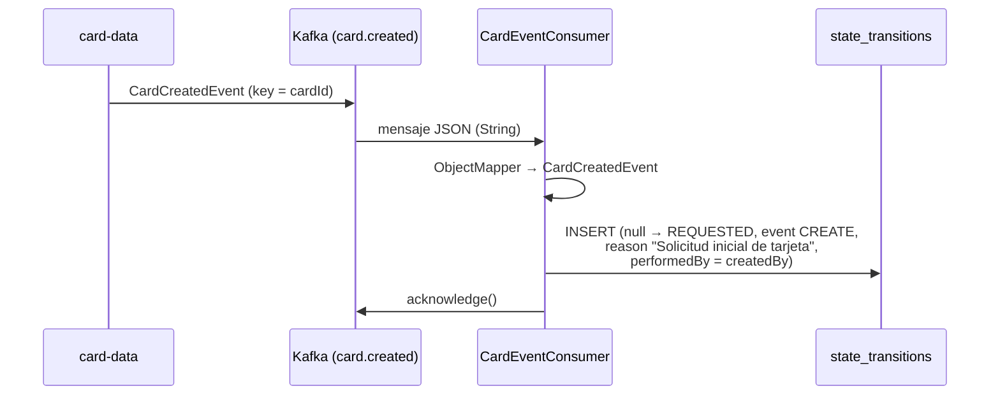
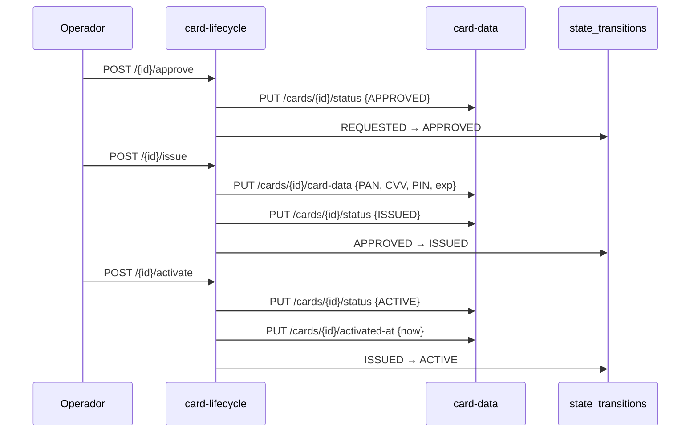
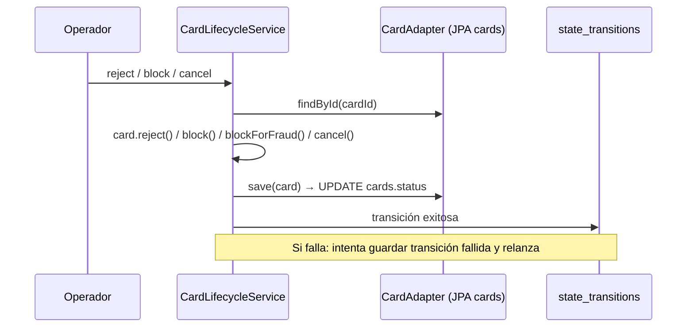

# card-lifecycle — Documentación técnica funcional

> Microservicio que **orquesta el ciclo de vida de la tarjeta** (aprobación, rechazo, emisión, activación, bloqueo, cancelación) y mantiene el **historial auditable de transiciones de estado**.

| Atributo | Valor |
|---|---|
| Artefacto Maven | `com.unisono.card:card-lifecycle` (`1.0.0-SNAPSHOT`) |
| Clase principal | `com.unisono.card.lifecycle.CardLifecycleApplication` |
| Puerto | `8083` |
| Base path REST | `/api/v1/card-lifecycle` |
| Base de datos | PostgreSQL `card_management_db` — tabla propia `state_transitions`; lee/escribe `cards` y lee `credit_limits` |
| Mensajería | Kafka (consumidor) — topic `card.created`, grupo `card-lifecycle-consumer-group` |
| Integración síncrona | REST hacia `card-data` (`card-data.base-url`, por defecto `http://localhost:8081`) |
| Dependencias internas | `card-shared` (Value Objects, `CardStatus`, excepciones), `card-events` (eventos y topics) |
| Librerías destacadas | Spring State Machine (`spring-statemachine-core`, `-data-jpa`) |
| Swagger UI | `http://localhost:8083/swagger-ui.html` |

---

## 1. Responsabilidad dentro del sistema

`card-data` es el dueño de la tarjeta (ver [DATA.md](DATA.md)); `card-lifecycle` es el **dueño de las transiciones**: decide cuándo una tarjeta cambia de estado, registra quién lo hizo y por qué, y propaga el cambio.



- Al recibir `card.created` registra la transición inicial `CREATE` (`null → REQUESTED`).
- Expone endpoints para mover la tarjeta por el ciclo de vida y consultar su historial.
- Cada transición queda registrada en `state_transitions` con motivo, usuario, fecha y resultado.

---

## 2. Arquitectura

Hexagonal, con un componente adicional de Spring State Machine:

```
com.unisono.card.lifecycle
├── domain
│   ├── model        Card (vista reducida de la tarjeta), StateTransition,
│   │                CardLifecycleState, CardLifecycleEvent, TransitionContext
│   ├── port.input   ApproveCard, RejectCard, IssueCard, ActivateCard, BlockCard,
│   │                UnblockCard, CancelCard, GetLifecycleHistory
│   ├── port.output  CardDataClient, CardPort, CreditLimitPort, StateTransitionRepository
│   └── exception    InvalidStateTransitionException
├── application
│   ├── service      ApproveCardService, IssueCardService, ActivateCardService,
│   │                CardLifecycleService
│   └── dto.response LifecycleHistoryResponse, StateTransitionResponse
└── infrastructure
    ├── adapter.input.rest     CardLifecycleController, DTOs, LifecycleDtoMapper
    ├── adapter.input.event    CardEventConsumer (Kafka)
    ├── adapter.output.card    CardDataRestClient (REST a card-data),
    │                          CardAdapter + CardJpaEntity (JPA sobre cards)
    ├── adapter.output.creditlimit  CreditLimitAdapter (JPA sobre credit_limits)
    ├── adapter.output.persistence  StateTransitionRepositoryAdapter, entity, mapper
    ├── statemachine           Config, Guards, Actions, Listener
    └── config                 KafkaConsumerConfig, RestClientConfig, SwaggerConfig
```

### 2.1 Dos estrategias de escritura conviven

Según la operación, el módulo actualiza la tarjeta por caminos distintos:

| Operación | Servicio | Cómo modifica la tarjeta | Valida estado actual |
|---|---|---|---|
| Aprobar | `ApproveCardService` | REST → `card-data` | No |
| Emitir | `IssueCardService` | REST → `card-data` | No |
| Activar | `ActivateCardService` | REST → `card-data` | No |
| Rechazar | `CardLifecycleService` | JPA directo sobre `cards` (`CardAdapter`) | Sí (dominio `Card`) |
| Bloquear / Bloquear por fraude | `CardLifecycleService` | JPA directo sobre `cards` | Sí |
| Cancelar | `CardLifecycleService` | JPA directo sobre `cards` | Sí |

`CardLifecycleService` también tiene `approveCard`, `issueCard` y `activateCard` (con validación de estado y, en la activación, del límite de crédito), pero el controller **no los usa**: llama a los servicios REST de la primera tabla.

### 2.2 Spring State Machine

`CardStateMachineConfig` (`@EnableStateMachineFactory`) define estados, transiciones, guards y actions. Sin embargo **ningún componente obtiene ni dispara la state machine** (no se inyecta `StateMachineFactory` en ningún lado). Hoy es una **especificación declarativa del ciclo de vida** que documenta las transiciones previstas, no el mecanismo que las ejecuta. Ver §9.

---

## 3. Modelo de dominio

### 3.1 Estados

`CardLifecycleState` replica a `CardStatus` de `card-shared` (el que se usa realmente en el código y en la base):

| Estado | Descripción | Tipo |
|---|---|---|
| `REQUESTED` | Solicitada | Inicial |
| `APPROVED` | Aprobada | Intermedio |
| `REJECTED` | Rechazada | Final |
| `ISSUED` | Emitida | Operativo |
| `ACTIVE` | Activa | Operativo |
| `BLOCKED` | Bloqueada | Bloqueo |
| `BLOCKED_FRAUD` | Bloqueada por Fraude | Bloqueo |
| `CANCELLED` | Cancelada | Final |
| `EXPIRED` | Vencida | Final |

### 3.2 Eventos

`CardLifecycleEvent`: `APPROVE` (Aprobar), `REJECT` (Rechazar), `ISSUE` (Emitir), `ACTIVATE` (Activar), `BLOCK` (Bloquear), `BLOCK_FRAUD` (Bloquear por Fraude), `UNBLOCK` (Desbloquear), `CANCEL` (Cancelar), `EXPIRE` (Expirar).

En `state_transitions` también aparece el evento `CREATE`, que no está en el enum: lo registra el consumidor de Kafka para el alta.

### 3.3 Diagrama de estados (especificación de la state machine)



**Guards** (definidos, hoy no se evalúan):

| Guard | Regla |
|---|---|
| `ApprovalGuard` | Requiere `reason` y `performedBy` no vacíos |
| `IssuanceGuard` | Requiere PAN, CVV, PIN y vencimiento; el vencimiento no puede estar vencido |
| `ActivationGuard` | La tarjeta debe tener **límite de crédito asignado** en `credit_limits` |
| `BlockGuard` | Requiere `reason` no vacío |

### 3.4 Reglas efectivas en el dominio `Card` (lifecycle)

La entidad `Card` del módulo es una vista reducida (`id`, `status`, `clientId`, PAN, CVV, `pinHash`, vencimiento) con sus propias validaciones. Son las reglas que **sí** se aplican en rechazo, bloqueo y cancelación:

| Método | Origen permitido | Destino |
|---|---|---|
| `approve()` | `REQUESTED` | `APPROVED` |
| `reject()` | `REQUESTED` | `REJECTED` |
| `issue(pan, cvv, pinHash, exp)` | `APPROVED` (y datos completos, vencimiento vigente) | `ISSUED` |
| `activate()` | `ISSUED` | `ACTIVE` |
| `block()` | `ACTIVE` | `BLOCKED` |
| `blockForFraud()` | `ACTIVE` | `BLOCKED_FRAUD` |
| `unblock()` | `BLOCKED` (no `BLOCKED_FRAUD`) | `ACTIVE` |
| `cancel()` | Cualquiera salvo `CANCELLED`, `REJECTED`, `EXPIRED` | `CANCELLED` |

Una transición inválida lanza `IllegalStateException("Transición inválida: X → Y. Estado actual: Z")`.

### 3.5 `StateTransition`

Registro de auditoría de cada cambio:

| Campo | Descripción |
|---|---|
| `id` | Autoincremental |
| `cardId` | Tarjeta afectada |
| `fromState` / `toState` | Estados origen y destino (`fromState` es `null` en el alta) |
| `event` | `CREATE`, `APPROVE`, `ISSUE`, … |
| `reason` | Motivo informado |
| `performedBy` | Usuario o sistema que ejecutó la acción |
| `transitionedAt` | Fecha y hora |
| `successful` | `true` / `false` |
| `errorMessage` | Detalle si falló |

Factories: `createSuccessful(...)` y `createFailed(...)` (esta última con `toState = null`). `getDescription()` arma un texto legible, por ejemplo: `Tarjeta <id>: Solicitada → Aprobada (Evento: Aprobar) - Razón: … - Por: …`.

---

## 4. API REST

Base: `/api/v1/card-lifecycle`. Todos los bodies se validan con Bean Validation.

### 4.1 `POST /{cardId}/approve` — Aprobar

```json
{ "reason": "Cliente cumple con requisitos crediticios", "approvedBy": "admin@bank.com" }
```

Ambos campos obligatorios. Llama a `card-data` `PUT /status` con `APPROVED` y registra `REQUESTED → APPROVED`.

Respuesta **200**:

```json
{ "cardId": "…", "message": "Tarjeta aprobada exitosamente", "status": "APPROVED", "timestamp": "2026-11-02T10:15:30" }
```

### 4.2 `POST /{cardId}/reject` — Rechazar

```json
{ "reason": "Cliente no cumple requisitos crediticios", "rejectedBy": "admin@bank.com" }
```

Valida `REQUESTED → REJECTED` en dominio y actualiza `cards.status` directamente. Respuesta **200** sin cuerpo.

### 4.3 `POST /{cardId}/issue` — Emitir

```json
{
  "cardNumber": "4532123456789012",
  "cvv": "123",
  "pin": "1234",
  "expirationMonth": 12,
  "expirationYear": 2028,
  "reason": "Emisión estándar de tarjeta aprobada",
  "issuedBy": "system@bank.com"
}
```

| Campo | Validación |
|---|---|
| `cardNumber` | `^[0-9]{13,19}$` + Luhn (`CardNumber.of`) |
| `cvv` | `^[0-9]{3,4}$` |
| `pin` | `^[0-9]{4}$` |
| `expirationMonth` | 1–12 |
| `expirationYear` | ≥ 2025 |
| `reason`, `issuedBy` | Obligatorios |

Flujo: `card-data` `PUT /card-data` (PAN, CVV, PIN en claro, vencimiento — `card-data` cifra y hashea) → `PUT /status` con `ISSUED` → registra `APPROVED → ISSUED`. Respuesta **200** `CardLifecycleResponse` con `status: ISSUED`.

### 4.4 `POST /{cardId}/activate` — Activar

```json
{ "pin": "1234", "reason": "Cliente solicitó activación vía app", "activatedBy": "cliente@email.com" }
```

Los tres campos son obligatorios (`pin` de 4 dígitos), pero **el PIN no se verifica** (ver §9). Flujo: `PUT /status` con `ACTIVE` → `PUT /activated-at` con la hora actual → registra `ISSUED → ACTIVE`. Respuesta **200** `CardLifecycleResponse` con `status: ACTIVE`.

### 4.5 `POST /{cardId}/block` — Bloquear

```json
{ "reason": "Tarjeta reportada como perdida", "blockedBy": "usuario@email.com", "blockType": "NORMAL" }
```

`blockType`: `NORMAL` (por defecto, también si es `null`) o `FRAUD`. Valida `ACTIVE → BLOCKED` o `ACTIVE → BLOCKED_FRAUD` y actualiza `cards.status` directamente. Respuesta **200** sin cuerpo.

### 4.6 `POST /{cardId}/cancel` — Cancelar

```json
{ "reason": "Cliente solicitó cancelación", "cancelledBy": "cliente@email.com" }
```

Cancela desde cualquier estado no final. Respuesta **200** sin cuerpo.

### 4.7 `GET /{cardId}/history` — Historial

Devuelve todas las transiciones de la tarjeta, **más recientes primero**:

```json
[
  {
    "id": 3,
    "fromState": "APPROVED",
    "fromStateDescription": "Aprobada",
    "toState": "ISSUED",
    "toStateDescription": "Emitida",
    "event": "ISSUE",
    "eventDescription": "Emitir",
    "reason": "Emisión estándar de tarjeta aprobada",
    "performedBy": "system@bank.com",
    "transitionedAt": "2026-11-02T10:20:00",
    "successful": true,
    "errorMessage": null
  }
]
```

Lista vacía si la tarjeta no tiene transiciones (no devuelve 404).

### 4.8 Errores

El módulo **no tiene `@RestControllerAdvice`**: los errores salen con el formato por defecto de Spring Boot (`timestamp`, `status`, `error`, `path`, y `message` porque `include-message: always`).

| Situación | Resultado actual |
|---|---|
| Body inválido (Bean Validation) | 400 |
| Transición inválida (`IllegalStateException`) | 500 |
| Tarjeta inexistente (`NotFoundException`) | 500 |
| PAN/CVV/PIN inválido en `issue` (`ValidationException`) | 500 |
| Error HTTP de `card-data` (`RestClientException`) | 500 |

---

## 5. Flujos funcionales

### 5.1 Alta (asíncrona, vía Kafka)



- El valor se recibe como `String` (`StringDeserializer`) y se deserializa a mano con un `ObjectMapper` con soporte de `java.time`.
- `enable.auto.commit=false`, `AckMode.MANUAL`, concurrencia 1, `auto-offset-reset=earliest`, `max.poll.records=100`.
- Si el procesamiento falla, la excepción se loguea y **no se hace ack** (ver §9 sobre el efecto real).

### 5.2 Aprobación → emisión → activación



Las llamadas a `card-data` son síncronas con `RestTemplate` (sin timeouts ni reintentos configurados). La transición se registra **después** de que `card-data` respondió OK. El `fromState` registrado está fijo en el código (`REQUESTED`, `APPROVED`, `ISSUED`), no se lee del estado real.

### 5.3 Rechazo, bloqueo y cancelación



Este camino **solo actualiza `cards.status`** (más datos de emisión si los tiene): no completa `block_reason`, `blocked_at`, `cancelled_reason` ni `cancelled_at`, que sí completa `card-data` en su propio endpoint de bloqueo.

### 5.4 Activación y límite de crédito

La regla “no se activa una tarjeta sin límite de crédito” está implementada en `CreditLimitAdapter.canActivate()` (consulta `credit_limits.card_id`), en `ActivationGuard` y en `CardLifecycleService.activateCard()`. **Ninguno de los tres está en el camino que usa el endpoint** (`ActivateCardService`), así que hoy la regla no se aplica.

---

## 6. Persistencia

### 6.1 Tabla propia `state_transitions`

| Columna | Tipo | Nulo | Notas |
|---|---|---|---|
| `id` | `bigint` | no | PK, `IDENTITY` |
| `card_id` | `varchar(36)` | no | |
| `from_state` | `varchar(20)` | sí | `null` en `CREATE` |
| `to_state` | `varchar(20)` | **no** | |
| `event` | `varchar(20)` | no | |
| `reason` | `text` | sí | |
| `performed_by` | `varchar(100)` | no | |
| `transitioned_at` | `timestamp` | no | `@CreationTimestamp` |
| `successful` | `boolean` | no | default `true` |
| `error_message` | `text` | sí | |
| `metadata` | `text` | sí | Reservado para JSON adicional; hoy siempre `null` |

Consultas (`JpaStateTransitionRepository`): por tarjeta (desc), solo exitosas, solo fallidas, última transición, conteo, existencia, por evento y por estado destino. El endpoint solo expone el historial completo.

### 6.2 Tablas compartidas

| Tabla | Dueño | Uso en lifecycle | Columnas mapeadas |
|---|---|---|---|
| `cards` | `card-data` | Lectura y escritura (`CardJpaEntity`) | `id`, `client_id`, `status`, `deleted`, `card_number_encrypted`, `last_four_digits`, `cvv_encrypted`, `pin_hash`, `expiration_month`, `expiration_year` |
| `credit_limits` | `card-limits` | Solo lectura (`CreditLimitJpaEntity`) | `id`, `card_id`, `purchase_limit_amount` |

> **Esquema:** las tres tablas las crea Flyway desde el repo `card-management-database`: `cards` en V1, `credit_limits` en V2 y `state_transitions` en V3. Este módulo usa `ddl-auto: validate` con Flyway deshabilitado, así que deben existir antes del arranque.
>
> En V3, `state_transitions.card_id` tiene FK a `cards(id)` (`ON DELETE CASCADE`), `to_state` es `NOT NULL` (lo que confirma el problema de las transiciones fallidas, §9 punto 7) y `event` es `varchar(50)` (la entidad declara 20).

---

## 7. Seguridad de datos sensibles

- En el camino REST (emisión), el PAN, el CVV y el PIN viajan **en claro** en el body hacia `card-data`, que los cifra (AES-GCM) y hashea (BCrypt). No hay TLS ni autenticación entre servicios.
- `CardAdapter` tiene un cifrado **placeholder** (`"ENCRYPTED_" + valor`) incompatible con el AES de `card-data` (ver §9).
- `Card.getLastFourDigits()` se usa para logs seguros.
- La API no tiene autenticación ni autorización: `approvedBy`, `blockedBy`, etc. son texto libre que envía el cliente.

---

## 8. Configuración y despliegue

### 8.1 Propiedades principales (`application.yml`)

| Propiedad | Valor por defecto |
|---|---|
| `server.port` | `8083` |
| `spring.datasource.url` | `jdbc:postgresql://localhost:5432/card_management_db` |
| `spring.datasource.username` / `password` | `card_user` / `card_pass` |
| `spring.jpa.hibernate.ddl-auto` | `validate` |
| `spring.kafka.bootstrap-servers` | `localhost:9092` |
| `spring.kafka.consumer.group-id` | `card-lifecycle-consumer-group` |
| `spring.kafka.listener.ack-mode` | `manual` |
| `card-data.base-url` | `http://localhost:8081` (default en `CardDataRestClient`) |
| `encryption.secret-key` | clave de desarrollo |

El perfil `card-lifecycle` (`application-card-lifecycle.yml`, activado por docker-compose) agrega logging a `logs/card-lifecycle.log`, Prometheus, SpringDoc y endpoints de actuator. Las propiedades `card-lifecycle.transitions.*` (timeout, reintentos) y `card-lifecycle.audit.*` (retención) están declaradas pero **ningún código las lee**.

### 8.2 Docker

- `card-lifecycle/Dockerfile`: build multi-stage con contexto en la raíz del repo, igual que el resto de los módulos.
- `deploy/docker/docker-compose.yml`: servicio `card-lifecycle-service`, puerto `8083`, perfil `card-lifecycle`, healthcheck sobre `/actuator/health`.

```bash
docker compose -f deploy/docker/docker-compose.yml up -d card-lifecycle-service
```

> El compose no define `CARD_DATA_BASE_URL` ni `SPRING_KAFKA_BOOTSTRAP_SERVERS`: dentro del contenedor el servicio intentará llegar a `card-data` y a Kafka en `localhost` (ver §9).

### 8.3 Observabilidad

- `GET /actuator/health`, `/actuator/metrics` (y `/actuator/prometheus` con el perfil).
- `StateMachineEventListener` loguea arranque, cambios de estado, eventos no aceptados y errores de la state machine (sin efecto mientras la state machine no se use).
- Logs `com.unisono.card` en `DEBUG`.

---

## 9. Limitaciones conocidas y deuda técnica

Comportamientos actuales del código que conviene resolver:

1. **La state machine no se ejecuta.** Guards, actions y listener están configurados, pero ningún servicio dispara eventos. Las reglas que solo están en la state machine (por ejemplo, los guards) no se aplican.
2. **Aprobar, emitir y activar no validan el estado actual.** Los servicios REST llaman a `card-data`, que tampoco valida ([DATA.md §10](DATA.md)). Se puede, por ejemplo, activar una tarjeta `REQUESTED` o `CANCELLED`, y el historial registrará igual un `fromState` fijo y posiblemente falso.
3. **No se valida el límite de crédito al activar.** La regla existe en `CardLifecycleService.activateCard()` y en `ActivationGuard`, pero el endpoint usa `ActivateCardService`, que no la invoca.
4. **El PIN de activación se pide y se ignora.** `ActivateCardRequest.pin` es obligatorio pero no se verifica contra `card-data` (`POST /cards/{id}/validate-pin`).
5. **Bloquear o cancelar una tarjeta emitida falla.** `CardAdapter` “descifra” `card_number_encrypted` quitando el prefijo `ENCRYPTED_`, pero `card-data` guarda AES-GCM en Base64. `CardNumber.of(...)` rechaza ese texto (longitud y Luhn) y la operación devuelve 500. Si el formato llegara a ser compatible, `save()` además sobrescribiría el PAN y el CVV cifrados con el placeholder.
6. **Escritura directa sobre `cards`.** Rechazo, bloqueo y cancelación saltean `card-data`: no se completan `block_reason`, `blocked_at`, `cancelled_reason` ni `cancelled_at`, y no pasan por sus reglas. Hay dos puertas de entrada para el bloqueo (`card-data /block` y `card-lifecycle /block`), y la de `card-data` no deja historial.
7. **Las transiciones fallidas no se registran.** `createFailed` usa `toState = null`, pero la columna `to_state` es `NOT NULL`. Además, el guardado ocurre dentro de la misma transacción que luego se revierte al relanzar la excepción.
8. **Sin desbloqueo.** No hay endpoint ni implementación de `UnblockCardUseCase`, aunque está previsto en la state machine y en el dominio.
9. **Ports sin implementar:** `RejectCardUseCase`, `BlockCardUseCase`, `CancelCardUseCase`, `UnblockCardUseCase` y `GetLifecycleHistoryUseCase` son interfaces sin implementación (el controller usa `CardLifecycleService` directamente). `CardDataClient` existe, pero los servicios dependen de la clase concreta `CardDataRestClient`.
10. **Consistencia entre servicios.** Emisión y activación hacen 2 llamadas REST seguidas: si la segunda falla, `card-data` queda a medio actualizar y no hay compensación. Si falla el guardado de la transición después de las llamadas, el cambio en `card-data` ya está hecho y no queda historial. `RestTemplate` no tiene timeouts.
11. **Manejo del consumidor Kafka.** Al fallar no hace ack, pero tampoco relanza la excepción, así que el `DefaultErrorHandler` no actúa. El mensaje solo se reprocesa si el consumidor se reinicia antes de confirmar un offset posterior; si después llega un mensaje correcto, su ack confirma también el offset del fallido y el fallido se pierde. Tampoco hay idempotencia: un reenvío duplica la transición `CREATE`.
12. **Errores HTTP poco precisos.** Sin `@RestControllerAdvice`, una transición inválida o una tarjeta inexistente devuelven 500 en lugar de 409/422 o 404. `InvalidStateTransitionException` está definida pero no se usa.
13. **docker-compose incompleto.** Faltan `CARD_DATA_BASE_URL` (por ejemplo `http://card-data-service:8081`) y `SPRING_KAFKA_BOOTSTRAP_SERVERS`, y no hay `depends_on`, así que dentro del contenedor los defaults apuntan a `localhost`. `ENCRYPTION_KEY` no corresponde a ninguna propiedad leída.
14. **Código muerto:** `hashPin()` en el controller, `StateTransitionResponse` (declara un package que no coincide con su carpeta), `LifecycleDtoMapper.toIssueCardCommand` y su record interno, `application/dto/response/LifecycleHistoryResponse` (duplicado del DTO REST), `TransitionContext`, `StateMachineActionConfig` (vacío) y las propiedades `card-lifecycle.*` del perfil.
15. **Sin tests.** El módulo no tiene `src/test`, aunque `spring-statemachine-test` está declarado en el `pom.xml`.
16. **Sin autenticación.** `performedBy` es un campo libre del request; la auditoría no está ligada a una identidad verificada.
