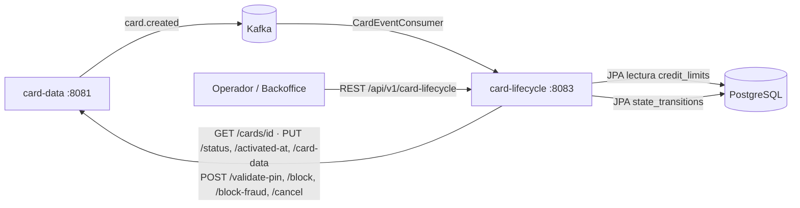
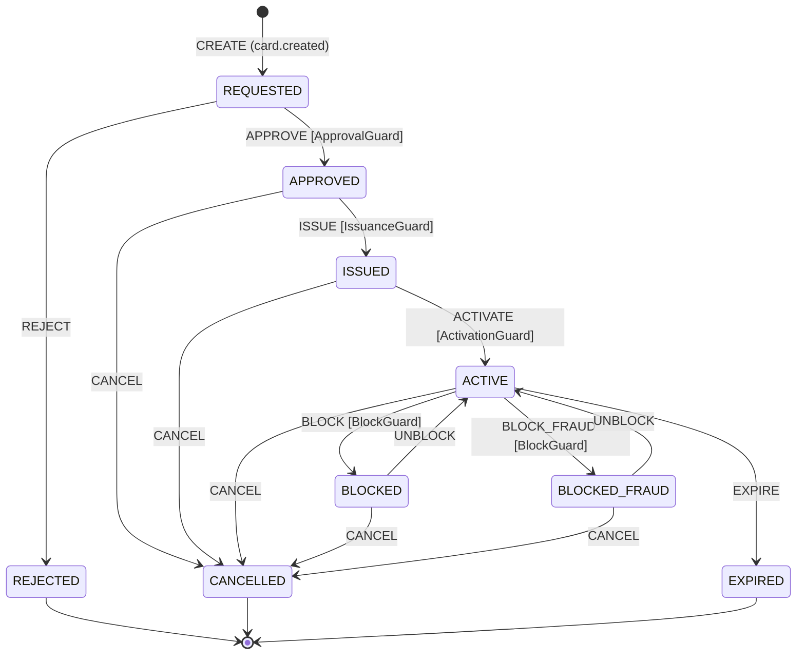
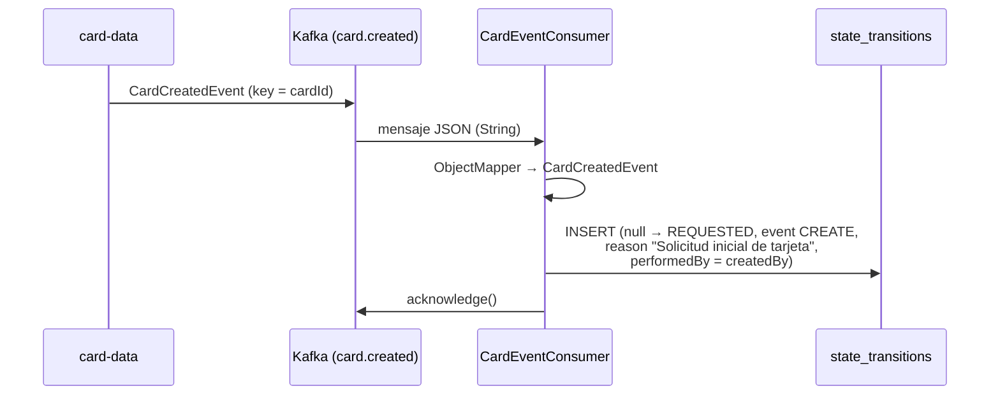
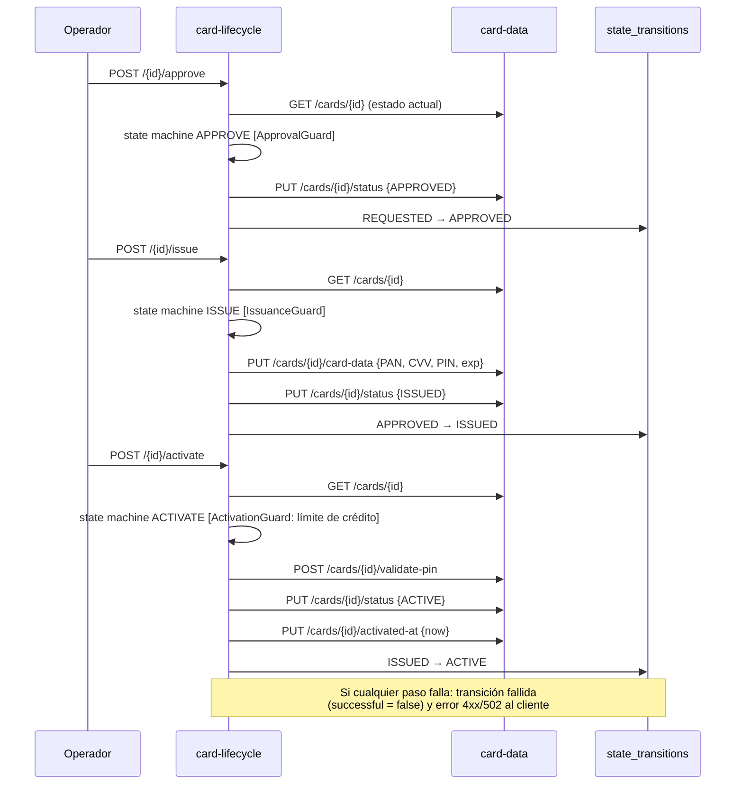
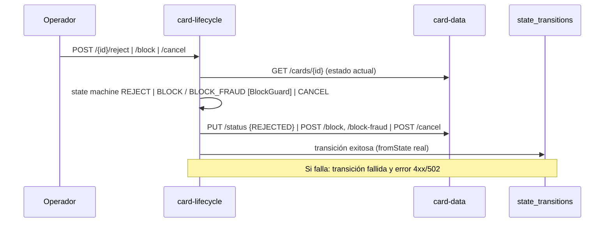

# card-lifecycle — Documentación técnica funcional

> Microservicio que **orquesta el ciclo de vida de la tarjeta** (aprobación, rechazo, emisión, activación, bloqueo, cancelación) y mantiene el **historial auditable de transiciones de estado**.

| Atributo | Valor |
|---|---|
| Artefacto Maven | `com.unisono.card:card-lifecycle` (`1.0.0-SNAPSHOT`) |
| Clase principal | `com.unisono.card.lifecycle.CardLifecycleApplication` |
| Puerto | `8083` |
| Base path REST | `/api/v1/card-lifecycle` |
| Base de datos | PostgreSQL `card_management_db` — tabla propia `state_transitions`; lee `credit_limits`. No accede a `cards` (la modifica vía `card-data`) |
| Mensajería | Kafka: consume `card.created` (grupo `card-lifecycle-consumer-group`) y publica en `dlq.card-events` los mensajes que no puede procesar |
| Integración síncrona | REST hacia `card-data` (`card-data.base-url`, por defecto `http://localhost:8081`): lectura de estado, cambios de estado, datos de emisión, validación de PIN, bloqueo y cancelación |
| Dependencias internas | `card-shared` (Value Objects, `CardStatus`, excepciones), `card-events` (eventos y topics) |
| Librerías destacadas | Spring State Machine (`spring-statemachine-core`, `-data-jpa`) |
| Swagger UI | `http://localhost:8083/swagger-ui.html` |

---

## 1. Responsabilidad dentro del sistema

`card-data` es el dueño de la tarjeta (ver [DATA.md](DATA.md)); `card-lifecycle` es el **dueño de las transiciones**: decide cuándo una tarjeta cambia de estado, registra quién lo hizo y por qué, y propaga el cambio.



- Al recibir `card.created` registra la transición inicial `CREATE` (`null → REQUESTED`).
- Expone endpoints para mover la tarjeta por el ciclo de vida y consultar su historial.
- Cada transición queda registrada en `state_transitions` con motivo, usuario, fecha y resultado.

---

## 2. Arquitectura

Hexagonal, con un componente adicional de Spring State Machine:

```
com.unisono.card.lifecycle
├── domain
│   ├── model        StateTransition, CardLifecycleState, CardLifecycleEvent,
│   │                TransitionContext
│   ├── port.input   ApproveCard, RejectCard, IssueCard, ActivateCard, BlockCard,
│   │                UnblockCard, CancelCard, GetLifecycleHistory
│   ├── port.output  CardDataClient, CreditLimitPort, StateTransitionRepository,
│   │                LifecycleStateMachinePort
│   └── exception    InvalidStateTransitionException, CardDataIntegrationException
├── application
│   ├── service      ApproveCardService, RejectCardService, IssueCardService,
│   │                ActivateCardService, BlockCardService, CancelCardService,
│   │                LifecycleTransitionExecutor, CardLifecycleService (consultas)
│   └── dto.response LifecycleHistoryResponse, StateTransitionResponse
└── infrastructure
    ├── adapter.input.rest     CardLifecycleController, GlobalExceptionHandler, DTOs,
    │                          LifecycleDtoMapper
    ├── adapter.input.event    CardEventConsumer (Kafka)
    ├── adapter.output.card    CardDataRestClient (REST a card-data)
    ├── adapter.output.creditlimit  CreditLimitAdapter (JPA sobre credit_limits)
    ├── adapter.output.persistence  StateTransitionRepositoryAdapter, entity, mapper
    ├── statemachine           SpringStateMachineAdapter, Config, Guards, Listener
    └── config                 KafkaConsumerConfig, RestClientConfig, SwaggerConfig
```

### 2.1 Cómo se ejecuta una transición

Todas las transiciones modifican la tarjeta **solo a través de `card-data`**; el módulo no escribe la tabla `cards`:

| Operación | Servicio | Llamadas a `card-data` |
|---|---|---|
| Aprobar | `ApproveCardService` | `PUT /status` (`APPROVED`) |
| Rechazar | `RejectCardService` | `PUT /status` (`REJECTED`) |
| Emitir | `IssueCardService` | `PUT /card-data` + `PUT /status` (`ISSUED`) |
| Activar | `ActivateCardService` | `POST /validate-pin` + `PUT /status` (`ACTIVE`) + `PUT /activated-at` |
| Bloquear / Bloquear por fraude | `BlockCardService` | `POST /block` / `POST /block-fraud` (completan `block_reason`, `blocked_at`) |
| Cancelar | `CancelCardService` | `POST /cancel` (completa `cancelled_reason`, `cancelled_at`) |

Todos delegan en `LifecycleTransitionExecutor`, que aplica siempre la misma secuencia:

1. Lee el estado real de la tarjeta en `card-data` (`GET /api/v1/cards/{id}`).
2. Dispara el evento en la state machine posicionada en ese estado (§2.2). Si no hay transición o un guard la rechaza, lanza `InvalidStateTransitionException` y **no se llama a `card-data`**.
3. Ejecuta los efectos en `card-data` (cambio de estado, datos de emisión, PIN, fecha de activación).
4. Registra la transición exitosa con el `fromState` real y el destino que devolvió la máquina.

Si falla cualquier paso con una excepción de dominio, registra una transición fallida (`successful = false`, `to_state` = destino buscado, `error_message` = motivo) y relanza la excepción. Si la tarjeta no existe (404) no se registra nada, porque `state_transitions.card_id` tiene FK a `cards`. Los servicios **no son transaccionales**: cada guardado en `state_transitions` se confirma por separado, así que el registro del fallo no se revierte. Si el guardado del fallo también falla, se loguea y se propaga el error original.

`CardLifecycleService` solo expone consultas del historial.

Junto con cada cambio, card-lifecycle envía `reason` y `performedBy` a `card-data`, que publica el evento de integración (`card.approved`, `card.blocked`, …) en la misma transacción. card-lifecycle no publica eventos de tarjeta. Ver [EVENTS.md §5.1](EVENTS.md).

`card-lifecycle` es la **única puerta de entrada** para cambiar el estado: los endpoints de `card-data` que usa son internos. Si alguien llama a `card-data` `/block` directamente, el cambio no queda en el historial (ver [DATA.md §4.2](DATA.md)).

### 2.2 Spring State Machine

`CardStateMachineConfig` (`@EnableStateMachineFactory`, `autoStartup(false)`) define estados, transiciones, guards y actions. `SpringStateMachineAdapter` (implementación de `LifecycleStateMachinePort`) la ejecuta en todas las transiciones:

- Por cada evento pide una máquina nueva a la `StateMachineFactory`, la resetea al estado real de la tarjeta y la arranca. La máquina **no persiste estado**: el dueño del estado sigue siendo `card-data`.
- Envía el evento con los headers `cardId` (`CardId`) y `context` (`TransitionContext` con `reason`, `performedBy` y, en la emisión, PAN, CVV, PIN y vencimiento).
- Si el resultado es `ACCEPTED` devuelve el estado destino. Si no, lanza `InvalidStateTransitionException` con el motivo que dejó el guard en la variable `guardRejection` del extended state o, si no hay transición para el evento, con `Transición inválida: no se puede ejecutar evento '<evento>' desde estado '<estado>'`.

Las transiciones **no tienen actions**: los efectos los hacen los servicios de aplicación después de que la máquina acepta el evento. La state machine es más estricta que `card-data` en un caso: solo permite bloquear desde `ACTIVE` (`card-data` también acepta `ISSUED`).

---

## 3. Modelo de dominio

### 3.1 Estados

`CardLifecycleState` replica a `CardStatus` de `card-shared` (el que se usa realmente en el código y en la base):

| Estado | Descripción | Tipo |
|---|---|---|
| `REQUESTED` | Solicitada | Inicial |
| `APPROVED` | Aprobada | Intermedio |
| `REJECTED` | Rechazada | Final |
| `ISSUED` | Emitida | Operativo |
| `ACTIVE` | Activa | Operativo |
| `BLOCKED` | Bloqueada | Bloqueo |
| `BLOCKED_FRAUD` | Bloqueada por Fraude | Bloqueo |
| `CANCELLED` | Cancelada | Final |
| `EXPIRED` | Vencida | Final |

### 3.2 Eventos

`CardLifecycleEvent`: `APPROVE` (Aprobar), `REJECT` (Rechazar), `ISSUE` (Emitir), `ACTIVATE` (Activar), `BLOCK` (Bloquear), `BLOCK_FRAUD` (Bloquear por Fraude), `UNBLOCK` (Desbloquear), `CANCEL` (Cancelar), `EXPIRE` (Expirar).

En `state_transitions` también aparece el evento `CREATE`, que no está en el enum: lo registra el consumidor de Kafka para el alta.

### 3.3 Diagrama de estados (especificación de la state machine)



**Guards**:

| Guard | Regla |
|---|---|
| `ApprovalGuard` | Requiere `reason` y `performedBy` no vacíos |
| `IssuanceGuard` | Requiere PAN, CVV, PIN y vencimiento; el vencimiento no puede estar vencido |
| `ActivationGuard` | La tarjeta debe tener **límite de crédito asignado** en `credit_limits` (`CreditLimitPort.canActivate`) |
| `BlockGuard` | Requiere `reason` no vacío |

### 3.4 `StateTransition`

Registro de auditoría de cada cambio:

| Campo | Descripción |
|---|---|
| `id` | Autoincremental |
| `cardId` | Tarjeta afectada |
| `fromState` / `toState` | Estados origen y destino (`fromState` es `null` en el alta) |
| `event` | `CREATE`, `APPROVE`, `ISSUE`, … |
| `reason` | Motivo informado |
| `performedBy` | Usuario o sistema que ejecutó la acción |
| `transitionedAt` | Fecha y hora |
| `successful` | `true` / `false` |
| `errorMessage` | Detalle si falló |

Factories: `createSuccessful(...)` y `createFailed(...)`. Esta última guarda en `toState` el estado destino buscado (la columna es `NOT NULL`); `successful = false` indica que no se alcanzó. `getDescription()` arma un texto legible, por ejemplo: `Tarjeta <id>: Solicitada → Aprobada (Evento: Aprobar) - Razón: … - Por: …`.

---

## 4. API REST

Base: `/api/v1/card-lifecycle`. Todos los bodies se validan con Bean Validation.

### 4.1 `POST /{cardId}/approve` — Aprobar

```json
{ "reason": "Cliente cumple con requisitos crediticios", "approvedBy": "admin@bank.com" }
```

Ambos campos obligatorios. Lee el estado en `card-data`, valida `APPROVE` con la state machine (`ApprovalGuard`), llama a `PUT /status` con `APPROVED` y registra la transición con el estado origen real.

Respuesta **200**:

```json
{ "cardId": "…", "message": "Tarjeta aprobada exitosamente", "status": "APPROVED", "timestamp": "2026-11-02T10:15:30" }
```

### 4.2 `POST /{cardId}/reject` — Rechazar

```json
{ "reason": "Cliente no cumple requisitos crediticios", "rejectedBy": "admin@bank.com" }
```

Lee el estado en `card-data`, valida `REJECT` con la state machine (solo desde `REQUESTED`), llama a `PUT /status` con `REJECTED` y registra la transición. Respuesta **200** sin cuerpo.

### 4.3 `POST /{cardId}/issue` — Emitir

```json
{
  "cardNumber": "4532123456789012",
  "cvv": "123",
  "pin": "4821",
  "expirationMonth": 12,
  "expirationYear": 2028,
  "reason": "Emisión estándar de tarjeta aprobada",
  "issuedBy": "system@bank.com"
}
```

| Campo | Validación |
|---|---|
| `cardNumber` | `^[0-9]{13,19}$` + Luhn (`CardNumber.of`) |
| `cvv` | `^[0-9]{3,4}$` |
| `pin` | `^[0-9]{4}$`; `PIN.of` además rechaza secuencias obvias (`1234`, `0000`, …) con 400 |
| `expirationMonth` | 1–12 |
| `expirationYear` | ≥ 2025 |
| `reason`, `issuedBy` | Obligatorios |

Flujo: lee el estado en `card-data` → valida `ISSUE` con la state machine (`IssuanceGuard`) → `PUT /card-data` (PAN, CVV, PIN en claro, vencimiento — `card-data` cifra y hashea) → `PUT /status` con `ISSUED` → registra la transición. Respuesta **200** `CardLifecycleResponse` con `status: ISSUED`.

### 4.4 `POST /{cardId}/activate` — Activar

```json
{ "pin": "4821", "reason": "Cliente solicitó activación vía app", "activatedBy": "cliente@email.com" }
```

Los tres campos son obligatorios (`pin` de 4 dígitos). Flujo:

1. Lee el estado en `card-data` y valida `ACTIVATE` con la state machine: la tarjeta debe estar `ISSUED` y tener límite de crédito (`ActivationGuard`). Si falla → **422**.
2. Verifica el PIN con `card-data` `POST /cards/{id}/validate-pin`. Si es incorrecto → **422** `PIN incorrecto: no se puede activar la tarjeta …`. El PIN se verifica **después** de la state machine para no consumir intentos en una activación que igual sería rechazada; cada PIN incorrecto suma un intento en `card-data`, que bloquea la tarjeta al llegar al máximo ([DATA.md](DATA.md)).
3. `PUT /status` con `ACTIVE` → `PUT /activated-at` con la hora actual → registra la transición.

Respuesta **200** `CardLifecycleResponse` con `status: ACTIVE`.

### 4.5 `POST /{cardId}/block` — Bloquear

```json
{ "reason": "Tarjeta reportada como perdida", "blockedBy": "usuario@email.com", "blockType": "NORMAL" }
```

`blockType`: `NORMAL` (por defecto, también si es `null`) o `FRAUD`. Valida `ACTIVE → BLOCKED` o `ACTIVE → BLOCKED_FRAUD` con la state machine (`BlockGuard`: `reason` obligatorio) y llama a `card-data` `POST /block` o `POST /block-fraud` con el motivo; `card-data` guarda `block_reason` y `blocked_at`. Respuesta **200** sin cuerpo.

### 4.6 `POST /{cardId}/cancel` — Cancelar

```json
{ "reason": "Cliente solicitó cancelación", "cancelledBy": "cliente@email.com" }
```

Cancela desde `APPROVED`, `ISSUED`, `ACTIVE`, `BLOCKED` o `BLOCKED_FRAUD` (no desde `REQUESTED`: para eso está el rechazo). Valida con la state machine y llama a `card-data` `POST /cancel` con el motivo; `card-data` guarda `cancelled_reason` y `cancelled_at`. Respuesta **200** sin cuerpo.

### 4.7 `GET /{cardId}/history` — Historial

Devuelve todas las transiciones de la tarjeta, **más recientes primero**:

```json
[
  {
    "id": 3,
    "fromState": "APPROVED",
    "fromStateDescription": "Aprobada",
    "toState": "ISSUED",
    "toStateDescription": "Emitida",
    "event": "ISSUE",
    "eventDescription": "Emitir",
    "reason": "Emisión estándar de tarjeta aprobada",
    "performedBy": "system@bank.com",
    "transitionedAt": "2026-11-02T10:20:00",
    "successful": true,
    "errorMessage": null
  }
]
```

Lista vacía si la tarjeta no tiene transiciones (no devuelve 404).

### 4.8 Errores

`GlobalExceptionHandler` (`@RestControllerAdvice`) traduce las excepciones de dominio a `{ timestamp, status, error, message }`, el mismo formato que `card-data`. `CardDataRestClient` traduce a su vez las respuestas de `card-data`: 404 → `NotFoundException`, 400 → `ValidationException`, 409/422 → `BusinessRuleException` (con el `message` que devolvió `card-data`), cualquier otro error o falta de respuesta → `CardDataIntegrationException`.

| Situación | Resultado |
|---|---|
| Body inválido (Bean Validation) | 400 (formato por defecto de Spring Boot) |
| PAN/CVV/PIN inválido (`ValidationException` / `InvalidValueObjectException`) | 400 |
| Tarjeta inexistente (`NotFoundException`, local o 404 de `card-data`) | 404 |
| Transición no permitida o rechazada por un guard (`InvalidStateTransitionException`) | 422 |
| Regla de negocio (`BusinessRuleException`: PIN incorrecto, 409/422 de `card-data`) | 422 |
| `card-data` caído o con error inesperado (`CardDataIntegrationException`) | 502 |

---

## 5. Flujos funcionales

### 5.1 Alta (asíncrona, vía Kafka)



- El valor se recibe como `String` (`StringDeserializer`) y se deserializa a mano con un `ObjectMapper` con soporte de `java.time`.
- `enable.auto.commit=false`, `AckMode.MANUAL`, concurrencia 1, `auto-offset-reset=earliest`, `max.poll.records=100`.
- **Idempotente:** card-data publica con un outbox *at-least-once*, así que el mismo evento puede llegar más de una vez. Si la tarjeta ya tiene su transición `CREATE`, el mensaje se confirma sin registrarla de nuevo. El índice único `uq_state_transitions_create` (V10) cubre además el caso de dos consumos en paralelo.
- El `eventId` del mensaje se guarda en `metadata` (`{"eventId":"…"}`).
- Si el procesamiento falla, la excepción llega al `DefaultErrorHandler`: reintenta 4 veces con espera exponencial (1 s, 2 s, 4 s, 8 s) y luego envía el mensaje a `dlq.card-events`. Un JSON ilegible va directo a la DLQ. Una violación de restricción que no sea el duplicado de `CREATE` (por ejemplo, FK a `cards`) se trata como error. Ver [EVENTS.md §5.3](EVENTS.md).

### 5.2 Aprobación → emisión → activación



Las llamadas a `card-data` son síncronas con `RestTemplate` (sin timeouts ni reintentos configurados). La transición exitosa se registra **después** de que `card-data` respondió OK, con el `fromState` leído de `card-data`. `card-data` vuelve a validar la transición al recibir `PUT /status` (422 si no está permitida, [DATA.md §3.5](DATA.md)); ese rechazo también queda registrado como transición fallida.

### 5.3 Rechazo, bloqueo y cancelación



Mismo mecanismo que §5.2. Como el cambio lo hace `card-data` con sus métodos de dominio, quedan completos `block_reason`, `blocked_at`, `cancelled_reason` y `cancelled_at`.

### 5.4 Activación y límite de crédito

La regla “no se activa una tarjeta sin límite de crédito” la aplica `ActivationGuard` en la state machine, que consulta `CreditLimitAdapter.canActivate()` (existencia de `credit_limits.card_id`). Si la tarjeta no tiene límite, la activación responde **422** con `No se puede activar la tarjeta: debe tener límite de crédito asignado. CardId: …`, queda registrada como transición fallida y no se llega a verificar el PIN ni a llamar a `card-data`.

---

## 6. Persistencia

### 6.1 Tabla propia `state_transitions`

| Columna | Tipo | Nulo | Notas |
|---|---|---|---|
| `id` | `bigint` | no | PK, `IDENTITY` |
| `card_id` | `varchar(36)` | no | |
| `from_state` | `varchar(20)` | sí | `null` en `CREATE` |
| `to_state` | `varchar(20)` | **no** | |
| `event` | `varchar(20)` | no | |
| `reason` | `text` | sí | |
| `performed_by` | `varchar(100)` | no | |
| `transitioned_at` | `timestamp` | no | `@CreationTimestamp` |
| `successful` | `boolean` | no | default `true` |
| `error_message` | `text` | sí | |
| `metadata` | `text` | sí | JSON adicional; en `CREATE`, el `eventId` del mensaje |

Consultas (`JpaStateTransitionRepository`): por tarjeta (desc), solo exitosas, solo fallidas, última transición, conteo, existencia, por evento y por estado destino. El endpoint solo expone el historial completo.

### 6.2 Tablas compartidas

| Tabla | Dueño | Uso en lifecycle | Columnas mapeadas |
|---|---|---|---|
| `credit_limits` | `card-limits` | Solo lectura (`CreditLimitJpaEntity`) | `id`, `card_id`, `purchase_limit_amount` |

> `cards` (dueño `card-data`) no está mapeada en este módulo: se lee y modifica solo vía REST. La FK `state_transitions.card_id → cards(id)` sigue existiendo.
>
> **Esquema:** las tres tablas las crea Flyway desde el repo `card-management-database`: `cards` en V1, `credit_limits` en V2 y `state_transitions` en V3. Este módulo usa `ddl-auto: validate` con Flyway deshabilitado, así que deben existir antes del arranque.
>
> En V3, `state_transitions.card_id` tiene FK a `cards(id)` (`ON DELETE CASCADE`), `to_state` es `NOT NULL` (por eso las transiciones fallidas guardan el destino buscado) y `event` es `varchar(50)` (la entidad declara 20).

---

## 7. Seguridad de datos sensibles

- En el camino REST (emisión), el PAN, el CVV y el PIN viajan **en claro** en el body hacia `card-data`, que los cifra (AES-GCM) y hashea (BCrypt). La activación también manda el PIN en claro a `validate-pin` (`pin`); los adelantos de payment-processing, en cambio, ya mandan un PIN block cifrado ([DATA.md §4.3](DATA.md)). No hay TLS ni autenticación entre servicios.
- El módulo no lee ni escribe PAN, CVV ni PIN en la base: el cifrado y el hash son responsabilidad exclusiva de `card-data`.
- `Card.getLastFourDigits()` se usa para logs seguros.
- La API no tiene autenticación ni autorización: `approvedBy`, `blockedBy`, etc. son texto libre que envía el cliente.

---

## 8. Configuración y despliegue

### 8.1 Propiedades principales (`application.yml`)

| Propiedad | Valor por defecto |
|---|---|
| `server.port` | `8083` |
| `spring.datasource.url` | `jdbc:postgresql://localhost:5432/card_management_db` |
| `spring.datasource.username` / `password` | `card_user` / `card_pass` |
| `spring.jpa.hibernate.ddl-auto` | `validate` |
| `spring.kafka.bootstrap-servers` | `localhost:9092` |
| `spring.kafka.consumer.group-id` | `card-lifecycle-consumer-group` |
| `spring.kafka.listener.ack-mode` | `manual` |
| `card-data.base-url` | `http://localhost:8081` (default en `CardDataRestClient`) |
| `card-lifecycle.kafka.retry.max-retries` | `4` (reintentos antes de enviar a la DLQ) |
| `card-lifecycle.kafka.retry.initial-interval-ms` | `1000` (se duplica en cada reintento) |

El perfil `card-lifecycle` (`application-card-lifecycle.yml`, activado por docker-compose) agrega logging a `logs/card-lifecycle.log`, Prometheus, SpringDoc y endpoints de actuator. Las propiedades `card-lifecycle.transitions.*` (timeout, reintentos) y `card-lifecycle.audit.*` (retención) están declaradas pero **ningún código las lee**.

### 8.2 Docker

- `services/card-lifecycle/Dockerfile`: build multi-stage con contexto en la raíz del repo, igual que el resto de los módulos.
- `deploy/docker/docker-compose.yml`: servicio `card-lifecycle-service`, puerto `8083`, perfil `card-lifecycle`, healthcheck sobre `/actuator/health`.

```bash
docker compose -f deploy/docker/docker-compose.yml up -d card-lifecycle-service
```

> Dentro de Docker `localhost` es el propio contenedor, así que el compose sobrescribe `SPRING_KAFKA_BOOTSTRAP_SERVERS=kafka:9092` y `CARD_DATA_BASE_URL=http://card-data-service:8081` (propiedad `card-data.base-url`). El servicio arranca cuando `kafka` y `card-data-service` están *healthy* (`depends_on`).

### 8.3 Observabilidad

- `GET /actuator/health`, `/actuator/metrics` (y `/actuator/prometheus` con el perfil).
- `StateMachineEventListener` loguea arranque, cambios de estado, eventos no aceptados y errores de la state machine (en aprobar, emitir y activar). Los guards loguean en `WARN` el motivo de cada rechazo.
- Logs `com.unisono.card` en `DEBUG`.

---

## 9. Limitaciones conocidas y deuda técnica

Comportamientos actuales del código que conviene resolver:

1. **Sin desbloqueo.** No hay endpoint ni implementación de `UnblockCardUseCase`, aunque está previsto en la state machine y en el dominio.
2. **Ports sin implementar:** `UnblockCardUseCase` y `GetLifecycleHistoryUseCase` son interfaces sin implementación (el historial se consulta con `CardLifecycleService` directamente).
3. **Consistencia entre servicios.** Emisión y activación hacen varias llamadas REST de escritura seguidas: si la segunda falla, `card-data` queda a medio actualizar y no hay compensación. Si falla el guardado de la transición después de las llamadas, el cambio en `card-data` ya está hecho y no queda historial. `RestTemplate` no tiene timeouts.
4. **Código muerto:** `hashPin()` en el controller, `LifecycleDtoMapper.toIssueCardCommand` y su record interno, `application/dto/response/LifecycleHistoryResponse` (duplicado del DTO REST), `StateMachineActionConfig` (vacío) y las propiedades `card-lifecycle.*` del perfil.
5. **Cobertura de tests parcial.** Hay tests del consumidor Kafka (incluidos reintentos y DLQ contra un broker embebido), de la state machine con sus guards (`SpringStateMachineAdapterTest`), del cliente REST (`CardDataRestClientTest`), de la activación (`ActivateCardServiceTest`) y de rechazo, bloqueo y cancelación (`BlockAndCancelServicesTest`); faltan los de aprobación, emisión y del controller.
