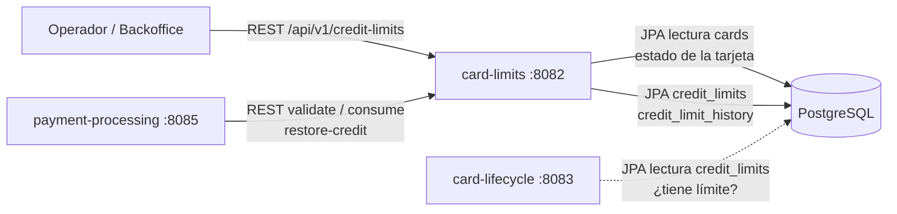
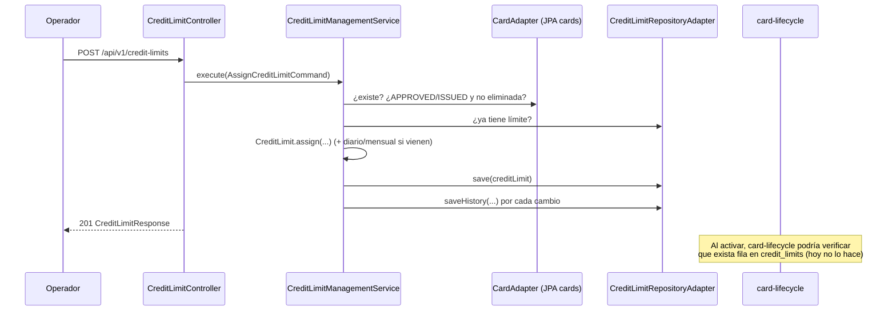
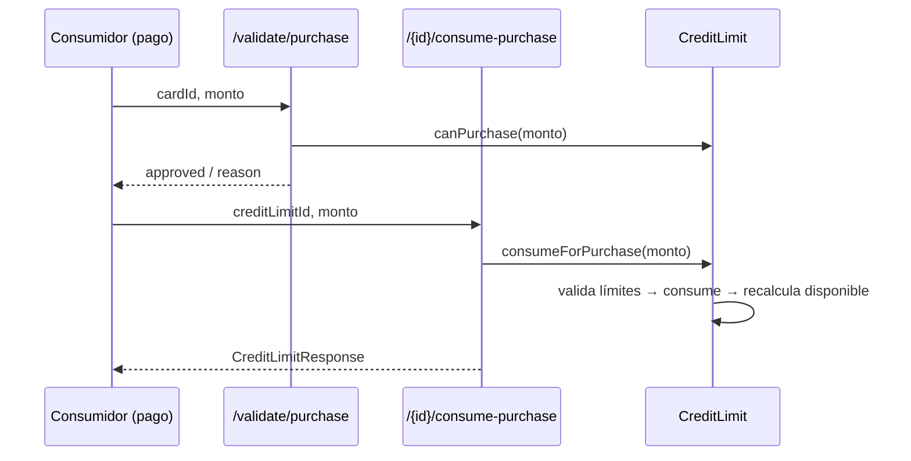

# card-limits — Documentación técnica funcional

> Microservicio dueño del **Aggregate Root `CreditLimit`**: asignación y modificación de límites de crédito de una tarjeta, consumo y liberación de crédito, validación de compras y adelantos, e historial auditable de cambios de límites.

| Atributo | Valor |
|---|---|
| Artefacto Maven | `com.unisono.card:card-limits` (`1.0.0-SNAPSHOT`) |
| Clase principal | `com.unisono.card.limits.CardLimitsApplication` |
| Puerto | `8082` |
| Base path REST | `/api/v1/credit-limits` |
| Base de datos | PostgreSQL `card_management_db` — tablas propias `credit_limits`, `credit_limit_history`, `credit_operations` y `credit_limit_outbox_events`; lee `cards` |
| Mensajería | Kafka, solo como productor: publica `credit-limit.assigned`, `.updated`, `.consumed` y `.released` con un transactional outbox (§6.5). No consume |
| Dependencias internas | `card-shared` (`Money`, `CardId`, `CardStatus`, excepciones) y `card-events` (contratos `credit-limit.*`, `KafkaTopics`) |
| Swagger UI | `http://localhost:8082/swagger-ui.html` |

---

## 1. Responsabilidad dentro del sistema

`card-limits` define **cuánto puede gastar una tarjeta** y lleva la cuenta de lo consumido. Es la base de la regla de negocio “no se activa una tarjeta sin límite asignado” (ver [LIFECYCLE.md §5.4](LIFECYCLE.md)) y de la autorización de pagos.



- **Asigna** el límite a una tarjeta en estado `APPROVED` o `ISSUED`, antes de que se active.
- **Consume** crédito por compras y adelantos, y lo **libera** cuando el cliente paga.
- **Valida** si una compra o un adelanto entra en los límites, sin consumir crédito.
- Registra en el **historial** cada asignación o cambio de límite.

> `payment-processing` usa la API tal como está:
> - **Antes de autorizar:** `validate/purchase` o `validate/cash-advance`.
> - **Al aprobar:** `consume-purchase` o `consume-cash-advance`.
> - **En reversos y devoluciones:** `restore-credit`.
>
> Resuelve el `creditLimitId` con `GET /card/{cardId}` ([PAYMENT.md §7](PAYMENT.md)).

---

## 2. Arquitectura

Hexagonal:

```
com.unisono.card.limits
├── domain
│   ├── model        CreditLimit (aggregate root), CreditLimitHistory,
│   │                PurchaseLimit, CashAdvanceLimit, ConsumedCredit, AvailableCredit,
│   │                DailyLimit, MonthlyLimit, LimitType
│   ├── port.input   AssignCreditLimit, UpdateCreditLimit, GetCreditInfo,
│   │                RecalculateAvailableCredit, ValidatePurchase
│   ├── port.output  CreditLimitRepository, CardPort, CardValidationPort
│   └── service      CreditLimitManagementService, CreditValidationService
├── application
│   ├── dto          Requests / Responses
│   └── mapper       CreditLimitDtoMapper
└── infrastructure
    ├── adapter.input.rest           CreditLimitController, CreditValidationController,
    │                                GlobalExceptionHandler
    ├── adapter.output.persistence   CreditLimitRepositoryAdapter, entities, mapper,
    │                                JpaCreditLimitRepository, JpaCreditLimitHistoryRepository
    ├── adapter.output.card          CardAdapter + CardJpaEntity (lectura de cards)
    ├── adapter.output.cardvalidation CardValidationAdapter
    └── config                       DataSource (Hikari), JPA, use cases, Swagger
```

### Mapa de casos de uso → servicios → endpoints

| Caso de uso (port input) | Implementación | Endpoints |
|---|---|---|
| `AssignCreditLimitUseCase` | `CreditLimitManagementService` | `POST /`, `POST /cards/{cardId}` |
| `GetCreditInfoUseCase` | `CreditLimitManagementService` | `GET /{creditLimitId}`, `GET /card/{cardId}`, `GET /card/{cardId}/info`, `GET /{creditLimitId}/history` |
| `UpdateCreditLimitUseCase` | `CreditLimitManagementService` | `PUT /{id}/increase-purchase-limit`, `/decrease-purchase-limit`, `/update-cash-advance-limit`, `/update-temporal-limits` |
| `RecalculateAvailableCreditUseCase` | `CreditLimitManagementService` | `POST /{id}/consume-purchase`, `/consume-cash-advance`, `/release-credit`, `/restore-credit` |
| `ValidatePurchaseUseCase` | `CreditValidationService` | `POST /validate/purchase`, `POST /validate/cash-advance` |

---

## 3. Modelo de dominio

### 3.1 `CreditLimit` (Aggregate Root)

| Campo | Tipo | Descripción |
|---|---|---|
| `id` | `String` (UUID) | Generado al asignar |
| `cardId` | `CardId` | Tarjeta asociada (1 límite por tarjeta) |
| `purchaseLimit` | `PurchaseLimit` | Límite total de compras |
| `cashAdvanceLimit` | `CashAdvanceLimit` | Tope de adelantos en efectivo |
| `consumedCredit` | `ConsumedCredit` | Crédito usado |
| `availableCredit` | `AvailableCredit` | `purchaseLimit − consumedCredit` (se recalcula tras cada cambio) |
| `dailyLimit` | `DailyLimit` | Tope diario con consumo del día |
| `monthlyLimit` | `MonthlyLimit` | Tope mensual con consumo del mes |
| `history` | `List<CreditLimitHistory>` | Cambios pendientes de persistir (en memoria) |
| `createdAt`, `updatedAt` | `LocalDateTime` | Auditoría |

**Invariantes declaradas:**

- El límite de adelantos no puede superar el límite de compras.
- El crédito consumido no puede superar el límite total.
- Crédito disponible = límite de compras − crédito consumido.
- Los límites diario y mensual se reinician solos al cambiar el día o el mes.

### 3.2 Value Objects

| VO | Reglas |
|---|---|
| `PurchaseLimit` | Entre **ARS 1.000** y **ARS 10.000.000**. `increase` / `decrease` revalidan el rango. |
| `CashAdvanceLimit` | Entre **ARS 500** y **ARS 5.000.000**. Se calcula como `purchaseLimit × porcentaje` (0–1, por defecto 0,30). |
| `ConsumedCredit` | `consume(+)` / `release(−)`. No valida que el resultado sea ≥ 0 (ver §9). |
| `AvailableCredit` | `isSufficientFor(monto)`, `isExhausted()`. |
| `DailyLimit` | Monto (por defecto **ARS 100.000**), consumido y `resetDate`. Si `resetDate ≠ hoy`, el disponible es el monto completo y el próximo consumo reinicia el contador. |
| `MonthlyLimit` | Igual que el diario, con `resetMonth` (`YearMonth`). Por defecto **ARS 500.000**. |

Todos operan sobre `Money` (`card-shared`): montos con escala 2 y `HALF_UP`. **Sumar, restar o comparar montos de distinta moneda lanza `BusinessRuleException` (422).**

### 3.3 Operaciones del aggregate

| Método | Validaciones | Efecto | Historial |
|---|---|---|---|
| `assign(cardId, monto, %adelantos, por)` | Datos obligatorios, % entre 0 y 1, rangos de los VO | Nuevo límite; consumido 0; diario/mensual por defecto | `ASSIGNED` (PURCHASE) |
| `increasePurchaseLimit(+monto)` | Nuevo total ≤ 10M | Sube el límite y recalcula el disponible | `INCREASED` (PURCHASE) |
| `decreasePurchaseLimit(−monto)` | Nuevo total ≥ 1.000 y ≥ consumido | Baja el límite y recalcula el disponible | `DECREASED` (PURCHASE) |
| `updateCashAdvanceLimit(nuevo)` | ≤ límite de compras, rango del VO | Reemplaza el tope de adelantos | `INCREASED`/`DECREASED` (CASH_ADVANCE) |
| `updateDailyLimit(nuevo)` / `updateMonthlyLimit(nuevo)` | No nulo | Reemplaza el tope; conserva el consumo del período en curso | `INCREASED`/`DECREASED` (DAILY/MONTHLY) |
| `consumeForPurchase(monto)` | > 0, ≤ límite de compras, ≤ disponible, ≤ disponible diario y mensual | Suma al consumido, al diario y al mensual | — |
| `consumeForCashAdvance(monto)` | > 0, ≤ tope de adelantos, ≤ disponible, ≤ diario y mensual | Igual que la compra | — |
| `releaseCredit(monto)` | > 0 | Pago del resumen: resta del consumido y recalcula el disponible (no toca diario ni mensual) | — |
| `restoreConsumption(monto, fechaOriginal)` | > 0, fecha obligatoria | Reverso o devolución: resta del consumido (como mucho hasta cero) y recalcula el disponible. Si `fechaOriginal` es del día en curso, resta del acumulado diario; si es del mes en curso, del mensual. Devuelve el excedente que no se pudo restaurar | — |
| `canPurchase(monto)` / `canCashAdvance(monto)` | Las mismas reglas, sin lanzar excepciones | `true` / `false` | — |

### 3.4 `CreditLimitHistory`

| Campo | Descripción |
|---|---|
| `id` | Autoincremental |
| `creditLimitId` | Límite afectado |
| `limitType` | `PURCHASE` (Límite de Compras), `CASH_ADVANCE` (Límite de Adelantos), `DAILY` (Límite Diario), `MONTHLY` (Límite Mensual) |
| `action` | `ASSIGNED`, `INCREASED`, `DECREASED` |
| `previousValue`, `newValue`, `difference` | Montos (`difference` siempre positivo) |
| `reason`, `changedBy` | Motivo y usuario |
| `changedAt` | Fecha y hora |
| `metadata` | Texto/JSON libre (hoy no se usa) |

**El consumo y la liberación de crédito no generan historial**: el módulo no guarda un registro de movimientos.

### 3.5 Elegibilidad de la tarjeta

Antes de asignar, el servicio consulta `cards` (lectura directa por JPA):

- La tarjeta debe existir → si no, **404**.
- Debe estar en `APPROVED` o `ISSUED` y no estar eliminada → si no, **422** (`"La tarjeta no puede recibir límite de crédito en su estado actual"`).
- No puede tener ya un límite activo → **422** (`"La tarjeta ya tiene un límite de crédito asignado"`).

Consumir, liberar y validar **no verifican el estado de la tarjeta** (ver §9).

---

## 4. API REST

Base: `/api/v1/credit-limits`. Bodies validados con Bean Validation.

### 4.1 Asignación

#### `POST /api/v1/credit-limits`

```json
{
  "cardId": "550e8400-e29b-41d4-a716-446655440000",
  "purchaseLimitAmount": 150000.00,
  "currency": "ARS",
  "cashAdvancePercentage": 0.30,
  "dailyLimitAmount": 100000.00,
  "monthlyLimitAmount": 500000.00,
  "assignedBy": "admin@unisono.com"
}
```

| Campo | Validación |
|---|---|
| `cardId` | Obligatorio |
| `purchaseLimitAmount` | Obligatorio, entre 1.000 y 10.000.000 |
| `currency` | Obligatorio, 3 letras (en la práctica solo funciona `ARS`, ver §9) |
| `cashAdvancePercentage` | Opcional, entre 0 y 1, por defecto 0,30 (un `0` explícito también se toma como 0,30) |
| `dailyLimitAmount`, `monthlyLimitAmount` | Opcionales, ≥ 0; si no se envían quedan 100.000 y 500.000 |
| `assignedBy` | Obligatorio |

Respuesta **201** → `CreditLimitResponse`.

#### `POST /api/v1/credit-limits/cards/{cardId}`

Igual que el anterior, pero toma el `cardId` del path. El campo `cardId` del body sigue siendo obligatorio por validación, aunque se ignora.

### 4.2 Consultas

| Método y ruta | Respuesta |
|---|---|
| `GET /{creditLimitId}` | `CreditLimitResponse` o 404 |
| `GET /card/{cardId}` | `CreditLimitResponse` o 404 |
| `GET /card/{cardId}/info` | `CreditInfoResponse` o 404 |
| `GET /{creditLimitId}/history` | `CreditLimitHistoryResponse[]` (más reciente primero) o 404 si el límite no existe |

**`CreditLimitResponse`**

```json
{
  "id": "7c9e6679-7425-40de-944b-e07fc1f90ae7",
  "cardId": "550e8400-e29b-41d4-a716-446655440000",
  "purchaseLimit": 150000.00,
  "cashAdvanceLimit": 45000.00,
  "availableCredit": 145000.00,
  "consumedCredit": 5000.00,
  "dailyLimit": 100000.00,
  "dailyAvailable": 95000.00,
  "monthlyLimit": 500000.00,
  "monthlyAvailable": 495000.00,
  "currency": "ARS",
  "createdAt": "2026-11-02T10:15:30",
  "updatedAt": "2026-11-02T11:00:00"
}
```

**`CreditInfoResponse`**: `purchaseLimit`, `cashAdvanceLimit`, `availableCredit`, `consumedCredit`, `utilizationPercentage` (consumido / límite × 100), `dailyAvailable`, `monthlyAvailable`, `currency`, `isExhausted`.

**`CreditLimitHistoryResponse`**: `id`, `limitType`, `action`, `previousValue`, `newValue`, `difference`, `currency`, `reason`, `changedBy`, `changedAt`, `description` (por ejemplo `"Límite de Compras: INCREASED cambió de ARS 150000.00 a ARS 200000.00 (diferencia: ARS 50000.00) - Razón: …"`).

### 4.3 Modificación de límites

`PUT /{creditLimitId}/increase-purchase-limit` · `/decrease-purchase-limit` · `/update-cash-advance-limit`

```json
{ "amount": 50000.00, "currency": "ARS", "reason": "Aumento por buen comportamiento crediticio", "changedBy": "admin@unisono.com" }
```

- En `increase` y `decrease`, `amount` es la **diferencia** a sumar o restar.
- En `update-cash-advance-limit`, `amount` es el **nuevo valor absoluto** del tope.

`PUT /{creditLimitId}/update-temporal-limits`

```json
{ "dailyLimitAmount": 150000.00, "monthlyLimitAmount": 600000.00, "currency": "ARS", "reason": "Ajuste de límites temporales", "changedBy": "admin@unisono.com" }
```

Los dos montos son opcionales (> 0 si se envían). Todos estos endpoints responden **200** `CreditLimitResponse`.

### 4.4 Consumo y liberación

| Método y ruta | Body | Efecto |
|---|---|---|
| `POST /{creditLimitId}/consume-purchase` | `{ "amount": 5000.00, "currency": "ARS", "description": "Compra en Mercado Libre", "operationId": "6f1c…" }` | Consume crédito por una compra |
| `POST /{creditLimitId}/consume-cash-advance` | ídem | Consume crédito por un adelanto |
| `POST /{creditLimitId}/release-credit` | `{ "paymentAmount": 10000.00, "currency": "ARS", "description": "Pago de resumen" }` | Libera crédito (pago del resumen) |
| `POST /{creditLimitId}/restore-credit` | `{ "amount": 1500.00, "currency": "ARS", "originalTransactionDate": "2026-11-03", "description": "Reverso de …", "operationId": "7a2d…" }` | Deshace un consumo (reverso o devolución): disponible y cupo diario y mensual del período de la transacción original. Si ya se pagó, el excedente no se restaura (se loguea) |
| `POST /{creditLimitId}/operations/{operationId}/cancel` | — | Deshace exactamente un consumo o una restauración enviados con `operationId` (ver abajo). Responde `{ "operationId", "outcome", "availableCredit", "currency", "overLimitAmount" }` |

Respuesta **200** `CreditLimitResponse`. `description` es obligatoria; solo se guarda en `credit_operations` cuando viene `operationId`.

**Operaciones idempotentes (`operationId`, opcional, hasta 64 caracteres).** payment-processing lo envía siempre ([PAYMENT.md §4.7](PAYMENT.md)):

- Un consumo o una restauración con `operationId` se registra en `credit_operations` con lo que movió: deltas de lo consumido, del cupo diario y del mensual, y la fecha en que se aplicó.
- Repetir el mismo `operationId` no vuelve a aplicar nada: responde 200 con el estado actual. Si llega con otro tipo de operación o para otro límite, responde 422.
- **Cancelar** deshace exactamente esos deltas. Lo consumido no baja de cero. El cupo diario o mensual solo se toca si sigue siendo el mismo día o mes: si ya se reseteó, no hay nada que devolver.
- **No valida límites**, a propósito. Deshacer una restauración significa que el reverso o la devolución nunca ocurrieron, así que lo restaurado se vuelve a consumir aunque la tarjeta ya lo haya gastado. En ese caso el disponible queda **negativo** (la tarjeta está excedida): la respuesta informa `overLimitAmount`, se loguea un `WARN` y las compras siguientes se rechazan por crédito insuficiente hasta que pague. `CreditLimit.getOverLimitAmount()` devuelve el exceso. `outcome`:
  - `CANCELLED`: estaba aplicada y se deshizo.
  - `VOIDED`: todavía no había llegado. Queda anulada y, si llega después, se rechaza con **409**. Cubre el caso de un timeout en el que el request todavía no se aplicó.
  - `ALREADY_CANCELLED`: ya estaba cancelada o anulada; no se hace nada.
- Sin `operationId`, el comportamiento es el anterior: no se registra y repetir el request aplica dos veces.

Consumo, restauración, liberación y cancelación bloquean la fila del límite (`SELECT … FOR UPDATE`) hasta el fin de la transacción, así que se ejecutan de a una por límite.

### 4.5 Validación (sin consumir)

`POST /validate/purchase` · `POST /validate/cash-advance`

```json
{ "cardId": "550e8400-e29b-41d4-a716-446655440000", "amount": 5000.00, "currency": "ARS" }
```

Respuesta **200** siempre que exista el límite (aunque la operación se rechace):

```json
{ "approved": false, "reason": "Se excede el límite diario. Disponible hoy: ARS 3000.00", "availableCredit": 145000.00, "requestedAmount": 5000.00, "currency": "ARS" }
```

Orden en que se evalúan los motivos de rechazo:

1. Límite de compras (o de adelantos).
2. Crédito disponible.
3. Límite diario.
4. Límite mensual.

**404** si la tarjeta no tiene límite asignado.

### 4.6 Errores (`GlobalExceptionHandler`)

Mismo formato que `card-data`:

```json
{ "timestamp": "…", "status": 422, "error": "Business Rule Violation", "message": "Crédito insuficiente. Disponible: …, Solicitado: …", "fieldErrors": null }
```

| Excepción | HTTP | Casos típicos |
|---|---|---|
| `NotFoundException` | 404 | Límite o tarjeta inexistente |
| `ValidationException` (incluye `InvalidValueObjectException`) | 400 | Montos fuera de rango en los VO, monto cero, moneda inválida |
| `MethodArgumentNotValidException` | 400 + `fieldErrors` | Bean Validation |
| `CreditOperationCancelledException` | 409 | Llega un consumo o una restauración cuyo `operationId` ya se canceló (anulado) |
| `BusinessRuleException` | 422 | Monedas distintas, tarjeta no elegible, límite duplicado, crédito insuficiente, límite diario o mensual excedido, reducción por debajo de lo consumido |
| Otras | 500 | — |

> Las anotaciones OpenAPI de los endpoints de consumo dicen “400 crédito insuficiente”, pero el código devuelve **422**.

---

## 5. Flujos funcionales

### 5.1 Asignación previa a la activación



### 5.2 Compra



La validación usa el **`cardId`**; el consumo usa el **`creditLimitId`**. Quien llama necesita los dos (el segundo se obtiene con `GET /card/{cardId}`). Validar y consumir son dos llamadas separadas, sin reserva: entre una y otra, otra operación puede consumir el disponible.

### 5.3 Reinicio diario y mensual

No hay jobs programados. Al leer o consumir, `DailyLimit` y `MonthlyLimit` comparan su fecha de reinicio con `LocalDate.now()` / `YearMonth.now()` (zona horaria del servidor). Si cambió el período, consideran el disponible completo y el siguiente consumo pone el contador en el monto consumido. En la base, `daily_limit_consumed` puede mostrar el valor del día anterior hasta el próximo consumo.

---

## 6. Persistencia

### 6.1 `credit_limits`

| Columna | Tipo | Nulo | Notas |
|---|---|---|---|
| `id` | `varchar(36)` | no | PK |
| `card_id` | `varchar(36)` | no | `UNIQUE`, índice `idx_credit_limit_card_id` |
| `purchase_limit_amount` / `_currency` | `numeric(15,2)` / `varchar(3)` | no | |
| `cash_advance_limit_amount` / `_currency` | `numeric(15,2)` / `varchar(3)` | no | |
| `consumed_credit_amount` / `_currency` | `numeric(15,2)` / `varchar(3)` | no | |
| `available_credit_amount` / `_currency` | `numeric(15,2)` / `varchar(3)` | no | Valor derivado, persistido |
| `daily_limit_amount` / `_currency` | `numeric(15,2)` / `varchar(3)` | no | |
| `daily_limit_consumed` | `numeric(15,2)` | no | |
| `daily_limit_reset_date` | `date` | no | |
| `monthly_limit_amount` / `_currency` | `numeric(15,2)` / `varchar(3)` | no | |
| `monthly_limit_consumed` | `numeric(15,2)` | no | |
| `monthly_limit_reset_year` / `_month` | `int` | no | |
| `created_at` / `updated_at` | `timestamp` | no | `@CreationTimestamp` / `@UpdateTimestamp` |
| `deleted` / `deleted_at` | `boolean` / `timestamp` | no / sí | Soft delete; índice `idx_credit_limit_deleted` |

### 6.2 `credit_limit_history`

| Columna | Tipo | Nulo |
|---|---|---|
| `id` | `bigint` IDENTITY | no |
| `credit_limit_id` | `varchar(36)` | no (índice) |
| `limit_type` | `varchar(20)` | no |
| `action` | `varchar(20)` | no (índice) |
| `previous_value_amount` / `_currency` | `numeric(15,2)` / `varchar(3)` | sí |
| `new_value_amount` / `_currency` | `numeric(15,2)` / `varchar(3)` | no |
| `difference_amount` / `_currency` | `numeric(15,2)` / `varchar(3)` | no |
| `reason` | `varchar(500)` | sí |
| `changed_by` | `varchar(100)` | sí |
| `changed_at` | `timestamp` | no (índice) |
| `metadata` | `text` | sí |

### 6.3 Lectura de `cards`

`CardJpaEntity` mapea solo `id`, `status` y `deleted` de la tabla de `card-data`, para validar si la tarjeta puede recibir un límite.

### 6.4 `credit_operations`

Operaciones de crédito identificadas por el cliente (V12), una por `operationId`:

- `operation_id` (PK, hasta 64 caracteres) y `credit_limit_id` (FK a `credit_limits`).
- `operation_type` (`CONSUME_PURCHASE`, `CONSUME_CASH_ADVANCE` o `RESTORE`; nulo en las `VOIDED`) y `status` (`APPLIED`, `CANCELLED` o `VOIDED`).
- `credit_delta`, `daily_delta`, `monthly_delta`: lo que movió la operación (positivo = consumió, negativo = devolvió), en `currency`.
- `applied_on`: fecha en que se aplicó (define si el cupo diario y mensual todavía se pueden revertir).
- `description`, `created_at` y `cancelled_at`.

### 6.5 `credit_limit_outbox_events` (eventos)

Transactional outbox de card-limits (V15), con la misma estructura que `outbox_events` de card-data: `event_id` (único), `aggregate_id` (el `cardId`, key del mensaje), `topic`, `event_type`, `payload` (JSON), `created_at`, `published_at`, `failed_at`, `attempts` y `last_error`.

- `CreditLimitEventEmitter` traduce cada cambio a su evento y lo encola con `EventOutboxPort` en la transacción del caso de uso (`Propagation.MANDATORY`). Si la operación se rechaza o falla, el evento no existe.
- **Asignación y cambios de límite** → `credit-limit.assigned` / `credit-limit.updated` (uno por entrada nueva de `credit_limit_history`).
- **Consumos y liberaciones** → `credit-limit.consumed` / `credit-limit.released`, según suba o baje lo consumido. Una operación repetida con el mismo `operationId` no vuelve a publicar.
- `CreditLimitOutboxRelay` publica los pendientes cada `poll-interval-ms`, en orden y con `FOR UPDATE SKIP LOCKED`. Un error transitorio corta el lote y se reintenta; uno permanente marca `failed_at`. `CreditLimitOutboxCleaner` borra los publicados de más de `retention-days`.
- Contratos y tipos de operación en [EVENTS.md §4.10](EVENTS.md).

### 6.6 Notas

- **Esquema:** lo crea Flyway desde el repo `card-management-database`: `credit_limits` en V2, `credit_limit_history` en V3, `credit_operations` en V12 y `credit_limit_outbox_events` en V15. Este módulo usa `ddl-auto: validate` con Flyway deshabilitado, así que las tablas deben existir antes del arranque.
- **Restricciones de la migración que el código no refleja:**
  - `credit_limits.card_id` → FK a `cards(id)` (`ON DELETE CASCADE`).
  - `chk_consumed_not_negative`: `consumed_credit_amount`, `daily_limit_consumed` y `monthly_limit_consumed` ≥ 0.
  - `credit_limit_history.credit_limit_id` → FK a `credit_limits(id)`.
  - `chk_limit_type` y `chk_action`: el `CHECK` de acciones admite además `CONSUMED` y `RELEASED`, que el código no usa.
  - `changed_by` es `NOT NULL` (la entidad lo declara nullable; el request lo exige).
  - Columnas `successful` (default `true`) y `error_message`, que la entidad no mapea.
  - Índice único parcial `(credit_limit_id, limit_type, action, changed_at, new_value_amount)`.
- Las consultas por id y por tarjeta filtran `deleted = false`. `CreditLimitRepository.delete()` hace soft delete, pero no hay endpoint que lo use.
- `JpaCreditLimitHistoryRepository` también ofrece consultas por tipo, por rango de fechas y por último cambio, que no se exponen.

---

## 7. Configuración y despliegue

### 7.1 Propiedades principales (`application.yml`)

| Propiedad | Valor por defecto |
|---|---|
| `server.port` | `8082` |
| `spring.datasource.url` | `jdbc:postgresql://localhost:5432/card_management_db` |
| `spring.datasource.username` / `password` | `card_user` / `card_pass` |
| `spring.jpa.hibernate.ddl-auto` | `validate` |
| `spring.kafka.bootstrap-servers` | `localhost:9092` (docker-compose: `kafka:9092`) |
| `card.limits.outbox.poll-interval-ms` / `batch-size` | `1000` / `50` |
| `card.limits.outbox.send-timeout-ms` | `15000` (debe superar `delivery.timeout.ms` + `max.block.ms` del productor) |
| `card.limits.outbox.retention-days` / `cleanup-cron` | `7` / `0 0 3 * * *` |
| `management.endpoints.web.exposure.include` | `health,info,metrics` |

El perfil `card-limits` (`application-card-limits.yml`, activado por docker-compose) agrega logging a `logs/card-limits.log`, Prometheus y SpringDoc. Declara además `credit-limits.defaults.*` (límite diario, mensual y % de adelantos), `credit-limits.validation.*` y `credit-limits.audit.*`, pero **ningún código las lee**: los valores efectivos están fijos en los VO.

`CreditLimitDatabaseConfig` arma su propio `HikariDataSource` y agrega propiedades del driver (`cachePrepStmts`, `rewriteBatchedStatements`, `useLocalSessionState`, …) que son de MySQL Connector/J y no tienen efecto en PostgreSQL.

### 7.2 Docker

- `services/card-limits/Dockerfile`: build multi-stage con contexto en la raíz del repo.
- `deploy/docker/docker-compose.yml`: servicio `card-limits-service`, puerto `8082`, perfil `card-limits`, healthcheck sobre `/actuator/health`. Publica en `kafka:9092` y espera a que `kafka` esté *healthy*.

```bash
docker compose -f deploy/docker/docker-compose.yml up -d card-limits-service
```

### 7.3 Observabilidad

- `GET /actuator/health` (incluye la base), `/actuator/metrics`, `/actuator/prometheus` (perfil).
- Los rechazos de validación se loguean en `WARN`.

---

## 8. Relación con otros módulos

| Módulo | Relación | Estado |
|---|---|---|
| `card-data` | `card-limits` lee `cards.status` y `cards.deleted` | Funciona (acoplamiento por base compartida) |
| `card-lifecycle` | Lee `credit_limits` por `card_id` para decidir si se puede activar | La regla existe pero el endpoint de activación no la usa ([LIFECYCLE.md §9](LIFECYCLE.md)); además esa consulta no filtra `deleted` |
| `payment-processing` | Valida (`validate/*`), consume al aprobar (`consume-*`) y restaura en reversos y devoluciones (`restore-credit`) por REST, siempre con `operationId`. Cancela las operaciones cuyo pago no confirmó (`operations/{id}/cancel`) | Funciona ([PAYMENT.md §4.7 y §7](PAYMENT.md)) |
| `card-events` | Contratos `credit-limit.*` y `KafkaTopics` ([EVENTS.md §4.10](EVENTS.md)) | Se publican por el outbox (§6.5); todavía sin consumidores |

---

## 9. Limitaciones conocidas y deuda técnica

### 9.1 Críticas

1. **Control de concurrencia parcial.** Consumo, restauración, liberación y cancelación bloquean la fila del límite (`PESSIMISTIC_WRITE`). El resto de las modificaciones (aumentar o reducir límites, límites temporales) sigue siendo leer → modificar → guardar sin `@Version`: una de ellas simultánea con un consumo puede pisarlo (*lost update*).
2. **Solo funciona en ARS.** Los mínimos y máximos de los VO, `Money.zero()` y los límites diario y mensual por defecto están en ARS. Asignar o consumir en otra moneda se rechaza con 422 (“Cannot operate on different currencies”).

### 9.2 Reglas de negocio

3. **Adelantos no acumulativos.** No se registra cuánto se usó en adelantos: cada adelanto se compara contra el tope completo, así que varios adelantos pueden superarlo en total.
4. **Liberar más de lo consumido da 500.** `releaseCredit` no valida que el pago sea ≤ consumido. El dominio lo deja pasar, pero el `CHECK chk_consumed_not_negative` de la migración V2 rechaza el `UPDATE` y el cliente recibe un 500 genérico en lugar de un 422 con un motivo claro.
5. **Asignaciones bajas fallan.** Con el 30% por defecto, cualquier límite de compras menor a ARS 1.666,67 da un tope de adelantos menor al mínimo de ARS 500 y la asignación se rechaza. Tampoco se puede asignar sin adelantos: `0` se convierte en 30%.
6. **No se valida el estado de la tarjeta al consumir ni al validar.** Una tarjeta bloqueada, cancelada o vencida puede seguir consumiendo crédito.
7. **Límites diario y mensual independientes del límite de compras.** Los defaults (100.000 / 500.000) se aplican aunque el límite de compras sea menor, y no se valida diario ≤ mensual.
8. **Sin reserva (hold).** Validar y consumir son operaciones separadas: no hay reserva de fondos ni confirmación posterior.
9. **Registro de movimientos incompleto.** Solo los consumos y restauraciones con `operationId` quedan en `credit_operations`. Los que llegan sin id y las liberaciones (pago del resumen) no dejan registro ni son idempotentes.
10. **Sin saldo a favor.** `restore-credit` baja lo consumido como mucho hasta cero. Si la tarjeta ya pagó el consumo que se devuelve, el excedente no se acredita y solo se loguea.

### 9.3 Técnicas

11. **Configuración ignorada:** `credit-limits.*` del perfil y las propiedades MySQL del DataSource.
12. **Archivos vacíos:** `domain/event/*` (3), `domain/exception/*` (3), `application/config/CreditLimitUseCaseConfig` y `infrastructure/config/CreditLimitJpaConfig` tienen 0 bytes.
13. **DTO ajeno:** `infrastructure/adapter/input/rest/dto/LifecycleHistoryResponse.java` es una copia del DTO de `card-lifecycle` que no se usa.
14. **Dos endpoints de asignación** (`POST /` y `POST /cards/{cardId}`) con reglas distintas para el `cardId`.
15. **`CreditLimitManagementService` se declara dos veces:** con `@Service` y como `@Bean` en `CreditLimitUseCaseConfig`. Lo mismo pasa con `CreditValidationService`.
16. **Tests incompletos:** `CreditLimitRestoreTest` (dominio de `restoreConsumption` y `revertOperation`), `CreditLimitControllerTest` y `CreditOperationIdempotencyTest` (idempotencia, cancelación y anulación, con repositorios en memoria, y los eventos `consumed`/`released`), `CreditLimitChangeEventsTest` (`assigned`/`updated`), `CreditLimitOutboxRelayTest` y `CreditLimitOutboxPersistenceTest` (outbox contra PostgreSQL con Testcontainers). Faltan tests de persistencia del límite y del lock.
