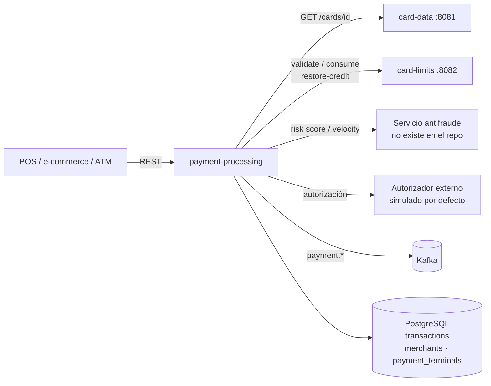
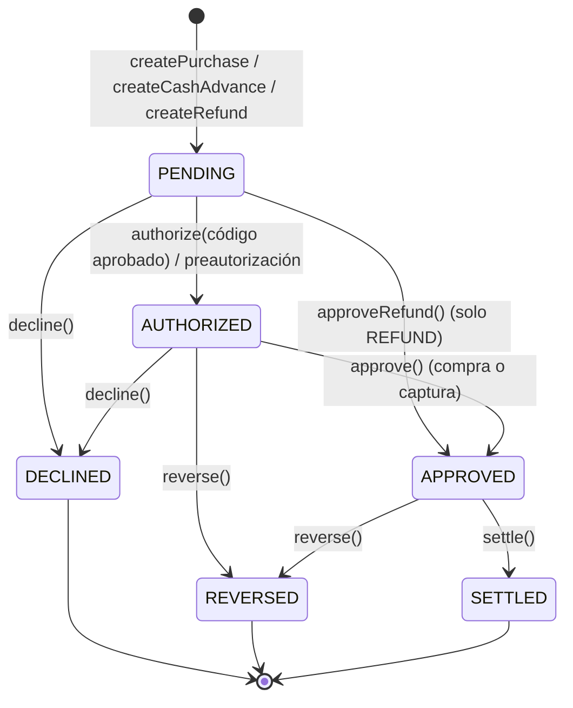
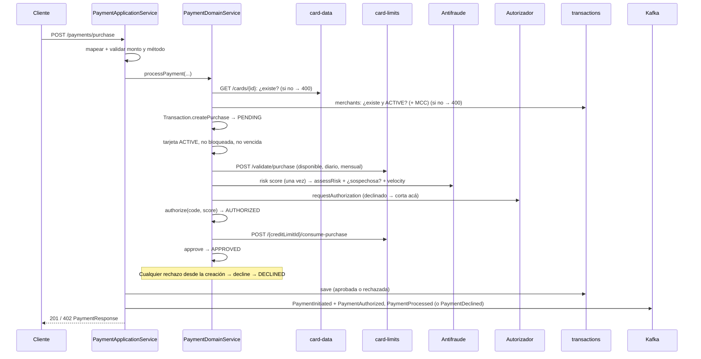

# payment-processing — Documentación técnica funcional

> Microservicio dueño del **Aggregate Root `Transaction`**: procesa compras y adelantos con validación de tarjeta y comercio, control de fondos, chequeo de fraude y autorización; gestiona reversos, devoluciones y liquidación, y publica eventos de pago en Kafka.

| Atributo | Valor |
|---|---|
| Artefacto Maven | `com.unisono.card:payment-processing` (`1.0.0-SNAPSHOT`) |
| Clase principal | `com.unisono.card.payment.PaymentApplication` |
| Puerto | `8080` por defecto (`SERVER_PORT`); `8085` en docker-compose |
| Base paths REST | `/api/v1/payments`, `/api/v1/refunds`, `/api/v1/reversals`, `/api/v1/settlements`, `/api/v1/transactions` |
| Base de datos | PostgreSQL — tablas `transactions`, `transaction_items`, `transaction_receipts`; lee `merchants` y `payment_terminals` |
| Mensajería | Kafka (productor) — topics `payment.*` |
| Dependencias internas | `card-shared` (`Money`, `CardId`, `ExpirationDate`, …), `card-events` (`DomainEvent`) |
| Integraciones REST | card-data, card-limits, servicio antifraude y autorizador (ver §7) |
| Perfiles | `payment` (docker-compose), `dev`, `prod` |
| Swagger UI | `/swagger-ui.html` |

> **Estado actual:** compras, adelantos, reversos, devoluciones y liquidación funcionan de punta a punta contra card-data y card-limits. El antifraude y el autorizador siguen siendo locales o simulados. Ver §10 para las limitaciones.

---

## 1. Responsabilidad dentro del sistema

`payment-processing` es el punto de entrada de las **operaciones con la tarjeta**. Orquesta las validaciones contra los otros servicios y lleva el registro de cada transacción.



---

## 2. Arquitectura

Hexagonal:

```
com.unisono.card.payment
├── domain
│   ├── model        Transaction (aggregate root), TransactionId, TransactionAmount,
│   │                CardData, MerchantInfo, AuthorizationCode,
│   │                TransactionStatus, TransactionType, PaymentMethod
│   ├── event        PaymentInitiated, PaymentAuthorized, PaymentProcessed, PaymentDeclined,
│   │                PaymentReversed, RefundInitiated, RefundProcessed, TransactionSettled,
│   │                TransactionCompleted, FraudDetected
│   ├── exception    PaymentException y subclases (§5.4)
│   ├── port.input   ProcessPayment, ProcessRefund, ReverseTransaction,
│   │                SettleTransactions, QueryTransaction
│   ├── port.output  CardValidationPort, CreditLimitPort, MerchantValidationPort,
│   │                FraudCheckPort, AuthorizationPort, PaymentEventPublisher,
│   │                TransactionRepository
│   └── service      PaymentDomainService (orquestación), TransactionValidationService
├── application
│   ├── dto          Commands (requests) y Responses
│   ├── mapper       MapStruct: Payment, Refund, Transaction, Settlement, Error
│   └── service      PaymentApplicationService, RefundApplicationService,
│                    TransactionReversalService, SettlementService, TransactionQueryService
└── infrastructure
    ├── adapter.input.rest   Payment, Refund, Reversal, Settlement, Transaction controllers;
    │                        GlobalExceptionHandler
    ├── adapter.output       authorization, card, creditlimit, fraud (REST);
    │                        merchant (JPA de solo lectura); event (Kafka); persistence (JPA)
    └── config               DatabaseConfig (DataSource + EMF + TxManager propios),
                             KafkaPaymentConfig, RestTemplateConfig, BeanConfig, OpenApiConfig
```

| Caso de uso | Implementación | Endpoints |
|---|---|---|
| `ProcessPaymentUseCase` | `PaymentApplicationService` | `POST /payments/purchase`, `/payments/cash-advance`, `/payments/pre-authorize`, `/payments/{id}/capture` |
| `ProcessRefundUseCase` | `RefundApplicationService` | `POST /refunds/full`, `/refunds/partial` |
| `ReverseTransactionUseCase` | `TransactionReversalService` | `POST /reversals`, `/reversals/{id}/auto` |
| `SettleTransactionsUseCase` | `SettlementService` | `POST /settlements/transaction/{id}`, `/settlements/batch`, `/settlements/all-pending` |
| `QueryTransactionUseCase` | `TransactionQueryService` | `GET /transactions/...` |

---

## 3. Modelo de dominio

### 3.1 `Transaction` (Aggregate Root)

| Campo | Tipo | Descripción |
|---|---|---|
| `transactionId` | `TransactionId` (UUID) | Generado al crear |
| `cardId` | `CardId` | Tarjeta (UUID de card-data) |
| `cardData` | `CardData` | Token del PAN, últimos 4, titular, vencimiento |
| `merchantInfo` | `MerchantInfo` | Id, nombre, MCC, ciudad, país |
| `type` | `TransactionType` | `PURCHASE`, `REFUND`, … |
| `amount` | `TransactionAmount` | Monto y, opcionalmente, monto local con tipo de cambio |
| `paymentMethod` | `PaymentMethod` | `CHIP`, `CONTACTLESS`, … |
| `status` | `TransactionStatus` | Estado (inicia en `PENDING`) |
| `authorizationCode` | `AuthorizationCode` | Código, fecha y response code ISO 8583. En un rechazo guarda el código declinado (`DECLINED-…`) con el response code del motivo |
| `riskScore` | `Integer` | 0–100 |
| `declineReason` | `String` | Motivo de rechazo o de reverso |
| `originalTransactionId` | `TransactionId` | Solo en `REFUND`: la transacción devuelta |
| `terminalId`, `posEntryMode` | `String` | Datos del terminal |
| `transactionDate`, `settlementDate` | `LocalDateTime` | |
| `version` | `int` | Bloqueo optimista |
| `domainEvents` | `List<DomainEvent>` | Eventos pendientes de publicar |

### 3.2 Estados y transiciones

| Estado | Descripción | ¿Final? | ¿Se puede reversar? | ¿Se puede liquidar? |
|---|---|---|---|---|
| `PENDING` | Pendiente | No | No | No |
| `AUTHORIZED` | Autorizada | No | Sí | No |
| `APPROVED` | Aprobada | **Sí** | Sí | Sí |
| `DECLINED` | Rechazada | Sí | No | No |
| `REVERSED` | Reversada | Sí | No | No |
| `SETTLED` | Liquidada | Sí | No | No |
| `FAILED` | Fallida | Sí | No | No |



| Método | Precondición | Evento emitido |
|---|---|---|
| `createPurchase(...)` | — | `PaymentInitiated` |
| `createCashAdvance(...)` | — | `PaymentInitiated` (tipo `CASH_ADVANCE`) |
| `createRefund(...)` | — | `RefundInitiated` |
| `authorize(code, risk)` | No final y código aprobado (`"00"`) | `PaymentAuthorized` |
| `assessRisk(score)` | No final. Guarda el score evaluado por el antifraude, también si después se rechaza | — |
| `approve()` | Estado `AUTHORIZED` | `PaymentProcessed` |
| `approveRefund(originalId)` | Tipo `REFUND` y estado `PENDING` (las devoluciones no pasan por el autorizador) | `RefundProcessed` |
| `decline(reason, declinedCode)` | No final y código declinado (≠ `"00"`) | `PaymentDeclined` |
| `reverse(reason)` | `AUTHORIZED` o `APPROVED`; solo débitos (`PURCHASE`, `CASH_ADVANCE`), validado en `TransactionValidationService` | `PaymentReversed` |
| `settle()` | `APPROVED` | `TransactionSettled` |
| `complete()` | No final | `TransactionCompleted` |

### 3.3 Value Objects y enums

| Tipo | Reglas / valores |
|---|---|
| `TransactionAmount` | Monto > 0. Con conversión: `localAmount` + `exchangeRate` > 0. `getEffectiveAmount()` devuelve el local si hay conversión. |
| `CardData` | Token obligatorio, últimos 4 = 4 dígitos, vencimiento obligatorio. `getMaskedCardNumber()` → `************1234`. |
| `MerchantInfo` | Id y nombre obligatorios; MCC de 4 dígitos y país ISO-3166 alpha-2 si se informan. |
| `AuthorizationCode` | `approved(code)` → response `00`; `declined(rc)` → `DECLINED-xxxxxx`. |
| `PaymentMethod` | `CHIP`, `CONTACTLESS`, `MOBILE_WALLET` (seguros); `SWIPE`, `ONLINE`, `MANUAL`. `ONLINE` y `MANUAL` requieren CVV; `ONLINE` es tarjeta no presente. |
| `CardVerification` | PIN y CVV que ingresa el titular. Se verifican contra card-data y nunca se guardan. |
| `TransactionType` | `PURCHASE` (P), `REFUND` (R), `REVERSAL` (V), `CASH_ADVANCE` (A), `PRE_AUTHORIZATION` (PA), `CAPTURE` (C). |

### 3.4 Reglas de validación (`TransactionValidationService`)

- Monto entre **0,01** y **50.000,00** (monto efectivo).
- Un adelanto no puede ser `ONLINE`.
- Una devolución no puede superar el monto original.
- Solo se reversan transacciones `AUTHORIZED` o `APPROVED`.

---

## 4. Flujos funcionales

### 4.1 Compra (`PaymentDomainService.processPayment`)



Puntos clave:

- **Errores del request** (no se registran): tarjeta inexistente, comercio inexistente o no `ACTIVE`, MCC inválido, terminal desconocida, monto o método inválidos. Cortan con una excepción antes de crear la transacción (400). No se puede guardar una transacción así porque `card_id` y `merchant_id` son FK.
- **Rechazos** (se registran): desde que se crea la transacción, cualquier rechazo la pasa a **`DECLINED`** con `decline(reason, declinedCode)`. Se guarda, se publica `PaymentInitiated` + `PaymentDeclined` y el controller responde **402** con el `PaymentResponse` (`approved=false`, `declineReason`, `responseCode`):

| Motivo | `responseCode` |
|---|---|
| Tarjeta bloqueada o no `ACTIVE` | `62` |
| Tarjeta vencida | `54` |
| PIN incorrecto o faltante (adelanto) | `55` |
| CVV incorrecto o faltante (`ONLINE`/`MANUAL`) | `N7` |
| Fondos o límites insuficientes (validación o consumo en card-limits) | `51` |
| Fraude (score o velocity) | `59` |
| Autorizador declina | El código que devuelve (p. ej. `61`, `96`) |

- Si el consumo de crédito falla después de autorizar (el disponible cambió entre la validación y el consumo), se anula la autorización (`voidAuthorization`, best effort) y la transacción se declina con `51`.
- La compra se autoriza y aprueba en un solo paso: termina en `APPROVED`, lista para liquidar. Para separar la autorización de la captura está la preautorización (§4.6).
- El score de fraude se calcula **una sola vez** (una llamada al servicio externo). Ese valor es el que se evalúa (`isSuspicious(tx, score)`) y el que queda guardado, también en un rechazo.
- **CVV:** en `ONLINE` y `MANUAL` es obligatorio y se verifica contra card-data (`POST /cards/{id}/validate-cvv`) después del estado de la tarjeta. Si se envía en otro método, también se verifica. Incorrecto o faltante → `DECLINED` `N7`.
- El crédito se **consume** en card-limits al aprobar (baja el disponible y los acumulados diario y mensual), después de que el autorizador aprobó. Una transacción rechazada nunca lo consume. Un reverso o una devolución lo **restauran** con `restore-credit` (disponible y, si la original es del día o del mes en curso, el cupo diario y mensual). Liquidar no lo toca.
- Si card-data o card-limits no responden, el pago no se procesa: **503** `SERVICE_UNAVAILABLE`.
- Los eventos se publican **dentro de la transacción de base**, antes del commit.

### 4.2 Adelanto en efectivo

`processCashAdvance` busca el `terminalId` en `payment_terminals`: la terminal tiene que existir y estar `ACTIVE`, y su `merchant_id` (el operador del cajero) es el comercio de la transacción. Si no, responde **400** `MERCHANT_VALIDATION_FAILED` (`TERMINAL`).

Después sigue el mismo flujo que la compra, con `merchantName = "ATM Cash Advance"` y `paymentMethod = CHIP`. Las diferencias:

- La transacción es **`CASH_ADVANCE`**, se valida con `POST /validate/cash-advance` y consume con `consume-cash-advance`, es decir, contra el tope de adelantos.
- **Se verifica el PIN** contra card-data (`POST /cards/{id}/validate-pin`), después del estado de la tarjeta y antes de validar el crédito. Un PIN incorrecto declina la transacción con `55`. card-data cuenta el intento fallido: al tercero consecutivo bloquea la tarjeta, y los adelantos siguientes se declinan con `62`.

### 4.3 Reverso

1. Carga la transacción **con lock** (`SELECT … FOR UPDATE`, se serializa con las devoluciones) → valida que sea un débito (`PURCHASE`/`CASH_ADVANCE`) en `AUTHORIZED`/`APPROVED`. Una devolución no se puede reversar (400).
2. Si la transacción ya tiene devoluciones, no se reversa (400): el reverso devolvería el monto completo otra vez. Lo que falta se devuelve con una devolución.
3. Ejecuta `reverse(reason)` → `REVERSED`. Si estaba `AUTHORIZED` (preautorización), anula la autorización.
4. Llama a card-limits `restore-credit` por el monto y con la fecha de la transacción → guarda → publica `PaymentReversed`.

`/auto` hace lo mismo con el motivo fijo `"Automatic reversal due to timeout or system error"`.

### 4.4 Devolución (total y parcial)

1. Carga la transacción original **con lock** (`SELECT … FOR UPDATE`). Así, dos devoluciones simultáneas de la misma transacción se serializan y la segunda ve la primera.
2. Valida la original: tiene que ser un débito (`PURCHASE`/`CASH_ADVANCE`) en `APPROVED` o `SETTLED`, y de la misma tarjeta que el request.
3. Busca las devoluciones previas (`original_transaction_id`) y calcula **lo que falta devolver** = original − devoluciones `APPROVED`/`SETTLED`:
   - Si no falta nada → 400 `Transaction is already fully refunded`.
   - **Total:** el monto tiene que ser exactamente lo que falta. Sin devoluciones previas es el original; después de una parcial, es el resto.
   - **Parcial:** menor o igual a lo que falta.
4. Valida la tarjeta.
5. Crea una transacción `REFUND` **vinculada a la original** (`originalTransactionId`) y la aprueba con `approveRefund()` (`PENDING → APPROVED`, sin autorizador).
6. Llama a card-limits `restore-credit` con la fecha de la original → guarda → publica `RefundInitiated` y `RefundProcessed`.

La devolución queda `APPROVED` y se liquida como cualquier otra transacción. `RefundResponse` y `TransactionResponse` informan `originalTransactionId`.

### 4.5 Liquidación

- **Individual:** la transacción debe estar `APPROVED` y sin `settlementDate`. Ejecuta `settle()` → `SETTLED` → guarda → `TransactionSettled`. No llama a card-limits: el crédito ya se consumió al aprobar.
- **Batch:** liquida cada id. Los que fallan (estado inválido o inexistentes) se loguean y se devuelven en `failedTransactionIds`; `status` es `PARTIAL` si hubo alguno y `totalTransactions` cuenta liquidadas + fallidas.
- **all-pending:** liquida todas las `APPROVED` sin `settlementDate`.

### 4.6 Preautorización y captura

Sirve para cobros cuyo importe se confirma después (hotel, alquiler, combustible).

1. **`POST /payments/pre-authorize`** (mismo body que la compra): `PaymentDomainService.preAuthorize` corre el flujo completo de la compra (validaciones, crédito, fraude, autorizador) y **consume el crédito** en card-limits, que funciona como retención. La transacción es `PURCHASE` y queda en **`AUTHORIZED`**. Responde **201** (`approved=true`, `responseMessage` "pending capture") o **402** si se rechaza, igual que la compra. Publica `PaymentInitiated` y `PaymentAuthorized`.
2. **`POST /payments/{id}/capture`**: `captureTransaction` exige `AUTHORIZED`, llama a `captureAuthorization` del autorizador y la pasa a **`APPROVED`** (`PaymentProcessed`). No vuelve a tocar el crédito. Desde ahí se liquida como cualquier compra. Si el autorizador falla, responde 503 y la transacción sigue `AUTHORIZED`. Si no está `AUTHORIZED`, responde 400.
3. **Cancelar sin capturar:** `POST /reversals` sobre la transacción `AUTHORIZED`. Anula la autorización (`voidAuthorization`, best effort), libera la retención con `restore-credit` y la deja `REVERSED`.
4. **Expiración:** `PreAuthorizationExpiryScheduler` corre cada `payment.pre-authorization.expiry.interval-ms` (15 min). Busca las `PURCHASE` en `AUTHORIZED` autorizadas hace más de `payment.pre-authorization.expiration-hours` (168 h = 7 días) y las reversa como en el paso 3, con el motivo `Pre-authorization expired…`. Cada una va en su propia transacción de base: si una falla, se loguea y se reintenta en la próxima corrida. Se desactiva con `payment.pre-authorization.expiry.enabled=false`.

La captura es siempre por el monto total preautorizado.

---

## 5. API REST

### 5.1 `POST /api/v1/payments/purchase`

```json
{
  "cardId": "550e8400-e29b-41d4-a716-446655440000",
  "cardNumberToken": "TKN-6f1c…",
  "lastFourDigits": "1234",
  "cardholderName": "JUAN PEREZ",
  "expirationDate": "12/2028",
  "amount": 1500.00,
  "currency": "ARS",
  "merchantId": "MERCH-001",
  "merchantName": "Supermercado Centro",
  "merchantCategoryCode": "5411",
  "merchantCity": "CABA",
  "merchantCountry": "AR",
  "paymentMethod": "CHIP",
  "terminalId": "POS-0001",
  "posEntryMode": "051",
  "cvv": "123"
}
```

| Campo | Validación |
|---|---|
| `cardId`, `cardNumberToken`, `merchantId`, `merchantName` | Obligatorios |
| `lastFourDigits` | 4 dígitos |
| `expirationDate` | `MM/YYYY` (año 20xx) |
| `amount` | 0,01 – 50.000,00 |
| `currency` | 3 caracteres |
| `localAmount`, `localCurrency`, `exchangeRate` | Opcionales (conversión de moneda) |
| `merchantCategoryCode` | 4 dígitos (opcional) |
| `merchantCountry` | ISO alpha-2 (opcional) |
| `paymentMethod` | Obligatorio (enum) |
| `cvv` | 3–4 dígitos. Obligatorio en `ONLINE`/`MANUAL`; se verifica contra card-data y no se guarda |

Respuesta **201** `PaymentResponse`:

```json
{
  "transactionId": "…", "cardId": "…", "transactionType": "PURCHASE", "status": "APPROVED",
  "amount": 1500.00, "currency": "ARS", "authorizationCode": "AUTH-3F9A1C", "responseCode": "00",
  "responseMessage": "Transaction approved successfully", "riskScore": 10,
  "merchantId": "MERCH-001", "merchantName": "Supermercado Centro",
  "transactionDate": "2026-11-02T10:15:30", "authorizedAt": "2026-11-02T10:15:30",
  "approved": true, "declineReason": null, "receiptNumber": null
}
```

Respuesta **402** `PaymentResponse` cuando se rechaza (la transacción queda guardada como `DECLINED`):

```json
{
  "transactionId": "…", "transactionType": "PURCHASE", "status": "DECLINED",
  "amount": 1500.00, "currency": "ARS", "authorizationCode": null, "responseCode": "51",
  "responseMessage": "Transaction declined: Insufficient funds on card …",
  "approved": false, "declineReason": "Insufficient funds on card …", "authorizedAt": null
}
```

`authorizationCode` y `authorizedAt` solo se informan si la transacción se autorizó.

### 5.2 `POST /api/v1/payments/cash-advance`

Campos: `cardId`, `cardNumberToken`, `lastFourDigits`, `expirationDate`, `amount` (0,01 – **5.000,00**), `currency`, `terminalId` (obligatorio), `atmLocation`, `country`, `pin` (4 dígitos, obligatorio; se verifica contra card-data, ver §4.2). Respuesta **201** `PaymentResponse`, o **402** si se rechaza.

### 5.3 Otros endpoints

| Método y ruta | Body / parámetros | Respuesta |
|---|---|---|
| `POST /payments/pre-authorize` | Igual que `/payments/purchase` | 201 `PaymentResponse` (`AUTHORIZED`) / 402 |
| `POST /payments/{transactionId}/capture` | — | 200 `PaymentResponse` (`APPROVED`) |
| `POST /refunds/full` · `/refunds/partial` | `{ originalTransactionId, cardId, refundAmount, currency, merchantId, reason, isPartialRefund, initiatedBy }`. En `full`, `refundAmount` tiene que ser lo que falta devolver | 201 `RefundResponse` |
| `POST /reversals` | `{ transactionId, reason, reversalType, initiatedBy }` | 200 `TransactionResponse` |
| `POST /reversals/{transactionId}/auto` | — | 200 `TransactionResponse` |
| `POST /settlements/transaction/{transactionId}` | — | 200 `TransactionResponse` |
| `POST /settlements/batch` | `{ transactionIds: [...], settlementBatchId?, initiatedBy? }` | 200 `SettlementResponse` |
| `POST /settlements/all-pending` | — | 200 `SettlementResponse` |
| `GET /transactions/{transactionId}` | — | 200 `TransactionResponse` / 404 |
| `GET /transactions/card/{cardId}` | — | 200 `TransactionResponse[]` |
| `GET /transactions/card/{cardId}/status/{status}` | — | 200 `TransactionResponse[]` |
| `GET /transactions/card/{cardId}/range?fromDate=&toDate=` | ISO date-time | 200 `TransactionResponse[]` |
| `GET /transactions/card/{cardId}/summary?fromDate=&toDate=` | opcionales | 200 `TransactionSummaryResponse` |
| `GET /transactions/pending-settlement` | — | 200 `TransactionResponse[]` |

- **`TransactionResponse`:** todos los datos de la transacción (montos y conversión, tarjeta enmascarada, autorización, comercio, terminal, fechas, motivos, `version`). Omite los `null`.
- **`TransactionSummaryResponse`:** totales por estado (aprobadas incluye `SETTLED`; pendientes incluye `AUTHORIZED`), montos total, aprobado y rechazado, promedio, máximo y mínimo.
- **`SettlementResponse`:** `settlementBatchId`, totales, ids liquidados y fallidos, `status` (`COMPLETED`/`PARTIAL`) y mensaje.

### 5.4 Errores (`GlobalExceptionHandler`)

```json
{
  "errorCode": "INSUFFICIENT_FUNDS",
  "message": "Insufficient funds on card …",
  "details": "Requested: …, Available: …, Shortfall: …",
  "timestamp": "2026-11-02T10:15:30",
  "path": "uri=/api/v1/payments/purchase",
  "validationErrors": null
}
```

| Excepción | HTTP | `errorCode` |
|---|---|---|
| `MethodArgumentNotValidException` | 400 | `VALIDATION_ERROR` (+ `validationErrors[]` con campo, mensaje y valor rechazado) |
| `TransactionNotFoundException` | 404 | `TRANSACTION_NOT_FOUND` |
| `InvalidTransactionException` | 400 | `INVALID_TRANSACTION` |
| `TransactionAlreadyProcessedException` | 409 | `TRANSACTION_ALREADY_PROCESSED` |
| `InsufficientFundsException` | 402 | `INSUFFICIENT_FUNDS` |
| `CardValidationException` | 400 | `CARD_VALIDATION_FAILED` (en compras y adelantos, solo tarjeta inexistente; en devoluciones, también bloqueada, no `ACTIVE` o vencida) |
| `AuthorizationFailedException` | 402 | `AUTHORIZATION_FAILED` |
| `FraudDetectedException` | 403 | `FRAUD_DETECTED` |
| `MerchantValidationException` | 400 | `MERCHANT_VALIDATION_FAILED` (comercio inexistente o no `ACTIVE`, terminal desconocida, MCC inválido) |
| `ExternalServiceException` | 503 | `SERVICE_UNAVAILABLE` (card-data o card-limits no responden o responden 5xx) |
| `ValidationException` de `card-shared` (incluye `InvalidValueObjectException`, p. ej. `expirationDate` mal formado o moneda inválida) | 400 | `INVALID_VALUE` |
| `BusinessRuleException` de `card-shared` (p. ej. monedas distintas en `Money`) | 422 | `BUSINESS_RULE_VIOLATION` |
| Otra `PaymentException` | 500 | `PAYMENT_ERROR` |
| Cualquier otra | 500 | `INTERNAL_ERROR` |

En compras y adelantos, `InsufficientFundsException`, `FraudDetectedException`, `AuthorizationFailedException` y los `CardValidationException` de una tarjeta existente no llegan al handler: el dominio los convierte en un rechazo registrado (402 `PaymentResponse`, ver §4.1).

---

## 6. Antifraude y autorización

### 6.1 Antifraude (`FraudCheckAdapter`)

- Pide el score a `POST {fraud-detection}/api/v1/fraud/risk-score`. Si falla, calcula un **score básico local**:

| Factor | Puntos |
|---|---|
| Monto ≥ 10.000 / ≥ 5.000 / ≥ 1.000 | +30 / +20 / +10 |
| Método `ONLINE` / `MANUAL` | +20 / +15 |
| País del comercio ≠ `AR` | +15 |
| Con conversión de moneda | +10 |
| Tope | 100 |

- El dominio pide el score una sola vez y se lo pasa a `isSuspicious(transaction, score)`, que no lo recalcula.
- **Sospechosa** si `score ≥ fraud.risk-threshold.high` (70; 90 en `dev`) **o** si el monto ≥ `fraud.amount.suspicious-threshold` (5.000) **y** es `ONLINE` **y** `score ≥ medium` (40).
- **Velocity:** `GET {fraud-detection}/api/v1/fraud/velocity-check/{cardId}`. Si falla, no bloquea.
- También hay chequeos de geolocalización, de anomalía de monto y reporte de fraude, pero el flujo no los usa.

### 6.2 Autorización (`AuthorizationAdapter`)

- Con `authorization.simulate=true` (**default**, y en `dev`): espera 100 ms y aprueba con `AUTH-XXXXXX`. Declina con código `61` los montos **mayores** a `authorization.simulate-decline-above`. El default es 50.000,00, el máximo que admite un pago, así que todo monto válido se aprueba. Para probar rechazos del autorizador hay que bajarlo.
- Con `simulate=false` (`prod`): `POST {authorization}/api/v1/authorization/request` con el PAN enmascarado. Ante un error devuelve declinado `96`.
- Un código declinado no lanza excepción: el dominio declina la transacción con ese response code (402, ver §4.1), sin tocar el crédito.
- También implementa `capture` y `void`. `capture` se usa al capturar una preautorización. `void` se usa al reversar una preautorización sin capturar y cuando el consumo de crédito falla después de autorizar.

---

## 7. Integraciones salientes

| Puerto | Destino | Llamadas | URL por defecto (`services.*`) |
|---|---|---|---|
| `CardValidationPort` | card-data | `GET /api/v1/cards/{cardId}` → `status`, `isBlocked`, `isExpired`; `POST /api/v1/cards/{cardId}/validate-pin` → `valid` (adelantos); `POST …/validate-cvv` → `valid` (`ONLINE`/`MANUAL`) | `CARD_DATA_SERVICE_URL` = `http://localhost:8081` |
| `CreditLimitPort` | card-limits | `POST /api/v1/credit-limits/validate/purchase` · `…/validate/cash-advance`; `GET …/card/{cardId}` (resuelve el `creditLimitId`); `POST …/{creditLimitId}/consume-purchase` · `…/consume-cash-advance` · `…/restore-credit` (reversos y devoluciones) | `CARD_LIMITS_SERVICE_URL` = `http://localhost:8082` |
| `MerchantValidationPort` | Base compartida | `merchants` (existe y `status = 'ACTIVE'`) y `payment_terminals` (terminal `ACTIVE` → `merchant_id`), por JPA de solo lectura | — |
| `FraudCheckPort` | Servicio antifraude | `/api/v1/fraud/*` | `FRAUD_DETECTION_SERVICE_URL` = `http://localhost:8081` (no existe: `8081` es card-data) |
| `AuthorizationPort` | Autorizador | `/api/v1/authorization/*` | `AUTHORIZATION_SERVICE_URL` = `http://localhost:8082` (no existe: `8082` es card-limits); simulado por defecto |

No hay un servicio de comercios: `merchants` y `payment_terminals` (V4) se cargan directamente en la base. `MerchantEntity` y `PaymentTerminalEntity` son `@Immutable` y solo mapean las columnas que se leen.

`RestTemplate`: timeouts de 5 s (conexión) y 10 s (lectura), con un interceptor que loguea URI y status.

**Política ante fallos:**

| Chequeo | Respuesta del destino | Efecto |
|---|---|---|
| Tarjeta | 404 | 400 `CARD_VALIDATION_FAILED` (`EXISTENCE`), sin registrar |
| Tarjeta | Error de red o 5xx | 503 `SERVICE_UNAVAILABLE` |
| PIN | `valid=false` | `DECLINED` `55` (402) |
| PIN | 422 (tarjeta bloqueada) | `DECLINED` `62` (402) |
| PIN | Error de red o 5xx | 503 `SERVICE_UNAVAILABLE` |
| CVV | `valid=false` | `DECLINED` `N7` (402) |
| CVV | 422 (tarjeta bloqueada) | `DECLINED` `62` (402) |
| CVV | Error de red o 5xx | 503 `SERVICE_UNAVAILABLE` |
| Validación de crédito | `approved=false` | `DECLINED` `51` (402) con el motivo |
| Validación de crédito | 404 (sin límite asignado) | `DECLINED` `51` (402) (`Card has no credit limit`) |
| Consumo de crédito | 400 / 422 (el disponible cambió entre la validación y el consumo) | Se anula la autorización y `DECLINED` `51` (402) |
| Crédito (cualquier llamada) | Error de red o 5xx | 503 `SERVICE_UNAVAILABLE` |
| Score de fraude | Error | Score local |
| Velocity, geolocalización, anomalía | Error | Sin anomalía, no bloquea |

---

## 8. Eventos

Ver el catálogo completo en [EVENTS.md §6](EVENTS.md). Resumen:

| Evento | Topic | Cuándo se emite |
|---|---|---|
| `PaymentInitiated` | `payment.processing.initiated` | Al crear una compra o un adelanto (también si después se rechaza) |
| `PaymentAuthorized` | `payment.processing.authorized` | `authorize()` |
| `PaymentProcessed` | `payment.processing.completed` | `approve()` (compra y devolución) |
| `PaymentDeclined` | `payment.processing.declined` | `decline()`: compra o adelanto rechazado |
| `PaymentReversed` | `payment.reversal.completed` | `reverse()` |
| `RefundInitiated` | `payment.refund.initiated` | Al crear una devolución |
| `TransactionSettled` | `payment.settlement.completed` | `settle()` |
| `TransactionCompleted` | `payment.transaction.completed` | `complete()` (sin uso) |
| `RefundProcessed`, `FraudDetected` | `payment.refund.processed`, `payment.fraud.detected` | Nunca |

**Productor:**

- `acks=all`, idempotente, 3 reintentos, `snappy`, `linger.ms=10`, sin type headers.
- Key = `eventId`.
- `KafkaPaymentConfig` declara los 10 topics con **3 particiones** (`KAFKA_TOPIC_PARTITIONS`) y **replication factor 2** (`KAFKA_TOPIC_REPLICATION_FACTOR`). En docker-compose, con un solo broker, el factor es 1: si supera la cantidad de brokers, los topics no se crean al arrancar (`InvalidReplicationFactorException`).
- El envío es asíncrono: un error del broker solo se loguea.

---

## 9. Persistencia y configuración

### 9.1 Tablas (`ddl-auto: validate`)

El esquema se crea con Flyway en el repo `card-management-database` (`migrations/V5__create_alter_table.sql`, `V6__create_table_items.sql`, `V7__create_receipt_table.sql`, `V11__refund_original_transaction.sql`). `transactions.card_id` y `merchant_id` son `VARCHAR(36)` con FK a `cards(id)` y `merchants(id)`. Las dos se cumplen porque, antes de guardar, la tarjeta se valida en card-data y el comercio en `merchants`. Un id de comercio inexistente o de más de 36 caracteres se rechaza con 400.

**`transactions`**

- **Identificación:** `transaction_id` (UUID PK), `card_id`, `merchant_id`.
- **Tipo y estado:** `transaction_type`, `transaction_status`, `payment_method`.
- **Montos:** `amount`, `currency`, `local_amount`, `local_currency`, `exchange_rate`.
- **Tarjeta:** `card_number_token`, `card_last_four`, `card_holder_name`, `expiration_date`.
- **Autorización:** `authorization_code`, `authorization_date`, `authorization_response_code`.
- **Comercio:** `merchant_category_code`, `merchant_name`, `merchant_city`, `merchant_country`.
- **Terminal y fechas:** `terminal_id`, `pos_entry_mode`, `transaction_date`, `settlement_date`.
- **Riesgo y motivos:** `risk_score`, `fraud_check_status`, `decline_reason`, `reversal_reason`.
- **Devoluciones (V11):** `original_transaction_id` (UUID, FK a `transactions`, solo para `REFUND` por `CHECK`, con índice parcial). Las devoluciones anteriores a V11 quedan en `NULL` y no cuentan para el total devuelto.
- **Auditoría:** `created_at`, `updated_at`, `created_by`, `version` (`@Version`).
- **Índices:** card, merchant, status, fecha, fecha de liquidación, código de autorización.

**Tablas asociadas:**

- **`transaction_items`:** detalle de ítems (descripción, cantidad, precio unitario, total).
- **`transaction_receipts`:** comprobantes (`receipt_number` único `RCP-…`, tipo `DIGITAL|PRINTED|EMAIL|SMS`, `receipt_data` en **jsonb** vía hypersistence-utils, estado de entrega).

**De solo lectura** (V4, las administra el módulo de comercios): `merchants` (`id`, `legal_name`, `trade_name`, `status`) y `payment_terminals` (`id`, `merchant_id`, `terminal_type`, `status`).

El dominio no usa ítems ni comprobantes. `CustomTransactionRepositoryImpl` tiene consultas de estadísticas, sospechosas, duplicados y volumen por comercio, que tampoco se exponen.

### 9.2 Configuración

| Propiedad | Default | Nota |
|---|---|---|
| `server.port` | `${SERVER_PORT:8080}` | compose: `8085` |
| `spring.datasource.url` | `jdbc:postgresql://localhost:5432/card_management` | Otra base que la del resto de los servicios (`card_management_db`); compose la sobrescribe. `dev`: `card_management_dev` |
| `spring.kafka.bootstrap-servers` | `${KAFKA_BOOTSTRAP_SERVERS:localhost:9092}` | compose: `kafka:9092` |
| `spring.flyway.*` | `enabled: true`, `classpath:db/migration` | Flyway no está en el `pom.xml` y no existe la carpeta: no tiene efecto |
| `authorization.simulate` | `true` | `prod`: `false` |
| `payment.pre-authorization.expiration-hours` | `${PRE_AUTHORIZATION_EXPIRATION_HOURS:168}` | Antigüedad a partir de la cual una preautorización sin capturar se reversa |
| `payment.pre-authorization.expiry.enabled` · `.interval-ms` · `.initial-delay-ms` | `true` · `900000` · `60000` | Job de expiración |
| `authorization.simulate-decline-above` | `${SIMULATE_AUTHORIZATION_DECLINE_ABOVE:50000.00}` | El simulador declina (`61`) los montos mayores a este valor |
| `fraud.*` | umbrales 70/40/20, velocity 10/h y 50/día, monto 5.000 | `velocity.*` no se usa |
| `management.endpoint.health.show-details` | `when-authorized` | |

`DatabaseConfig` define `paymentDataSource` (Hikari, pool de 20, `autoCommit=false`), `paymentEntityManagerFactory` y `paymentTransactionManager` propios.

### 9.3 Docker

`services/payment-processing/Dockerfile` (multi-stage) y servicio `payment-processing-service` en compose: perfil `payment`, puerto `8085`, `KAFKA_BOOTSTRAP_SERVERS=kafka:9092`, `depends_on: kafka`, `CARD_DATA_SERVICE_URL=http://card-data-service:8081` y `CARD_LIMITS_SERVICE_URL=http://card-limits-service:8082`. Las URLs de antifraude y autorizador quedan en sus defaults de `localhost`.

---

## 10. Limitaciones conocidas y deuda técnica

### 10.1 Reglas de negocio

1. **Sin saldo a favor:** si la tarjeta ya pagó el consumo, `restore-credit` baja lo consumido hasta cero y el excedente de la devolución no se acredita en ningún lado. card-limits solo lo loguea.
2. **Sin captura parcial:** la captura de una preautorización es siempre por el monto total. Para cobrar menos hay que reversarla y hacer una compra nueva.
3. **El CVV no cuenta intentos:** a diferencia del PIN, un CVV incorrecto no suma intentos fallidos en card-data ni bloquea la tarjeta.

### 10.2 Técnicas

4. **Consumo de crédito sin compensación:** card-limits se llama antes de `save()`. Si después falla el guardado o la publicación de eventos, el crédito queda consumido sin transacción que lo respalde. Lo mismo pasa con `restore-credit` en reversos y devoluciones. No hay saga ni reintento.
5. **Eventos antes del commit:** se publican dentro de `@Transactional`. Si el commit falla, ya salieron eventos de una transacción inexistente. No hay outbox.
6. **Key Kafka = `eventId`:** no hay orden por transacción ni por tarjeta. Nadie consume estos topics.
7. **URLs por defecto cruzadas:** antifraude y autorizador apuntan a `localhost:8081` y `8082`, que son card-data y card-limits. Ninguno de esos servicios existe en el repo.
8. **Base de datos distinta por defecto** (`card_management` vs `card_management_db`).
9. **Configuración sin efecto:** Flyway, `fraud.velocity.*`, `spring.application.name: card-management-service` (nombre del proyecto padre, no del servicio).
10. **Código sin uso:** `QueryTransactionRequest`, ítems y comprobantes, `CustomTransactionRepository`, la mayoría de las consultas de `JpaTransactionRepository`, `findRequiringReversal`, `complete()`, `FraudDetected`, y `PaymentResponse.receiptNumber` (siempre `null`).
11. **Reconstrucción por reflexión:** `TransactionEntityMapper.toDomain` usa el constructor privado y `setField` por nombre. Es frágil ante renombres.
12. **Moneda por defecto `USD`** en resúmenes y liquidaciones vacías, mientras el resto del sistema solo opera en ARS ([LIMITS.md §9.1](LIMITS.md)).
13. **Seguridad:** el token del PAN lo provee el cliente (no hay servicio de tokenización) y el PIN viaja en claro en el request.
14. **Tests incompletos:** hay tests unitarios de `PaymentDomainService`, `Transaction` (devoluciones), `SettlementService`, de los adapters de card-data, card-limits y comercios, y del `GlobalExceptionHandler`. También de `TransactionReversalService` y `PreAuthorizationExpiryService`. Faltan los de controllers, persistencia (incluido el mapper por reflexión, el lock y las consultas nuevas) y `RefundApplicationService`.
