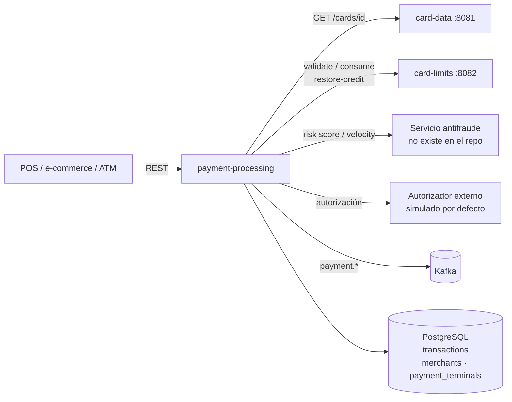
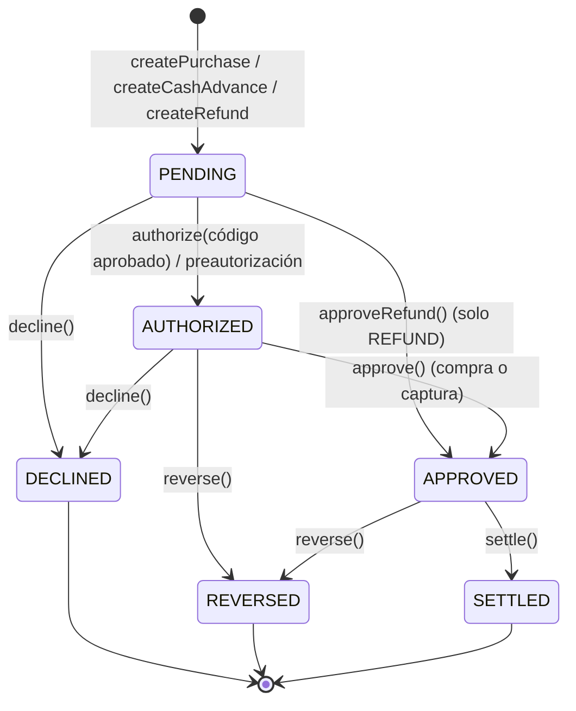
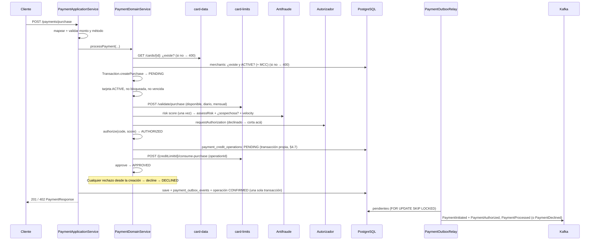

# payment-processing — Documentación técnica funcional

> Microservicio dueño del **Aggregate Root `Transaction`**: procesa compras y adelantos con validación de tarjeta y comercio, control de fondos, chequeo de fraude y autorización; gestiona reversos, devoluciones y liquidación, y publica eventos de pago en Kafka.

| Atributo | Valor |
|---|---|
| Artefacto Maven | `com.unisono.card:payment-processing` (`1.0.0-SNAPSHOT`) |
| Clase principal | `com.unisono.card.payment.PaymentApplication` |
| Puerto | `8085` (`SERVER_PORT`), el mismo que en docker-compose |
| Base paths REST | `/api/v1/payments`, `/api/v1/refunds`, `/api/v1/reversals`, `/api/v1/settlements`, `/api/v1/transactions` |
| Base de datos | PostgreSQL — tablas `transactions`, `payment_outbox_events`, `payment_credit_operations`; lee `merchants` y `payment_terminals` |
| Mensajería | Kafka (productor, vía outbox) — topics `payment.*` |
| Dependencias internas | `card-shared` (`Money`, `CardId`, `ExpirationDate`, …), `card-events` (`DomainEvent`) |
| Integraciones REST | card-data, card-limits, servicio antifraude y autorizador (ver §7) |
| Perfiles | Ninguno por defecto (docker-compose tampoco usa); opcionales `dev` y `prod` |
| Swagger UI | `/swagger-ui.html` |

> **Estado actual:** compras, adelantos, reversos, devoluciones y liquidación funcionan de punta a punta contra card-data y card-limits. El antifraude y el autorizador siguen siendo locales o simulados. Ver §10 para las limitaciones.

---

## 1. Responsabilidad dentro del sistema

`payment-processing` es el punto de entrada de las **operaciones con la tarjeta**. Orquesta las validaciones contra los otros servicios y lleva el registro de cada transacción.



---

## 2. Arquitectura

Hexagonal:

```
com.unisono.card.payment
├── domain
│   ├── model        Transaction (aggregate root), TransactionId, TransactionAmount,
│   │                CardData, MerchantInfo, AuthorizationCode,
│   │                TransactionStatus, TransactionType, PaymentMethod
│   ├── event        PaymentInitiated, PaymentAuthorized, PaymentProcessed, PaymentDeclined,
│   │                PaymentReversed, RefundInitiated, RefundProcessed, TransactionSettled
│   ├── exception    PaymentException y subclases (§5.4)
│   ├── port.input   ProcessPayment, ProcessRefund, ReverseTransaction,
│   │                SettleTransactions, QueryTransaction
│   ├── port.output  CardValidationPort, CreditLimitPort, MerchantValidationPort,
│   │                FraudCheckPort, AuthorizationPort, PaymentEventPublisher,
│   │                TransactionRepository
│   └── service      PaymentDomainService (orquestación), TransactionValidationService
├── application
│   ├── dto          Commands (requests) y Responses
│   ├── mapper       MapStruct: Payment, Refund, Transaction, Settlement, Error
│   └── service      PaymentApplicationService, RefundApplicationService,
│                    TransactionReversalService, SettlementService, TransactionQueryService
└── infrastructure
    ├── adapter.input.rest   Payment, Refund, Reversal, Settlement, Transaction controllers;
    │                        GlobalExceptionHandler
    ├── adapter.output       authorization, card, fraud (REST);
    │                        creditlimit: CreditLimitAdapter (REST) + saga (SagaCreditLimitPort,
    │                        CreditOperationJournal, CreditOperationCompensator, CreditOperationReconciler);
    │                        merchant (JPA de solo lectura);
    │                        event: outbox (OutboxPaymentEventPublisher, PaymentOutboxRelay, PaymentOutboxCleaner);
    │                        persistence (JPA)
    ├── observability        ConsistencyMonitor (métricas de la saga y del outbox), ConsistencyHealthIndicator
    └── config               DatabaseConfig (DataSource + EMF + TxManager propios),
                             KafkaPaymentConfig, RestTemplateConfig, BeanConfig, OpenApiConfig, SchedulingConfig
```

| Caso de uso | Implementación | Endpoints |
|---|---|---|
| `ProcessPaymentUseCase` | `PaymentApplicationService` | `POST /payments/purchase`, `/payments/cash-advance`, `/payments/pre-authorize`, `/payments/{id}/capture` |
| `ProcessRefundUseCase` | `RefundApplicationService` | `POST /refunds/full`, `/refunds/partial` |
| `ReverseTransactionUseCase` | `TransactionReversalService` | `POST /reversals`, `/reversals/{id}/auto` |
| `SettleTransactionsUseCase` | `SettlementService` | `POST /settlements/transaction/{id}`, `/settlements/batch`, `/settlements/all-pending` |
| `QueryTransactionUseCase` | `TransactionQueryService` | `GET /transactions/...` |

---

## 3. Modelo de dominio

### 3.1 `Transaction` (Aggregate Root)

| Campo | Tipo | Descripción |
|---|---|---|
| `transactionId` | `TransactionId` (UUID) | Generado al crear |
| `cardId` | `CardId` | Tarjeta (UUID de card-data) |
| `cardData` | `CardData` | Token del PAN, últimos 4, titular, vencimiento |
| `merchantInfo` | `MerchantInfo` | Id, nombre, MCC, ciudad, país |
| `type` | `TransactionType` | `PURCHASE`, `REFUND`, … |
| `amount` | `TransactionAmount` | Monto y, opcionalmente, monto local con tipo de cambio |
| `paymentMethod` | `PaymentMethod` | `CHIP`, `CONTACTLESS`, … |
| `status` | `TransactionStatus` | Estado (inicia en `PENDING`) |
| `authorizationCode` | `AuthorizationCode` | Código, fecha y response code ISO 8583. En un rechazo guarda el código declinado (`DECLINED-…`) con el response code del motivo |
| `riskScore` | `Integer` | 0–100 |
| `declineReason` | `String` | Motivo de rechazo o de reverso |
| `originalTransactionId` | `TransactionId` | Solo en `REFUND`: la transacción devuelta |
| `terminalId`, `posEntryMode` | `String` | Datos del terminal |
| `transactionDate`, `settlementDate` | `LocalDateTime` | |
| `version` | `int` | Bloqueo optimista |
| `domainEvents` | `List<DomainEvent>` | Eventos pendientes de publicar |

### 3.2 Estados y transiciones

| Estado | Descripción | ¿Final? | ¿Se puede reversar? | ¿Se puede liquidar? |
|---|---|---|---|---|
| `PENDING` | Pendiente | No | No | No |
| `AUTHORIZED` | Autorizada | No | Sí | No |
| `APPROVED` | Aprobada | **Sí** | Sí | Sí |
| `DECLINED` | Rechazada | Sí | No | No |
| `REVERSED` | Reversada | Sí | No | No |
| `SETTLED` | Liquidada | Sí | No | No |
| `FAILED` | Fallida | Sí | No | No |



| Método | Precondición | Evento emitido |
|---|---|---|
| `createPurchase(...)` | — | `PaymentInitiated` |
| `createCashAdvance(...)` | — | `PaymentInitiated` (tipo `CASH_ADVANCE`) |
| `createRefund(...)` | — | `RefundInitiated` |
| `reconstitute(PersistedState)` | Estado completo (ids, tarjeta, comercio, tipo, monto, método, estado, fecha) | Ninguno: reconstruye una transacción guardada (lo usa `TransactionEntityMapper`, sin reflexión) |
| `authorize(code, risk)` | No final y código aprobado (`"00"`) | `PaymentAuthorized` |
| `assessRisk(score)` | No final. Guarda el score evaluado por el antifraude, también si después se rechaza | — |
| `approve()` | Estado `AUTHORIZED` | `PaymentProcessed` |
| `approveRefund(originalId)` | Tipo `REFUND` y estado `PENDING` (las devoluciones no pasan por el autorizador) | `RefundProcessed` |
| `decline(reason, declinedCode)` | No final y código declinado (≠ `"00"`) | `PaymentDeclined` |
| `reverse(reason)` | `AUTHORIZED` o `APPROVED`; solo débitos (`PURCHASE`, `CASH_ADVANCE`), validado en `TransactionValidationService` | `PaymentReversed` |
| `settle()` | `APPROVED` | `TransactionSettled` |

### 3.3 Value Objects y enums

| Tipo | Reglas / valores |
|---|---|
| `TransactionAmount` | Monto > 0. Con conversión: `localAmount` + `exchangeRate` > 0. `getEffectiveAmount()` devuelve el local si hay conversión. |
| `CardData` | Token obligatorio, últimos 4 = 4 dígitos, vencimiento obligatorio. `getMaskedCardNumber()` → `************1234`. |
| `MerchantInfo` | Id y nombre obligatorios; MCC de 4 dígitos y país ISO-3166 alpha-2 si se informan. |
| `AuthorizationCode` | `approved(code)` → response `00`; `declined(rc)` → `DECLINED-xxxxxx`. |
| `PaymentMethod` | `CHIP`, `CONTACTLESS`, `MOBILE_WALLET` (seguros); `SWIPE`, `ONLINE`, `MANUAL`. `ONLINE` y `MANUAL` requieren CVV; `ONLINE` es tarjeta no presente. |
| `CardVerification` | PIN y CVV que ingresa el titular. Se verifican contra card-data y nunca se guardan. |
| `PinBlock` | PIN cifrado por el terminal: bloque ISO 9564 formato 4 (32 hex) + id de la clave. payment-processing no lo puede descifrar: lo reenvía a card-data. `toString()` no muestra el bloque. |
| `TransactionType` | `PURCHASE` (P), `REFUND` (R), `REVERSAL` (V), `CASH_ADVANCE` (A), `PRE_AUTHORIZATION` (PA), `CAPTURE` (C). |

### 3.4 Reglas de validación (`TransactionValidationService`)

- Monto entre **0,01** y **50.000,00** (monto efectivo).
- Un adelanto no puede ser `ONLINE`.
- Una devolución no puede superar el monto original.
- Solo se reversan transacciones `AUTHORIZED` o `APPROVED`.

---

## 4. Flujos funcionales

### 4.1 Compra (`PaymentDomainService.processPayment`)



Puntos clave:

- **Errores del request** (no se registran): tarjeta inexistente, comercio inexistente o no `ACTIVE`, MCC inválido, terminal desconocida, monto o método inválidos. Cortan con una excepción antes de crear la transacción (400). No se puede guardar una transacción así porque `card_id` y `merchant_id` son FK.
- **Rechazos** (se registran): desde que se crea la transacción, cualquier rechazo la pasa a **`DECLINED`** con `decline(reason, declinedCode)`. Se guarda, se publica `PaymentInitiated` + `PaymentDeclined` y el controller responde **402** con el `PaymentResponse` (`approved=false`, `declineReason`, `responseCode`):

| Motivo | `responseCode` |
|---|---|
| Tarjeta bloqueada o no `ACTIVE` | `62` |
| Tarjeta vencida | `54` |
| PIN incorrecto o faltante (adelanto) | `55` |
| CVV incorrecto o faltante (`ONLINE`/`MANUAL`) | `N7` |
| Fondos o límites insuficientes (validación o consumo en card-limits) | `51` |
| Fraude (score o velocity) | `59` |
| Autorizador declina | El código que devuelve (p. ej. `61`, `96`) |

- Si el consumo de crédito falla después de autorizar (el disponible cambió entre la validación y el consumo), se anula la autorización (`voidAuthorization`, best effort) y la transacción se declina con `51`.
- La compra se autoriza y aprueba en un solo paso: termina en `APPROVED`, lista para liquidar. Para separar la autorización de la captura está la preautorización (§4.6).
- El score de fraude se calcula **una sola vez** (una llamada al servicio externo). Ese valor es el que se evalúa (`isSuspicious(tx, score)`) y el que queda guardado, también en un rechazo.
- **CVV:** en `ONLINE` y `MANUAL` es obligatorio y se verifica contra card-data (`POST /cards/{id}/validate-cvv`) después del estado de la tarjeta. Si se envía en otro método, también se verifica. Incorrecto o faltante → `DECLINED` `N7`.
- El crédito se **consume** en card-limits al aprobar (baja el disponible y los acumulados diario y mensual), después de que el autorizador aprobó. Una transacción rechazada nunca lo consume. Un reverso o una devolución lo **restauran** con `restore-credit` (disponible y, si la original es del día o del mes en curso, el cupo diario y mensual). Liquidar no lo toca.
- Si card-data o card-limits no responden, el pago no se procesa: **503** `SERVICE_UNAVAILABLE`.
- Los eventos se guardan en el **outbox** con la transacción y se publican después del commit. El consumo de crédito queda atado a esa misma transacción: si no confirma, se deshace en card-limits (§4.7).

### 4.2 Adelanto en efectivo

`processCashAdvance` busca el `terminalId` en `payment_terminals`: la terminal tiene que existir y estar `ACTIVE`, y su `merchant_id` (el operador del cajero) es el comercio de la transacción. Si no, responde **400** `MERCHANT_VALIDATION_FAILED` (`TERMINAL`).

Después sigue el mismo flujo que la compra, con `merchantName = "ATM Cash Advance"` y `paymentMethod = CHIP`. Las diferencias:

- La transacción es **`CASH_ADVANCE`**, se valida con `POST /validate/cash-advance` y consume con `consume-cash-advance`, es decir, contra el tope de adelantos.
- **Se verifica el PIN** contra card-data (`POST /cards/{id}/validate-pin`), después del estado de la tarjeta y antes de validar el crédito. Un PIN incorrecto declina la transacción con `55`. card-data cuenta el intento fallido: al tercero consecutivo bloquea la tarjeta, y los adelantos siguientes se declinan con `62`.
- **El PIN nunca viaja en claro.** El terminal lo cifra en un **PIN block ISO 9564 formato 4** (AES) con una clave de cifrado de PIN (PEK) que comparte con card-data, y manda el bloque (`pinBlock`) con el id de la clave (`pinKeyId`). payment-processing reenvía el bloque tal cual: no tiene la clave. card-data lo descifra en memoria con la clave y el PAN de la tarjeta (el bloque está atado al PAN, así que no sirve para otra tarjeta) y lo compara con el hash. Si card-data no lo puede descifrar (clave desconocida, formato o tarjeta equivocados), responde 400 sin contar un intento, y el adelanto se declina con `55` (`Invalid PIN block`). Detalle en [DATA.md §4.3](DATA.md).

### 4.3 Reverso

1. Carga la transacción **con lock** (`SELECT … FOR UPDATE`, se serializa con las devoluciones) → valida que sea un débito (`PURCHASE`/`CASH_ADVANCE`) en `AUTHORIZED`/`APPROVED`. Una devolución no se puede reversar (400).
2. Si la transacción ya tiene devoluciones, no se reversa (400): el reverso devolvería el monto completo otra vez. Lo que falta se devuelve con una devolución.
3. Ejecuta `reverse(reason)` → `REVERSED`. Si estaba `AUTHORIZED` (preautorización), anula la autorización.
4. Llama a card-limits `restore-credit` por el monto y con la fecha de la transacción → guarda → publica `PaymentReversed`.

`/auto` hace lo mismo con el motivo fijo `"Automatic reversal due to timeout or system error"`.

### 4.4 Devolución (total y parcial)

1. Carga la transacción original **con lock** (`SELECT … FOR UPDATE`). Así, dos devoluciones simultáneas de la misma transacción se serializan y la segunda ve la primera.
2. Valida la original: tiene que ser un débito (`PURCHASE`/`CASH_ADVANCE`) en `APPROVED` o `SETTLED`, y de la misma tarjeta que el request.
3. Busca las devoluciones previas (`original_transaction_id`) y calcula **lo que falta devolver** = original − devoluciones `APPROVED`/`SETTLED`:
   - Si no falta nada → 400 `Transaction is already fully refunded`.
   - **Total:** el monto tiene que ser exactamente lo que falta. Sin devoluciones previas es el original; después de una parcial, es el resto.
   - **Parcial:** menor o igual a lo que falta.
4. Valida la tarjeta.
5. Crea una transacción `REFUND` **vinculada a la original** (`originalTransactionId`) y la aprueba con `approveRefund()` (`PENDING → APPROVED`, sin autorizador).
6. Llama a card-limits `restore-credit` con la fecha de la original → guarda → publica `RefundInitiated` y `RefundProcessed`.

La devolución queda `APPROVED` y se liquida como cualquier otra transacción. `RefundResponse` y `TransactionResponse` informan `originalTransactionId`.

### 4.5 Liquidación

- **Individual:** la transacción debe estar `APPROVED` y sin `settlementDate`. Ejecuta `settle()` → `SETTLED` → guarda → `TransactionSettled`. No llama a card-limits: el crédito ya se consumió al aprobar.
- **Batch:** liquida cada id. Los que fallan (estado inválido o inexistentes) se loguean y se devuelven en `failedTransactionIds`; `status` es `PARTIAL` si hubo alguno y `totalTransactions` cuenta liquidadas + fallidas.
- **all-pending:** liquida todas las `APPROVED` sin `settlementDate`.

### 4.6 Preautorización y captura

Sirve para cobros cuyo importe se confirma después (hotel, alquiler, combustible).

1. **`POST /payments/pre-authorize`** (mismo body que la compra): `PaymentDomainService.preAuthorize` corre el flujo completo de la compra (validaciones, crédito, fraude, autorizador) y **consume el crédito** en card-limits, que funciona como retención. La transacción es `PURCHASE` y queda en **`AUTHORIZED`**. Responde **201** (`approved=true`, `responseMessage` "pending capture") o **402** si se rechaza, igual que la compra. Publica `PaymentInitiated` y `PaymentAuthorized`.
2. **`POST /payments/{id}/capture`**: `captureTransaction` exige `AUTHORIZED`, llama a `captureAuthorization` del autorizador y la pasa a **`APPROVED`** (`PaymentProcessed`). No vuelve a tocar el crédito. Desde ahí se liquida como cualquier compra. Si el autorizador falla, responde 503 y la transacción sigue `AUTHORIZED`. Si no está `AUTHORIZED`, responde 400.
3. **Cancelar sin capturar:** `POST /reversals` sobre la transacción `AUTHORIZED`. Anula la autorización (`voidAuthorization`, best effort), libera la retención con `restore-credit` y la deja `REVERSED`.
4. **Expiración:** `PreAuthorizationExpiryScheduler` corre cada `payment.pre-authorization.expiry.interval-ms` (15 min). Busca las `PURCHASE` en `AUTHORIZED` autorizadas hace más de `payment.pre-authorization.expiration-hours` (168 h = 7 días) y las reversa como en el paso 3, con el motivo `Pre-authorization expired…`. Cada una va en su propia transacción de base: si una falla, se loguea y se reintenta en la próxima corrida. Se desactiva con `payment.pre-authorization.expiry.enabled=false`.

La captura es siempre por el monto total preautorizado.

### 4.7 Consistencia con card-limits y Kafka (saga y outbox)

Una transacción de pago toca tres sistemas: su tabla, card-limits (REST) y Kafka. La base es la única que confirma o deshace de forma atómica, así que las otras dos se atan a su transacción.

**Outbox (eventos).** `OutboxPaymentEventPublisher` guarda cada evento en `payment_outbox_events` dentro de la transacción de la operación (`MANDATORY`). Si la transacción no confirma, el evento no existe. `PaymentOutboxRelay` publica los pendientes cada segundo, en orden de inserción y esperando la confirmación del broker, con el **card id como key**. Ante un error transitorio (broker caído) corta el lote y reintenta en la próxima pasada, sin límite. Ante uno permanente (payload inválido, mensaje demasiado grande) marca el evento `failed_at` y sigue. La semántica es at-least-once: un consumidor tiene que deduplicar por `eventId`. `PaymentOutboxCleaner` borra a las 3 AM los publicados hace más de 7 días; los fallidos quedan para revisión. Es el mismo patrón que card-data ([DATA.md §5.1](DATA.md)), en una tabla propia porque el relay de card-data lee `outbox_events`.

**Saga (crédito).** `SagaCreditLimitPort` envuelve cada consumo (`consume-purchase`, `consume-cash-advance`) y cada restauración (`restore-credit` en reversos y devoluciones):

1. Registra la operación **`PENDING`** en `payment_credit_operations`, en una transacción propia que confirma antes de llamar. Así queda registrada aunque el pago nunca confirme.
2. La toma con `SELECT … FOR UPDATE` en la transacción del pago y llama a card-limits con su `operationId` (un UUID por operación). En card-limits cada `operationId` se aplica una sola vez ([LIMITS.md](LIMITS.md)).
3. Si card-limits la aplica, la marca **`CONFIRMED`** en la transacción del pago. Si la rechaza (400/422: crédito insuficiente), la marca **`REJECTED`**: no aplicó nada.
4. Si la transacción del pago **no confirma** (falla card-limits, el guardado, el outbox o el commit), la operación sigue `PENDING`:
   - Apenas termina la transacción, `CreditOperationCompensator` la cancela en card-limits (`POST /{creditLimitId}/operations/{operationId}/cancel`) y la marca **`COMPENSATED`**.
   - Si eso falla, si el proceso se cae o si no se sabe si el commit llegó, `CreditOperationReconciler` la compensa después. Corre cada 30 s y solo toma las `PENDING` de más de 60 s que ninguna transacción tiene tomadas (`FOR UPDATE SKIP LOCKED`). Reintenta sin límite.

Cancelar es seguro en todos los casos. Si la operación se aplicó, card-limits la deshace exactamente: devuelve lo consumido o vuelve a consumir lo restaurado. Volver a consumir **no valida el disponible**, a propósito: el reverso o la devolución nunca se guardaron, así que el crédito restaurado no le correspondía al cliente aunque ya lo haya gastado. Si lo gastó, la tarjeta queda **excedida**: card-limits informa el exceso (`overLimitAmount`) y payment-processing lo cuenta en `payment_credit_saga_over_limit_total`, lo loguea y dispara una alerta (§9.4). Las compras siguientes se rechazan por crédito insuficiente hasta que pague. Si no llegó a aplicarse (timeout antes de llegar), la anula y la rechaza si llega después. Así un timeout de card-limits nunca deja el crédito movido sin una transacción que lo respalde.

| Falla | Resultado |
|---|---|
| card-limits rechaza el consumo | `REJECTED`; la transacción se guarda `DECLINED` `51` |
| card-limits no responde o da timeout | El pago responde 503 y no se guarda; la operación se cancela (deshecha o anulada) |
| Falla el guardado, el outbox o el commit | No se guarda nada; la operación se cancela en card-limits |
| El proceso se cae entre la llamada y el commit | La operación queda `PENDING` y la cancela el reconciliador |
| Kafka caído | La transacción se guarda igual; los eventos esperan en el outbox |

---

## 5. API REST

### 5.1 `POST /api/v1/payments/purchase`

```json
{
  "cardId": "550e8400-e29b-41d4-a716-446655440000",
  "cardNumberToken": "TKN-6f1c…",
  "lastFourDigits": "1234",
  "cardholderName": "JUAN PEREZ",
  "expirationDate": "12/2028",
  "amount": 1500.00,
  "currency": "ARS",
  "merchantId": "MERCH-001",
  "merchantName": "Supermercado Centro",
  "merchantCategoryCode": "5411",
  "merchantCity": "CABA",
  "merchantCountry": "AR",
  "paymentMethod": "CHIP",
  "terminalId": "POS-0001",
  "posEntryMode": "051",
  "cvv": "123"
}
```

| Campo | Validación |
|---|---|
| `cardId`, `cardNumberToken`, `merchantId`, `merchantName` | Obligatorios |
| `lastFourDigits` | 4 dígitos |
| `expirationDate` | `MM/YYYY` (año 20xx) |
| `amount` | 0,01 – 50.000,00 |
| `currency` | 3 caracteres |
| `localAmount`, `localCurrency`, `exchangeRate` | Opcionales (conversión de moneda) |
| `merchantCategoryCode` | 4 dígitos (opcional) |
| `merchantCountry` | ISO alpha-2 (opcional) |
| `paymentMethod` | Obligatorio (enum) |
| `cvv` | 3–4 dígitos. Obligatorio en `ONLINE`/`MANUAL`; se verifica contra card-data y no se guarda |

Respuesta **201** `PaymentResponse`:

```json
{
  "transactionId": "…", "cardId": "…", "transactionType": "PURCHASE", "status": "APPROVED",
  "amount": 1500.00, "currency": "ARS", "authorizationCode": "AUTH-3F9A1C", "responseCode": "00",
  "responseMessage": "Transaction approved successfully", "riskScore": 10,
  "merchantId": "MERCH-001", "merchantName": "Supermercado Centro",
  "transactionDate": "2026-11-02T10:15:30", "authorizedAt": "2026-11-02T10:15:30",
  "approved": true, "declineReason": null
}
```

Respuesta **402** `PaymentResponse` cuando se rechaza (la transacción queda guardada como `DECLINED`):

```json
{
  "transactionId": "…", "transactionType": "PURCHASE", "status": "DECLINED",
  "amount": 1500.00, "currency": "ARS", "authorizationCode": null, "responseCode": "51",
  "responseMessage": "Transaction declined: Insufficient funds on card …",
  "approved": false, "declineReason": "Insufficient funds on card …", "authorizedAt": null
}
```

`authorizationCode` y `authorizedAt` solo se informan si la transacción se autorizó.

### 5.2 `POST /api/v1/payments/cash-advance`

Campos: `cardId`, `cardNumberToken`, `lastFourDigits`, `expirationDate`, `amount` (0,01 – **5.000,00**), `currency`, `terminalId` (obligatorio), `atmLocation`, `country`, `pinBlock` (PIN block ISO 9564 formato 4, 32 caracteres hex, obligatorio) y `pinKeyId` (id de la clave con que lo cifró el terminal, obligatorio). El PIN se verifica contra card-data (§4.2). Ya no se acepta el PIN en claro (`pin`). Respuesta **201** `PaymentResponse`, o **402** si se rechaza.

### 5.3 Otros endpoints

| Método y ruta | Body / parámetros | Respuesta |
|---|---|---|
| `POST /payments/pre-authorize` | Igual que `/payments/purchase` | 201 `PaymentResponse` (`AUTHORIZED`) / 402 |
| `POST /payments/{transactionId}/capture` | — | 200 `PaymentResponse` (`APPROVED`) |
| `POST /refunds/full` · `/refunds/partial` | `{ originalTransactionId, cardId, refundAmount, currency, merchantId, reason, isPartialRefund, initiatedBy }`. En `full`, `refundAmount` tiene que ser lo que falta devolver | 201 `RefundResponse` |
| `POST /reversals` | `{ transactionId, reason, reversalType, initiatedBy }` | 200 `TransactionResponse` |
| `POST /reversals/{transactionId}/auto` | — | 200 `TransactionResponse` |
| `POST /settlements/transaction/{transactionId}` | — | 200 `TransactionResponse` |
| `POST /settlements/batch` | `{ transactionIds: [...], settlementBatchId?, initiatedBy? }` | 200 `SettlementResponse` |
| `POST /settlements/all-pending` | — | 200 `SettlementResponse` |
| `GET /transactions/{transactionId}` | — | 200 `TransactionResponse` / 404 |
| `GET /transactions/card/{cardId}` | — | 200 `TransactionResponse[]` |
| `GET /transactions/card/{cardId}/status/{status}` | — | 200 `TransactionResponse[]` |
| `GET /transactions/card/{cardId}/range?fromDate=&toDate=` | ISO date-time | 200 `TransactionResponse[]` |
| `GET /transactions/card/{cardId}/summary?fromDate=&toDate=` | opcionales | 200 `TransactionSummaryResponse` |
| `GET /transactions/pending-settlement` | — | 200 `TransactionResponse[]` |

- **`TransactionResponse`:** todos los datos de la transacción (montos y conversión, tarjeta enmascarada, autorización, comercio, terminal, fechas, motivos, `version`). Omite los `null`.
- **`TransactionSummaryResponse`:** totales por estado (aprobadas incluye `SETTLED`; pendientes incluye `AUTHORIZED`), montos total, aprobado y rechazado, promedio, máximo y mínimo.
- **`SettlementResponse`:** `settlementBatchId`, totales, ids liquidados y fallidos, `status` (`COMPLETED`/`PARTIAL`) y mensaje.

### 5.4 Errores (`GlobalExceptionHandler`)

```json
{
  "errorCode": "INSUFFICIENT_FUNDS",
  "message": "Insufficient funds on card …",
  "details": "Requested: …, Available: …, Shortfall: …",
  "timestamp": "2026-11-02T10:15:30",
  "path": "uri=/api/v1/payments/purchase",
  "validationErrors": null
}
```

| Excepción | HTTP | `errorCode` |
|---|---|---|
| `MethodArgumentNotValidException` | 400 | `VALIDATION_ERROR` (+ `validationErrors[]` con campo, mensaje y valor rechazado) |
| `TransactionNotFoundException` | 404 | `TRANSACTION_NOT_FOUND` |
| `InvalidTransactionException` | 400 | `INVALID_TRANSACTION` |
| `TransactionAlreadyProcessedException` | 409 | `TRANSACTION_ALREADY_PROCESSED` |
| `InsufficientFundsException` | 402 | `INSUFFICIENT_FUNDS` |
| `CardValidationException` | 400 | `CARD_VALIDATION_FAILED` (en compras y adelantos, solo tarjeta inexistente; en devoluciones, también bloqueada, no `ACTIVE` o vencida) |
| `AuthorizationFailedException` | 402 | `AUTHORIZATION_FAILED` |
| `FraudDetectedException` | 403 | `FRAUD_DETECTED` |
| `MerchantValidationException` | 400 | `MERCHANT_VALIDATION_FAILED` (comercio inexistente o no `ACTIVE`, terminal desconocida, MCC inválido) |
| `ExternalServiceException` | 503 | `SERVICE_UNAVAILABLE` (card-data o card-limits no responden o responden 5xx) |
| `ValidationException` de `card-shared` (incluye `InvalidValueObjectException`, p. ej. `expirationDate` mal formado o moneda inválida) | 400 | `INVALID_VALUE` |
| `BusinessRuleException` de `card-shared` (p. ej. monedas distintas en `Money`) | 422 | `BUSINESS_RULE_VIOLATION` |
| Otra `PaymentException` | 500 | `PAYMENT_ERROR` |
| Cualquier otra | 500 | `INTERNAL_ERROR` |

En compras y adelantos, `InsufficientFundsException`, `FraudDetectedException`, `AuthorizationFailedException` y los `CardValidationException` de una tarjeta existente no llegan al handler: el dominio los convierte en un rechazo registrado (402 `PaymentResponse`, ver §4.1).

---

## 6. Antifraude y autorización

### 6.1 Antifraude (`FraudCheckAdapter`)

- Pide el score a `POST {fraud-detection}/api/v1/fraud/risk-score`. Si falla, calcula un **score básico local**:

| Factor | Puntos |
|---|---|
| Monto ≥ 10.000 / ≥ 5.000 / ≥ 1.000 | +30 / +20 / +10 |
| Método `ONLINE` / `MANUAL` | +20 / +15 |
| País del comercio ≠ `AR` | +15 |
| Con conversión de moneda | +10 |
| Tope | 100 |

- El dominio pide el score una sola vez y se lo pasa a `isSuspicious(transaction, score)`, que no lo recalcula.
- **Sospechosa** si `score ≥ fraud.risk-threshold.high` (70; 90 en `dev`) **o** si el monto ≥ `fraud.amount.suspicious-threshold` (5.000) **y** es `ONLINE` **y** `score ≥ medium` (40).
- **Velocity:** `GET {fraud-detection}/api/v1/fraud/velocity-check/{cardId}`. Si falla, no bloquea.
- También hay chequeos de geolocalización, de anomalía de monto y reporte de fraude, pero el flujo no los usa.

### 6.2 Autorización (`AuthorizationAdapter`)

- Con `authorization.simulate=true` (**default**, y en `dev`): espera 100 ms y aprueba con `AUTH-XXXXXX`. Declina con código `61` los montos **mayores** a `authorization.simulate-decline-above`. El default es 50.000,00, el máximo que admite un pago, así que todo monto válido se aprueba. Para probar rechazos del autorizador hay que bajarlo.
- Con `simulate=false` (`prod`): `POST {authorization}/api/v1/authorization/request` con el PAN enmascarado. Ante un error devuelve declinado `96`.
- Un código declinado no lanza excepción: el dominio declina la transacción con ese response code (402, ver §4.1), sin tocar el crédito.
- También implementa `capture` y `void`. `capture` se usa al capturar una preautorización. `void` se usa al reversar una preautorización sin capturar y cuando el consumo de crédito falla después de autorizar.

---

## 7. Integraciones salientes

| Puerto | Destino | Llamadas | URL por defecto (`services.*`) |
|---|---|---|---|
| `CardValidationPort` | card-data | `GET /api/v1/cards/{cardId}` → `status`, `isBlocked`, `isExpired`; `POST /api/v1/cards/{cardId}/validate-pin` con `{ pinBlock, pinKeyId }` → `valid` (adelantos); `POST …/validate-cvv` → `valid` (`ONLINE`/`MANUAL`) | `CARD_DATA_SERVICE_URL` = `http://localhost:8081` |
| `CreditLimitPort` (`SagaCreditLimitPort` → `CreditLimitAdapter`) | card-limits | `POST /api/v1/credit-limits/validate/purchase` · `…/validate/cash-advance`; `GET …/card/{cardId}` (resuelve el `creditLimitId`); `POST …/{creditLimitId}/consume-purchase` · `…/consume-cash-advance` · `…/restore-credit` (reversos y devoluciones), con `operationId`; `POST …/{creditLimitId}/operations/{operationId}/cancel` (compensación, §4.7) | `CARD_LIMITS_SERVICE_URL` = `http://localhost:8082` |
| `MerchantValidationPort` | Base compartida | `merchants` (existe y `status = 'ACTIVE'`) y `payment_terminals` (terminal `ACTIVE` → `merchant_id`), por JPA de solo lectura | — |
| `FraudCheckPort` | Servicio antifraude | `/api/v1/fraud/*` | `FRAUD_DETECTION_SERVICE_URL` = `http://localhost:8086` (no existe en el repo; si no responde se usa el cálculo local) |
| `AuthorizationPort` | Autorizador | `/api/v1/authorization/*` | `AUTHORIZATION_SERVICE_URL` = `http://localhost:8087` (no existe en el repo); simulado por defecto |

No hay un servicio de comercios: `merchants` y `payment_terminals` (V4) se cargan directamente en la base. `MerchantEntity` y `PaymentTerminalEntity` son `@Immutable` y solo mapean las columnas que se leen.

`RestTemplate`: timeouts de 5 s (conexión) y 10 s (lectura), con un interceptor que loguea URI y status.

**Política ante fallos:**

| Chequeo | Respuesta del destino | Efecto |
|---|---|---|
| Tarjeta | 404 | 400 `CARD_VALIDATION_FAILED` (`EXISTENCE`), sin registrar |
| Tarjeta | Error de red o 5xx | 503 `SERVICE_UNAVAILABLE` |
| PIN | `valid=false` | `DECLINED` `55` (402) |
| PIN | 422 (tarjeta bloqueada) | `DECLINED` `62` (402) |
| PIN | 400 (PIN block indescifrable o clave desconocida) | `DECLINED` `55` (402), `Invalid PIN block`; no suma un intento |
| PIN | Error de red o 5xx | 503 `SERVICE_UNAVAILABLE` |
| CVV | `valid=false` | `DECLINED` `N7` (402) |
| CVV | 422 (tarjeta bloqueada) | `DECLINED` `62` (402) |
| CVV | Error de red o 5xx | 503 `SERVICE_UNAVAILABLE` |
| Validación de crédito | `approved=false` | `DECLINED` `51` (402) con el motivo |
| Validación de crédito | 404 (sin límite asignado) | `DECLINED` `51` (402) (`Card has no credit limit`) |
| Consumo de crédito | 400 / 422 (el disponible cambió entre la validación y el consumo) | Se anula la autorización y `DECLINED` `51` (402) |
| Crédito (cualquier llamada) | Error de red o 5xx | 503 `SERVICE_UNAVAILABLE`. Si era un consumo o una restauración, se cancela en card-limits (§4.7) |
| Consumo o restauración | 409 (la operación ya se había cancelado) | 503 y se compensa: no debería pasar, porque cada intento usa un `operationId` nuevo |
| Cancelación (compensación) | Error | La operación sigue `PENDING` y la reintenta el reconciliador |
| Score de fraude | Error | Score local |
| Velocity, geolocalización, anomalía | Error | Sin anomalía, no bloquea |

---

## 8. Eventos

Ver el catálogo completo en [EVENTS.md §6](EVENTS.md). Resumen:

| Evento | Topic | Cuándo se emite |
|---|---|---|
| `PaymentInitiated` | `payment.processing.initiated` | Al crear una compra o un adelanto (también si después se rechaza) |
| `PaymentAuthorized` | `payment.processing.authorized` | `authorize()` |
| `PaymentProcessed` | `payment.processing.completed` | `approve()`: compra o captura |
| `PaymentDeclined` | `payment.processing.declined` | `decline()`: compra o adelanto rechazado |
| `PaymentReversed` | `payment.reversal.completed` | `reverse()` |
| `RefundInitiated` | `payment.refund.initiated` | Al crear una devolución |
| `RefundProcessed` | `payment.refund.processed` | `approveRefund()`: la devolución queda aprobada |
| `TransactionSettled` | `payment.settlement.completed` | `settle()` |

**Productor:**

- Los eventos salen del outbox (`payment_outbox_events`) a través de `PaymentOutboxRelay`, después del commit (§4.7). At-least-once: el consumidor deduplica por `eventId`.
- Key = **card id**: los eventos de una tarjeta (y de cada una de sus transacciones) quedan en la misma partición y en orden. Todos los eventos implementan `PaymentEvent` (`getCardId()`).
- Payload: el JSON que serializa el `ObjectMapper` de Spring al guardar el evento. El relay lo envía tal cual.
- `acks=all`, idempotente, 3 reintentos, `lz4`, `linger.ms=10`, sin type headers. Timeouts acotados (`request.timeout.ms=5000`, `delivery.timeout.ms=10000`, `max.block.ms=5000`) para que cada envío se resuelva antes de que el relay deje de esperar (`payment.outbox.send-timeout-ms=16000`).
- `KafkaPaymentConfig` declara los 8 topics con **3 particiones** (`KAFKA_TOPIC_PARTITIONS`) y **replication factor 2** (`KAFKA_TOPIC_REPLICATION_FACTOR`). En docker-compose, con un solo broker, el factor es 1: si supera la cantidad de brokers, los topics no se crean al arrancar (`InvalidReplicationFactorException`).
- Nadie consume todavía estos topics.

---

## 9. Persistencia y configuración

### 9.1 Tablas (`ddl-auto: validate`)

El esquema se crea con Flyway en el repo `card-management-database` (`migrations/V5__create_alter_table.sql`, `V6__create_table_items.sql`, `V7__create_receipt_table.sql`, `V11__refund_original_transaction.sql`, `V12__payment_outbox_and_credit_operations.sql`). `transactions.card_id` y `merchant_id` son `VARCHAR(36)` con FK a `cards(id)` y `merchants(id)`. Las dos se cumplen porque, antes de guardar, la tarjeta se valida en card-data y el comercio en `merchants`. Un id de comercio inexistente o de más de 36 caracteres se rechaza con 400.

**`transactions`**

- **Identificación:** `transaction_id` (UUID PK), `card_id`, `merchant_id`.
- **Tipo y estado:** `transaction_type`, `transaction_status`, `payment_method`.
- **Montos:** `amount`, `currency`, `local_amount`, `local_currency`, `exchange_rate`.
- **Tarjeta:** `card_number_token`, `card_last_four`, `card_holder_name`, `expiration_date`.
- **Autorización:** `authorization_code`, `authorization_date`, `authorization_response_code`.
- **Comercio:** `merchant_category_code`, `merchant_name`, `merchant_city`, `merchant_country`.
- **Terminal y fechas:** `terminal_id`, `pos_entry_mode`, `transaction_date`, `settlement_date`.
- **Riesgo y motivos:** `risk_score`, `fraud_check_status`, `decline_reason`, `reversal_reason`.
- **Devoluciones (V11):** `original_transaction_id` (UUID, FK a `transactions`, solo para `REFUND` por `CHECK`, con índice parcial). Las devoluciones anteriores a V11 quedan en `NULL` y no cuentan para el total devuelto.
- **Auditoría:** `created_at`, `updated_at`, `created_by`, `version` (`@Version`).
- **Índices:** card, merchant, status, fecha, fecha de liquidación, código de autorización.

**Tablas asociadas:**

- **`transaction_items`** (V6) y **`transaction_receipts`** (V7): ítems y comprobantes. Existen en la base, pero el servicio no las mapea ni las usa.

**De solo lectura** (V4, las administra el módulo de comercios): `merchants` (`id`, `legal_name`, `trade_name`, `status`) y `payment_terminals` (`id`, `merchant_id`, `terminal_type`, `status`).

**Outbox y saga (V12):**

- **`payment_outbox_events`:** igual que `outbox_events` de card-data (`event_id` único, `aggregate_id` = card id, `topic`, `event_type`, `payload` JSON, `created_at`, `published_at`, `failed_at`, `attempts`, `last_error`), con índices parciales de pendientes, publicados y fallidos. Para reintentar un fallido: `UPDATE payment_outbox_events SET failed_at = NULL WHERE id = …`.
- **`payment_credit_operations`:** `operation_id` (PK, el que recibe card-limits), `transaction_id` (sin FK: la transacción puede no haberse guardado nunca), `card_id`, `operation_type` (`CONSUME_PURCHASE`, `CONSUME_CASH_ADVANCE`, `RESTORE`), `amount`, `currency`, `status` (`PENDING`, `CONFIRMED`, `REJECTED`, `COMPENSATED`), `attempts`, `last_error`, `created_at`, `updated_at`. Índice parcial de las `PENDING`. Una `PENDING` con muchos `attempts` indica que card-limits no responde a las cancelaciones.

`JpaTransactionRepository` solo tiene las consultas que usa el servicio.

### 9.2 Configuración

| Propiedad | Default | Nota |
|---|---|---|
| `server.port` | `${SERVER_PORT:8085}` | |
| `spring.application.name` | `payment-processing` | |
| `spring.datasource.url` | `jdbc:postgresql://localhost:5432/card_management_db` | La misma base que el resto de los servicios, también en `dev` (con `ddl-auto: validate`) |
| `spring.kafka.bootstrap-servers` | `${KAFKA_BOOTSTRAP_SERVERS:localhost:9092}` | compose: `kafka:9092` |
| `spring.flyway.enabled` | `false` | El esquema lo migra el repo `card-management-database` (§9.1) |
| `authorization.simulate` | `true` | `prod`: `false` |
| `payment.pre-authorization.expiration-hours` | `${PRE_AUTHORIZATION_EXPIRATION_HOURS:168}` | Antigüedad a partir de la cual una preautorización sin capturar se reversa |
| `payment.pre-authorization.expiry.enabled` · `.interval-ms` · `.initial-delay-ms` | `true` · `900000` · `60000` | Job de expiración |
| `authorization.simulate-decline-above` | `${SIMULATE_AUTHORIZATION_DECLINE_ABOVE:50000.00}` | El simulador declina (`61`) los montos mayores a este valor |
| `fraud.*` | umbrales alto 70 y medio 40, monto sospechoso 5.000 | Las reglas de velocidad las decide el servicio antifraude |
| `payment.outbox.poll-interval-ms` · `.batch-size` · `.send-timeout-ms` | `${PAYMENT_OUTBOX_POLL_INTERVAL_MS:1000}` · `50` · `16000` | Relay del outbox. `send-timeout-ms` tiene que superar `delivery.timeout.ms + max.block.ms` del productor |
| `payment.outbox.retention-days` · `.cleanup-cron` | `7` · `0 0 3 * * *` | Limpieza de publicados |
| `payment.credit-saga.reconciler.enabled` · `.interval-ms` | `${PAYMENT_CREDIT_SAGA_RECONCILER_ENABLED:true}` · `${PAYMENT_CREDIT_SAGA_RECONCILER_INTERVAL_MS:30000}` | Reconciliador de la saga |
| `payment.credit-saga.reconciler.stale-after-seconds` · `.batch-size` · `.initial-delay-ms` | `60` · `20` · `30000` | Antigüedad mínima para compensar una `PENDING`; tiene que superar el timeout de las llamadas REST (10 s) |
| `payment.credit-saga.alerts.stuck-after-attempts` · `.stuck-after-minutes` | `5` · `15` | Cuándo una operación `PENDING` cuenta como trabada (§9.4) |
| `payment.outbox.alerts.stalled-after-minutes` | `5` | Cuándo un evento pendiente cuenta como atascado |
| `payment.observability.refresh-interval-ms` · `.refresh-initial-delay-ms` | `30000` · `15000` | Recálculo de los gauges de consistencia |
| `management.endpoint.health.show-details` | `when-authorized` | |
| `management.endpoint.health.status.order` · `.http-mapping.DEGRADED` | `DOWN,OUT_OF_SERVICE,DEGRADED,UP,UNKNOWN` · `200` | Estado `DEGRADED` de §9.4 |
| `management.prometheus.metrics.export.enabled` | `true` | `/actuator/prometheus` |

`DatabaseConfig` define `paymentDataSource` (Hikari, pool de 20, `autoCommit=false`), `paymentEntityManagerFactory` y `paymentTransactionManager` propios.

`TransactionPersistenceAdapter.save` hace `saveAndFlush`: así el aggregate que devuelve trae la versión (`@Version`) que quedó en la base, y los errores de constraints aparecen en el `save()` y no recién en el commit.

**Tests de persistencia:** extienden `PostgresPersistenceTest`, que levanta un PostgreSQL 16 con Testcontainers y usa el `DatabaseConfig` real con `ddl-auto: create`. Corren con `mvn test`; sin Docker se saltean.

### 9.3 Docker

`services/payment-processing/Dockerfile` (multi-stage) y servicio `payment-processing-service` en compose (sin perfil: toda la configuración está en `application.yml`; los perfiles opcionales son `dev` y `prod`): puerto `8085`, `KAFKA_BOOTSTRAP_SERVERS=kafka:9092`, `depends_on: kafka`, `CARD_DATA_SERVICE_URL=http://card-data-service:8081` y `CARD_LIMITS_SERVICE_URL=http://card-limits-service:8082`. Las URLs de antifraude y autorizador quedan en sus defaults de `localhost`.


### 9.4 Observabilidad de la consistencia

`ConsistencyMonitor` publica en `/actuator/prometheus` el estado de la saga de crédito (§4.7) y del outbox. Los gauges se recalculan cada 30 s con consultas a la base, no en cada scrape:

| Métrica | Tipo | Qué mide |
|---|---|---|
| `payment_credit_saga_pending` | gauge | Operaciones de crédito `PENDING`: pagos que no confirmaron y todavía no se compensaron |
| `payment_credit_saga_stuck` | gauge | `PENDING` con 5 o más cancelaciones fallidas, o de más de 15 min. **El disponible en card-limits está mal hasta que se compensen** |
| `payment_credit_saga_compensations_total{result, source}` | contador | Compensaciones: `result` = `compensated` / `failed`; `source` = `immediate` (al deshacerse la transacción) / `reconciler` |
| `payment_credit_saga_over_limit_total` | contador | Compensaciones que dejaron la tarjeta excedida (ver §4.7) |
| `payment_outbox_pending` | gauge | Eventos sin publicar |
| `payment_outbox_stalled` | gauge | Eventos sin publicar de más de 5 min (Kafka inaccesible) |
| `payment_outbox_failed` | gauge | Eventos con error permanente (no se reintentan) |
| `payment_outbox_publish_failures_total{kind}` | contador | Envíos fallidos: `transient` / `permanent` |

Además:

- **Health `paymentConsistency`** (`/actuator/health`): `UP`, o **`DEGRADED`** si hay operaciones trabadas o eventos atascados o fallidos, con los conteos en el detalle. `DEGRADED` responde **200**: el servicio sigue atendiendo y un reinicio no arregla el problema, así que no conviene que un orquestador lo reinicie.
- **Log:** cada refresco con operaciones trabadas o eventos atascados escribe un `ERROR` (🚨). Cuando una operación llega a 5 intentos fallidos, se loguea una vez que necesita revisión.
- Las operaciones trabadas se siguen reintentando sin límite: la alerta avisa, pero la resolución depende de que card-limits vuelva a responder o de una revisión manual.
- **Reglas de alerta de ejemplo** para Prometheus en `deploy/prometheus/payment-processing-alerts.yml`, validadas con `promtool`: `CreditSagaOperationsStuck` (critical), `CreditSagaCompensationsFailing`, `CreditSagaCompensationLeftCardOverLimit`, `PaymentOutboxStalled` y `PaymentOutboxEventsFailed` (critical). El docker-compose no incluye Prometheus.

---

## 10. Limitaciones conocidas y deuda técnica

### 10.1 Reglas de negocio

1. **Sin saldo a favor:** si la tarjeta ya pagó el consumo, `restore-credit` baja lo consumido hasta cero y el excedente de la devolución no se acredita en ningún lado. card-limits solo lo loguea.
2. **Sin captura parcial:** la captura de una preautorización es siempre por el monto total. Para cobrar menos hay que reversarla y hacer una compra nueva.
3. **El CVV no cuenta intentos:** a diferencia del PIN, un CVV incorrecto no suma intentos fallidos en card-data ni bloquea la tarjeta.

### 10.2 Técnicas

4. **Exceso de límite por compensación:** deshacer una restauración puede dejar la tarjeta por encima de su límite (§4.7). Es el resultado correcto y se alerta, pero no hay un flujo de negocio para resolverlo: no se avisa al cliente ni se bloquea la tarjeta; solo se rechazan las compras siguientes.
5. **Seguridad:** el token del PAN lo provee el cliente (no hay servicio de tokenización). El PIN de los adelantos ya viaja cifrado (PIN block), pero la clave de cifrado de PIN es una sola por configuración, sin HSM ni DUKPT (una clave por transacción). Entre servicios no hay TLS ni autenticación.
6. **Sin tests de punta a punta:** hay tests unitarios de dominio, servicios de aplicación (incluido `RefundApplicationService`), adapters, saga, outbox y los cinco controllers (MockMvc con los mappers y el `GlobalExceptionHandler` reales). La persistencia se prueba contra PostgreSQL con Testcontainers (`TransactionPersistenceTest`, `OutboxAndCreditOperationQueriesTest`): mapeo, `@Version`, consultas, el lock de `findByIdForUpdate` y los `FOR UPDATE SKIP LOCKED` del relay y del reconciliador. Ese esquema lo genera Hibernate, no las migraciones de `card-management-database`. Falta un test con el contexto completo de Spring, Kafka, card-data y card-limits.
