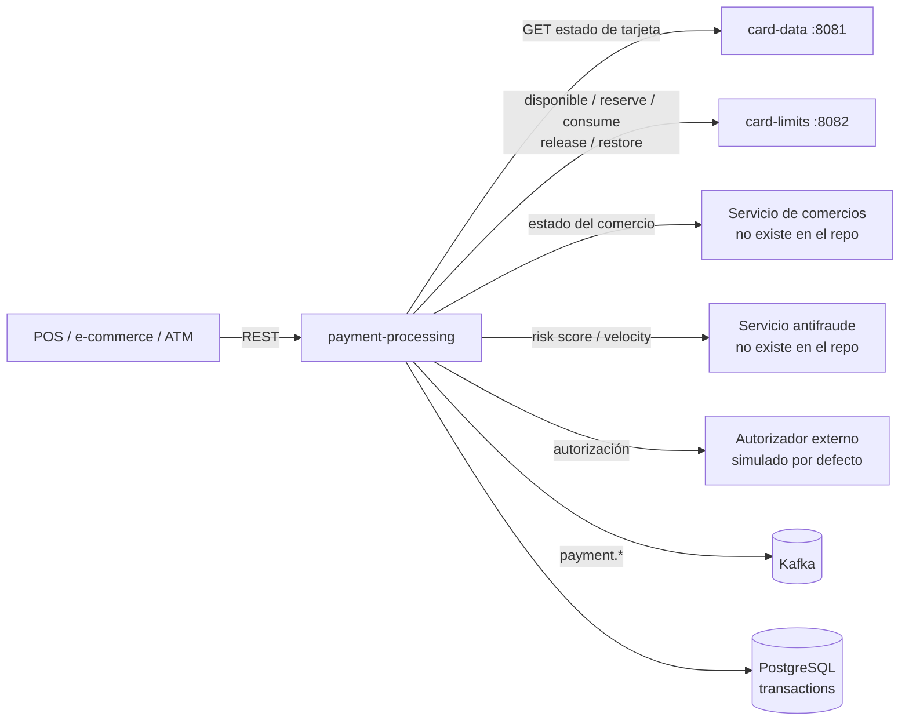
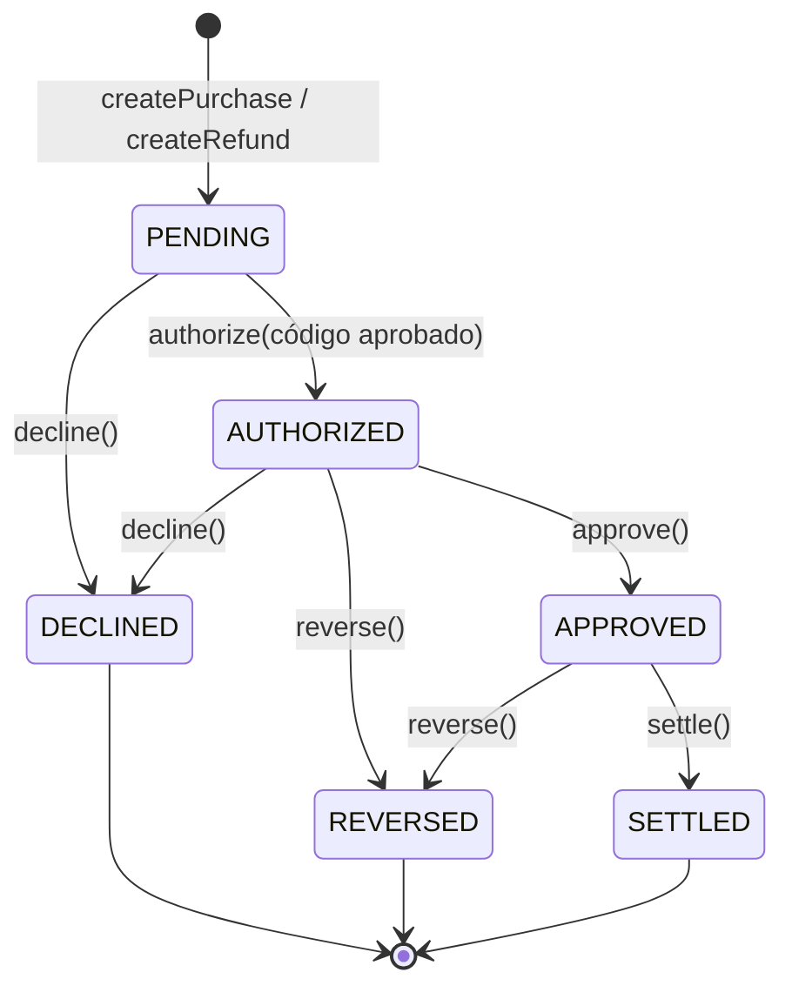
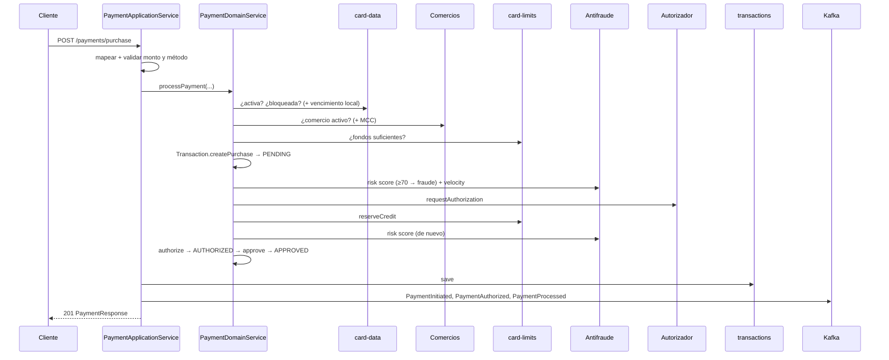

# payment-processing — Documentación técnica funcional

> Microservicio dueño del **Aggregate Root `Transaction`**: procesa compras y adelantos con validación de tarjeta y comercio, control de fondos, chequeo de fraude y autorización; gestiona reversos, devoluciones y liquidación, y publica eventos de pago en Kafka.

| Atributo | Valor |
|---|---|
| Artefacto Maven | `com.unisono.card:payment-processing` (`1.0.0-SNAPSHOT`) |
| Clase principal | `com.unisono.card.payment.PaymentApplication` |
| Puerto | `8080` por defecto (`SERVER_PORT`); `8085` en docker-compose |
| Base paths REST | `/api/v1/payments`, `/api/v1/refunds`, `/api/v1/reversals`, `/api/v1/settlements`, `/api/v1/transactions` |
| Base de datos | PostgreSQL — tablas `transactions`, `transaction_items`, `transaction_receipts` |
| Mensajería | Kafka (productor) — topics `payment.*` |
| Dependencias internas | `card-shared` (`Money`, `CardId`, `ExpirationDate`, …), `card-events` (`DomainEvent`) |
| Integraciones REST | card-data, card-limits, servicio de comercios, servicio antifraude, autorizador (ver §7) |
| Perfiles | `payment` (docker-compose), `dev`, `prod` |
| Swagger UI | `/swagger-ui.html` |

> ⚠️ **Estado actual:** el módulo compila, pero ningún flujo de pago llega a completarse de punta a punta. Ver §10 antes de usar este servicio.

---

## 1. Responsabilidad dentro del sistema

`payment-processing` es el punto de entrada de las **operaciones con la tarjeta**. Orquesta las validaciones contra los otros servicios y lleva el registro de cada transacción.



---

## 2. Arquitectura

Hexagonal:

```
com.unisono.card.payment
├── domain
│   ├── model        Transaction (aggregate root), TransactionId, TransactionAmount,
│   │                CardData, MerchantInfo, AuthorizationCode,
│   │                TransactionStatus, TransactionType, PaymentMethod
│   ├── event        PaymentInitiated, PaymentAuthorized, PaymentProcessed, PaymentDeclined,
│   │                PaymentReversed, RefundInitiated, RefundProcessed, TransactionSettled,
│   │                TransactionCompleted, FraudDetected
│   ├── exception    PaymentException y subclases (§5.4)
│   ├── port.input   ProcessPayment, ProcessRefund, ReverseTransaction,
│   │                SettleTransactions, QueryTransaction
│   ├── port.output  CardValidationPort, CreditLimitPort, MerchantValidationPort,
│   │                FraudCheckPort, AuthorizationPort, PaymentEventPublisher,
│   │                TransactionRepository
│   └── service      PaymentDomainService (orquestación), TransactionValidationService
├── application
│   ├── dto          Commands (requests) y Responses
│   ├── mapper       MapStruct: Payment, Refund, Transaction, Settlement, Error
│   └── service      PaymentApplicationService, RefundApplicationService,
│                    TransactionReversalService, SettlementService, TransactionQueryService
└── infrastructure
    ├── adapter.input.rest   Payment, Refund, Reversal, Settlement, Transaction controllers;
    │                        GlobalExceptionHandler
    ├── adapter.output       authorization, card, creditlimit, fraud, merchant (REST);
    │                        event (Kafka); persistence (JPA)
    └── config               DatabaseConfig (DataSource + EMF + TxManager propios),
                             KafkaPaymentConfig, RestTemplateConfig, BeanConfig, OpenApiConfig
```

| Caso de uso | Implementación | Endpoints |
|---|---|---|
| `ProcessPaymentUseCase` | `PaymentApplicationService` | `POST /payments/purchase`, `/payments/cash-advance`, `/payments/{id}/capture` |
| `ProcessRefundUseCase` | `RefundApplicationService` | `POST /refunds/full`, `/refunds/partial` |
| `ReverseTransactionUseCase` | `TransactionReversalService` | `POST /reversals`, `/reversals/{id}/auto` |
| `SettleTransactionsUseCase` | `SettlementService` | `POST /settlements/transaction/{id}`, `/settlements/batch`, `/settlements/all-pending` |
| `QueryTransactionUseCase` | `TransactionQueryService` | `GET /transactions/...` |

---

## 3. Modelo de dominio

### 3.1 `Transaction` (Aggregate Root)

| Campo | Tipo | Descripción |
|---|---|---|
| `transactionId` | `TransactionId` (UUID) | Generado al crear |
| `cardId` | `CardId` | Tarjeta (UUID de card-data) |
| `cardData` | `CardData` | Token del PAN, últimos 4, titular, vencimiento |
| `merchantInfo` | `MerchantInfo` | Id, nombre, MCC, ciudad, país |
| `type` | `TransactionType` | `PURCHASE`, `REFUND`, … |
| `amount` | `TransactionAmount` | Monto y, opcionalmente, monto local con tipo de cambio |
| `paymentMethod` | `PaymentMethod` | `CHIP`, `CONTACTLESS`, … |
| `status` | `TransactionStatus` | Estado (inicia en `PENDING`) |
| `authorizationCode` | `AuthorizationCode` | Código, fecha y response code ISO 8583 |
| `riskScore` | `Integer` | 0–100 |
| `declineReason` | `String` | Motivo de rechazo o de reverso |
| `terminalId`, `posEntryMode` | `String` | Datos del terminal |
| `transactionDate`, `settlementDate` | `LocalDateTime` | |
| `version` | `int` | Bloqueo optimista |
| `domainEvents` | `List<DomainEvent>` | Eventos pendientes de publicar |

### 3.2 Estados y transiciones

| Estado | Descripción | ¿Final? | ¿Se puede reversar? | ¿Se puede liquidar? |
|---|---|---|---|---|
| `PENDING` | Pendiente | No | No | No |
| `AUTHORIZED` | Autorizada | No | Sí | No |
| `APPROVED` | Aprobada | **Sí** | Sí | Sí |
| `DECLINED` | Rechazada | Sí | No | No |
| `REVERSED` | Reversada | Sí | No | No |
| `SETTLED` | Liquidada | Sí | No | No |
| `FAILED` | Fallida | Sí | No | No |



| Método | Precondición | Evento emitido |
|---|---|---|
| `createPurchase(...)` | — | `PaymentInitiated` |
| `createRefund(...)` | — | `RefundInitiated` |
| `authorize(code, risk)` | No final y código aprobado (`"00"`) | `PaymentAuthorized` |
| `approve()` | Estado `AUTHORIZED` | `PaymentProcessed` |
| `decline(reason)` | No final | `PaymentDeclined` |
| `reverse(reason)` | `AUTHORIZED` o `APPROVED` | `PaymentReversed` |
| `settle()` | `APPROVED` | `TransactionSettled` |
| `complete()` | No final | `TransactionCompleted` |

### 3.3 Value Objects y enums

| Tipo | Reglas / valores |
|---|---|
| `TransactionAmount` | Monto > 0. Con conversión: `localAmount` + `exchangeRate` > 0. `getEffectiveAmount()` devuelve el local si hay conversión. |
| `CardData` | Token obligatorio, últimos 4 = 4 dígitos, vencimiento obligatorio. `getMaskedCardNumber()` → `************1234`. |
| `MerchantInfo` | Id y nombre obligatorios; MCC de 4 dígitos y país ISO-3166 alpha-2 si se informan. |
| `AuthorizationCode` | `approved(code)` → response `00`; `declined(rc)` → `DECLINED-xxxxxx`. |
| `PaymentMethod` | `CHIP`, `CONTACTLESS`, `MOBILE_WALLET` (seguros); `SWIPE`, `ONLINE`, `MANUAL`. `ONLINE` y `MANUAL` requieren CVV; `ONLINE` es tarjeta no presente. |
| `TransactionType` | `PURCHASE` (P), `REFUND` (R), `REVERSAL` (V), `CASH_ADVANCE` (A), `PRE_AUTHORIZATION` (PA), `CAPTURE` (C). |

### 3.4 Reglas de validación (`TransactionValidationService`)

- Monto entre **0,01** y **50.000,00** (monto efectivo).
- Un adelanto no puede ser `ONLINE`.
- Una devolución no puede superar el monto original.
- Solo se reversan transacciones `AUTHORIZED` o `APPROVED`.

---

## 4. Flujos funcionales

### 4.1 Compra (`PaymentDomainService.processPayment`)



Puntos clave:

- Cualquier validación fallida corta el flujo con una excepción **antes de persistir**: los rechazos **no quedan registrados** y no se emite `PaymentDeclined`.
- La compra se autoriza y aprueba en un solo paso (no hay preautorización): termina en `APPROVED`, lista para liquidar.
- El crédito se **reserva** al aprobar y se **consume** al liquidar.
- Los eventos se publican **dentro de la transacción de base**, antes del commit.

### 4.2 Adelanto en efectivo

`processCashAdvance` arma un `ProcessPaymentCommand` y llama a `processPurchase`. Para eso fija `merchantId = "ATM-<terminalId>"`, `merchantName = "ATM Cash Advance"` y `paymentMethod = CHIP`. La transacción resultante es de tipo **`PURCHASE`**, no `CASH_ADVANCE`.

### 4.3 Reverso

1. Carga la transacción → valida `AUTHORIZED`/`APPROVED`.
2. Ejecuta `reverse(reason)` → `REVERSED`.
3. Llama a `card-limits releaseCredit` → guarda → publica `PaymentReversed`.

`/auto` hace lo mismo con el motivo fijo `"Automatic reversal due to timeout or system error"`.

### 4.4 Devolución (total y parcial)

1. Carga la transacción original, que debe estar `APPROVED` o `SETTLED`.
2. Valida el monto:
   - **Total:** igual al original.
   - **Parcial:** menor o igual al original.
3. Valida la tarjeta.
4. Crea una transacción `REFUND` y la aprueba.
5. Llama a `card-limits restoreCredit` → guarda → publica `RefundInitiated` (+ `PaymentProcessed`).

> Este es el flujo diseñado; hoy falla en el paso 4 (ver §10.1, punto 3).

### 4.5 Liquidación

- **Individual:** la transacción debe estar `APPROVED` y sin `settlementDate`. Ejecuta `settle()` → `SETTLED` → `card-limits consumeCredit` → guarda → `TransactionSettled`.
- **Batch:** liquida cada id. Los que fallan se loguean y se omiten.
- **all-pending:** liquida todas las `APPROVED` sin `settlementDate`.

### 4.6 Captura

`POST /payments/{id}/capture` exige `AUTHORIZED` y aprueba la transacción. Como las compras quedan directamente en `APPROVED`, hoy no hay transacciones capturables.

---

## 5. API REST

### 5.1 `POST /api/v1/payments/purchase`

```json
{
  "cardId": "550e8400-e29b-41d4-a716-446655440000",
  "cardNumberToken": "TKN-6f1c…",
  "lastFourDigits": "1234",
  "cardholderName": "JUAN PEREZ",
  "expirationDate": "12/2028",
  "amount": 1500.00,
  "currency": "ARS",
  "merchantId": "MERCH-001",
  "merchantName": "Supermercado Centro",
  "merchantCategoryCode": "5411",
  "merchantCity": "CABA",
  "merchantCountry": "AR",
  "paymentMethod": "CHIP",
  "terminalId": "POS-0001",
  "posEntryMode": "051",
  "cvv": "123"
}
```

| Campo | Validación |
|---|---|
| `cardId`, `cardNumberToken`, `merchantId`, `merchantName` | Obligatorios |
| `lastFourDigits` | 4 dígitos |
| `expirationDate` | `MM/YYYY` (año 20xx) |
| `amount` | 0,01 – 50.000,00 |
| `currency` | 3 caracteres |
| `localAmount`, `localCurrency`, `exchangeRate` | Opcionales (conversión de moneda) |
| `merchantCategoryCode` | 4 dígitos (opcional) |
| `merchantCountry` | ISO alpha-2 (opcional) |
| `paymentMethod` | Obligatorio (enum) |
| `cvv` | 3–4 dígitos (opcional; **no se usa**) |

Respuesta **201** `PaymentResponse`:

```json
{
  "transactionId": "…", "cardId": "…", "transactionType": "PURCHASE", "status": "APPROVED",
  "amount": 1500.00, "currency": "ARS", "authorizationCode": "AUTH-3F9A1C", "responseCode": "00",
  "responseMessage": "Transaction approved successfully", "riskScore": 10,
  "merchantId": "MERCH-001", "merchantName": "Supermercado Centro",
  "transactionDate": "2026-11-02T10:15:30", "authorizedAt": "2026-11-02T10:15:30",
  "approved": true, "declineReason": null, "receiptNumber": null
}
```

### 5.2 `POST /api/v1/payments/cash-advance`

Campos: `cardId`, `cardNumberToken`, `lastFourDigits`, `expirationDate`, `amount` (0,01 – **5.000,00**), `currency`, `terminalId` (obligatorio), `atmLocation`, `country`, `pin` (4–6 dígitos, obligatorio pero **no se valida**). Respuesta **201** `PaymentResponse`.

### 5.3 Otros endpoints

| Método y ruta | Body / parámetros | Respuesta |
|---|---|---|
| `POST /payments/{transactionId}/capture` | — | 200 `PaymentResponse` |
| `POST /refunds/full` · `/refunds/partial` | `{ originalTransactionId, cardId, refundAmount, currency, merchantId, reason, isPartialRefund, initiatedBy }` | 201 `RefundResponse` |
| `POST /reversals` | `{ transactionId, reason, reversalType, initiatedBy }` | 200 `TransactionResponse` |
| `POST /reversals/{transactionId}/auto` | — | 200 `TransactionResponse` |
| `POST /settlements/transaction/{transactionId}` | — | 200 `TransactionResponse` |
| `POST /settlements/batch` | `{ transactionIds: [...], settlementBatchId?, initiatedBy? }` | 200 `SettlementResponse` |
| `POST /settlements/all-pending` | — | 200 `SettlementResponse` |
| `GET /transactions/{transactionId}` | — | 200 `TransactionResponse` / 404 |
| `GET /transactions/card/{cardId}` | — | 200 `TransactionResponse[]` |
| `GET /transactions/card/{cardId}/status/{status}` | — | 200 `TransactionResponse[]` |
| `GET /transactions/card/{cardId}/range?fromDate=&toDate=` | ISO date-time | 200 `TransactionResponse[]` |
| `GET /transactions/card/{cardId}/summary?fromDate=&toDate=` | opcionales | 200 `TransactionSummaryResponse` |
| `GET /transactions/pending-settlement` | — | 200 `TransactionResponse[]` |

- **`TransactionResponse`:** todos los datos de la transacción (montos y conversión, tarjeta enmascarada, autorización, comercio, terminal, fechas, motivos, `version`). Omite los `null`.
- **`TransactionSummaryResponse`:** totales por estado (aprobadas incluye `SETTLED`; pendientes incluye `AUTHORIZED`), montos total, aprobado y rechazado, promedio, máximo y mínimo.
- **`SettlementResponse`:** `settlementBatchId`, totales, ids liquidados y fallidos, `status` (`COMPLETED`/`PARTIAL`) y mensaje.

### 5.4 Errores (`GlobalExceptionHandler`)

```json
{
  "errorCode": "INSUFFICIENT_FUNDS",
  "message": "Insufficient funds on card …",
  "details": "Requested: …, Available: …, Shortfall: …",
  "timestamp": "2026-11-02T10:15:30",
  "path": "uri=/api/v1/payments/purchase",
  "validationErrors": null
}
```

| Excepción | HTTP | `errorCode` |
|---|---|---|
| `MethodArgumentNotValidException` | 400 | `VALIDATION_ERROR` (+ `validationErrors[]` con campo, mensaje y valor rechazado) |
| `TransactionNotFoundException` | 404 | `TRANSACTION_NOT_FOUND` |
| `InvalidTransactionException` | 400 | `INVALID_TRANSACTION` |
| `TransactionAlreadyProcessedException` | 409 | `TRANSACTION_ALREADY_PROCESSED` |
| `InsufficientFundsException` | 402 | `INSUFFICIENT_FUNDS` |
| `CardValidationException` | 400 | `CARD_VALIDATION_FAILED` |
| `AuthorizationFailedException` | 402 | `AUTHORIZATION_FAILED` (response codes `51`, `59`, `62`, `03`) |
| `FraudDetectedException` | 403 | `FRAUD_DETECTED` |
| `MerchantValidationException` | 400 | `MERCHANT_VALIDATION_FAILED` |
| Otra `PaymentException` | 500 | `PAYMENT_ERROR` |
| Cualquier otra | 500 | `INTERNAL_ERROR` |

---

## 6. Antifraude y autorización

### 6.1 Antifraude (`FraudCheckAdapter`)

- Pide el score a `POST {fraud-detection}/api/v1/fraud/risk-score`. Si falla, calcula un **score básico local**:

| Factor | Puntos |
|---|---|
| Monto ≥ 10.000 / ≥ 5.000 / ≥ 1.000 | +30 / +20 / +10 |
| Método `ONLINE` / `MANUAL` | +20 / +15 |
| País del comercio ≠ `AR` | +15 |
| Con conversión de moneda | +10 |
| Tope | 100 |

- **Sospechosa** si `score ≥ fraud.risk-threshold.high` (70; 90 en `dev`) **o** si el monto ≥ `fraud.amount.suspicious-threshold` (5.000) **y** es `ONLINE` **y** `score ≥ medium` (40).
- **Velocity:** `GET {fraud-detection}/api/v1/fraud/velocity-check/{cardId}`. Si falla, no bloquea.
- También hay chequeos de geolocalización, de anomalía de monto y reporte de fraude, pero el flujo no los usa.

### 6.2 Autorización (`AuthorizationAdapter`)

- Con `authorization.simulate=true` (**default**, y en `dev`): espera 100 ms y aprueba con `AUTH-XXXXXX` si el monto es < 50.000; si no, declina con código `61`.
- Con `simulate=false` (`prod`): `POST {authorization}/api/v1/authorization/request` con el PAN enmascarado. Ante un error devuelve declinado `96`.
- También implementa `capture` y `void` contra el autorizador, que el flujo no usa.

---

## 7. Integraciones salientes

| Puerto | Llamada | URL por defecto (`services.*`) | ¿Existe el destino? |
|---|---|---|---|
| `CardValidationPort` | `GET /api/v1/cards/{cardId}/status` | `CARD_DATA_SERVICE_URL` = `http://localhost:8081` | **No**: card-data solo tiene `PUT /status`; para leer el estado está `GET /api/v1/cards/{id}` |
| `CreditLimitPort` | `GET /api/v1/credit-limits/{cardId}/available`, `POST …/reserve`, `…/consume`, `…/release`, `…/restore` | `CARD_LIMITS_SERVICE_URL` = `http://localhost:8082` | **No** (ver [LIMITS.md §9.1](LIMITS.md)) |
| `MerchantValidationPort` | `GET /api/v1/merchants/{id}/status` | `MERCHANT_SERVICE_URL` = `http://localhost:8080` | No hay servicio de comercios en el repo |
| `FraudCheckPort` | `/api/v1/fraud/*` | `FRAUD_DETECTION_SERVICE_URL` = `http://localhost:8081` | No existe (`8081` es card-data) |
| `AuthorizationPort` | `/api/v1/authorization/*` | `AUTHORIZATION_SERVICE_URL` = `http://localhost:8082` | No existe (`8082` es card-limits); simulado por defecto |

`RestTemplate`: timeouts de 5 s (conexión) y 10 s (lectura), con un interceptor que loguea URI y status.

**Política ante fallos** (cada adapter captura las excepciones):

| Chequeo | Si el servicio falla, asume… | Efecto |
|---|---|---|
| Tarjeta activa | No activa | Rechaza |
| Tarjeta bloqueada | Bloqueada | Rechaza |
| Comercio activo | Inactivo | Rechaza |
| Crédito disponible | `0 USD` | Rechaza |
| Score de fraude | Score local | — |
| Velocity, geolocalización, anomalía | Sin anomalía | No bloquea |
| `reserve` / `consume` / `release` / `restore` | — | Lanza `RuntimeException` → 500 |

---

## 8. Eventos

Ver el catálogo completo en [EVENTS.md §6](EVENTS.md). Resumen:

| Evento | Topic | Cuándo se emite |
|---|---|---|
| `PaymentInitiated` | `payment.processing.initiated` | Al crear una compra |
| `PaymentAuthorized` | `payment.processing.authorized` | `authorize()` |
| `PaymentProcessed` | `payment.processing.completed` | `approve()` (compra y devolución) |
| `PaymentDeclined` | `payment.processing.declined` | `decline()` (hoy nunca se llama) |
| `PaymentReversed` | `payment.reversal.completed` | `reverse()` |
| `RefundInitiated` | `payment.refund.initiated` | Al crear una devolución |
| `TransactionSettled` | `payment.settlement.completed` | `settle()` |
| `TransactionCompleted` | `payment.transaction.completed` | `complete()` (sin uso) |
| `RefundProcessed`, `FraudDetected` | `payment.refund.processed`, `payment.fraud.detected` | Nunca |

**Productor:**

- `acks=all`, idempotente, 3 reintentos, `snappy`, `linger.ms=10`, sin type headers.
- Key = `eventId`.
- `KafkaPaymentConfig` declara los 10 topics con **3 particiones y replication factor 2**.
- El envío es asíncrono: un error del broker solo se loguea.

---

## 9. Persistencia y configuración

### 9.1 Tablas (`ddl-auto: validate`)

El esquema se crea con Flyway en el repo `card-management-database` (`migrations/V5__create_alter_table.sql`, `V6__create_table_items.sql`, `V7__create_receipt_table.sql`). `transactions.card_id` y `merchant_id` son `VARCHAR(36)` con FK a `cards(id)` y `merchants(id)`.

**`transactions`**

- **Identificación:** `transaction_id` (UUID PK), `card_id`, `merchant_id`.
- **Tipo y estado:** `transaction_type`, `transaction_status`, `payment_method`.
- **Montos:** `amount`, `currency`, `local_amount`, `local_currency`, `exchange_rate`.
- **Tarjeta:** `card_number_token`, `card_last_four`, `card_holder_name`, `expiration_date`.
- **Autorización:** `authorization_code`, `authorization_date`, `authorization_response_code`.
- **Comercio:** `merchant_category_code`, `merchant_name`, `merchant_city`, `merchant_country`.
- **Terminal y fechas:** `terminal_id`, `pos_entry_mode`, `transaction_date`, `settlement_date`.
- **Riesgo y motivos:** `risk_score`, `fraud_check_status`, `decline_reason`, `reversal_reason`.
- **Auditoría:** `created_at`, `updated_at`, `created_by`, `version` (`@Version`).
- **Índices:** card, merchant, status, fecha, fecha de liquidación, código de autorización.

**Tablas asociadas:**

- **`transaction_items`:** detalle de ítems (descripción, cantidad, precio unitario, total).
- **`transaction_receipts`:** comprobantes (`receipt_number` único `RCP-…`, tipo `DIGITAL|PRINTED|EMAIL|SMS`, `receipt_data` en **jsonb** vía hypersistence-utils, estado de entrega).

El dominio no usa ítems ni comprobantes. `CustomTransactionRepositoryImpl` tiene consultas de estadísticas, sospechosas, duplicados y volumen por comercio, que tampoco se exponen.

### 9.2 Configuración

| Propiedad | Default | Nota |
|---|---|---|
| `server.port` | `${SERVER_PORT:8080}` | compose: `8085` |
| `spring.datasource.url` | `jdbc:postgresql://localhost:5432/card_management` | Otra base que la del resto de los servicios (`card_management_db`); compose la sobrescribe. `dev`: `card_management_dev` |
| `spring.kafka.bootstrap-servers` | `${KAFKA_BOOTSTRAP_SERVERS:localhost:9092}` | compose: `kafka:9092` |
| `spring.flyway.*` | `enabled: true`, `classpath:db/migration` | Flyway no está en el `pom.xml` y no existe la carpeta: no tiene efecto |
| `authorization.simulate` | `true` | `prod`: `false` |
| `fraud.*` | umbrales 70/40/20, velocity 10/h y 50/día, monto 5.000 | `velocity.*` no se usa |
| `management.endpoint.health.show-details` | `when-authorized` | |

`DatabaseConfig` define `paymentDataSource` (Hikari, pool de 20, `autoCommit=false`), `paymentEntityManagerFactory` y `paymentTransactionManager` propios.

### 9.3 Docker

`services/payment-processing/Dockerfile` (multi-stage) y servicio `payment-processing-service` en compose: perfil `payment`, puerto `8085`, `KAFKA_BOOTSTRAP_SERVERS=kafka:9092`, `depends_on: kafka`, `CARD_DATA_SERVICE_URL=http://card-data-service:8081` y `CARD_LIMITS_SERVICE_URL=http://card-limits-service:8082`. Las URLs de comercios, antifraude y autorizador quedan en sus defaults de `localhost`.

---

## 10. Limitaciones conocidas y deuda técnica

### 10.1 Bloqueantes

1. **FK de `merchant_id`.** La migración V5 define `merchant_id → merchants(id)` y `card_id → cards(id)`. Una transacción solo se puede guardar si el comercio existe en `merchants`; los adelantos usan `merchantId = "ATM-<terminalId>"`, que no va a existir, y cualquier id de más de 36 caracteres excede la columna.
2. **Las validaciones previas siempre rechazan.**
   - `GET /api/v1/cards/{id}/status` no existe en card-data y la URL por defecto apunta a `8080` → `isCardActive=false` → toda compra termina en 400 `CARD_VALIDATION_FAILED`.
   - Si se corrigiera eso, el servicio de comercios no existe (→ comercio inactivo) y card-limits no expone los endpoints esperados (→ disponible `0 USD`, 402).
3. **Las devoluciones nunca funcionan.** `createRefund` deja la transacción en `PENDING` y `processRefund` llama a `approve()`, que exige `AUTHORIZED` → `InvalidTransactionException` (400).
4. **Reversos y liquidaciones fallan:** dependen de `releaseCredit` y `consumeCredit` en card-limits, que no existen (500). En batch, los errores se capturan y la respuesta sale “exitosa” con 0 liquidadas (`failedTransactionIds` siempre vacío).

### 10.2 Reglas de negocio

5. **Los rechazos no se registran:** validaciones, fraude y autorización lanzan excepciones antes de `save()`. No queda la transacción `DECLINED` ni se emite `PaymentDeclined`, y la rama 402 del controller con `PaymentResponse` nunca se ejecuta.
6. **Una autorización declinada se reporta mal:** el adapter devuelve un código declinado (no lanza excepción) y `authorize()` lo rechaza con `InvalidTransactionException` → 400 en lugar de 402 `AUTHORIZATION_FAILED`. Además, eso ocurre **después** de `reserveCredit`, así que el crédito queda reservado sin transacción que lo libere.
7. **El adelanto se procesa como compra:** el tipo queda `PURCHASE`, el PIN se pide pero no se verifica y no se aplican reglas propias (por ejemplo `validatePaymentMethod` con `CASH_ADVANCE`).
8. **CVV sin validar:** se recibe pero no se envía a nadie, aunque `ONLINE`/`MANUAL` lo requieren.
9. **Devoluciones parciales sin control acumulado:** cada parcial se compara contra el original, no contra lo ya devuelto. Tampoco se persiste el vínculo con la transacción original.
10. **Captura inutilizable:** no hay flujo de preautorización; `authorizeTransaction` no hace nada y no tiene endpoint.
11. **El vencimiento real no se valida:** se usa el `expirationDate` que envía el cliente. `isCardExpired()` del adapter siempre devuelve `false` y no se usa.
12. **El score de fraude se calcula 2 o 3 veces por compra** (con 2–3 llamadas al servicio externo) y el valor guardado puede no ser el mismo que se evaluó.
13. **Límite de 50.000 inconsistente:** el request admite hasta 50.000,00, pero el autorizador simulado declina con monto ≥ 50.000.

### 10.3 Técnicas

14. **Eventos antes del commit:** se publican dentro de `@Transactional`. Si el commit falla, ya salieron eventos de una transacción inexistente. No hay outbox.
15. **Key Kafka = `eventId`:** no hay orden por transacción ni por tarjeta. Replication factor 2 con un broker en compose. Nadie consume estos topics.
16. **URLs por defecto cruzadas:** comercios, antifraude y autorizador apuntan a `localhost:8080`, `8081` y `8082`, que son payment-processing, card-data y card-limits. Ninguno de esos servicios existe en el repo.
17. **Base de datos distinta por defecto** (`card_management` vs `card_management_db`).
18. **Configuración sin efecto:** Flyway, `fraud.velocity.*`, `spring.application.name: card-management-service` (nombre del proyecto padre, no del servicio).
19. **Código sin uso:** `QueryTransactionRequest`, ítems y comprobantes, `CustomTransactionRepository`, la mayoría de las consultas de `JpaTransactionRepository`, `findRequiringReversal`, `complete()`, `RefundProcessed`, `FraudDetected`, y `PaymentResponse.receiptNumber` (siempre `null`).
20. **Reconstrucción por reflexión:** `TransactionEntityMapper.toDomain` usa el constructor privado y `setField` por nombre. Es frágil ante renombres.
21. **Moneda por defecto `USD`** en resúmenes y liquidaciones vacías, mientras el resto del sistema solo opera en ARS ([LIMITS.md §9.1](LIMITS.md)).
22. **Seguridad:** el token del PAN lo provee el cliente (no hay servicio de tokenización) y el PIN viaja en claro en el request.
23. **Sin tests:** no existe `src/test`, aunque el `pom.xml` configura JaCoCo.
