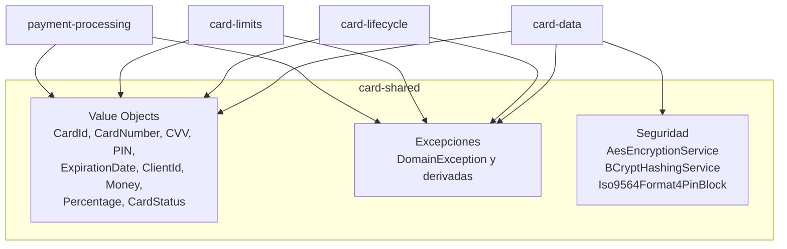
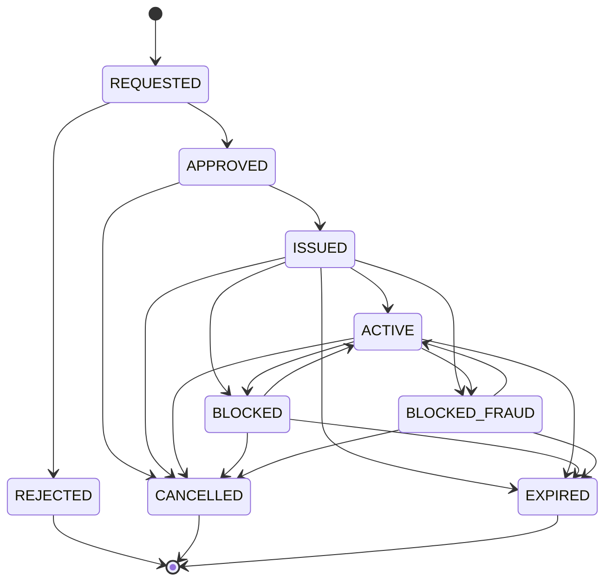
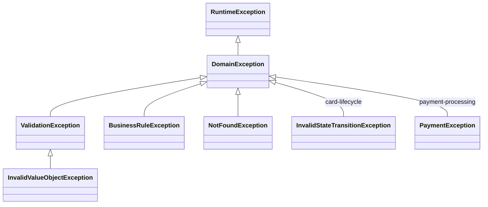

# card-shared — Documentación técnica funcional

> Librería base (**shared kernel**) con los **Value Objects** del dominio de tarjetas, la **jerarquía de excepciones** y los **servicios de cifrado y hashing** que usan el resto de los módulos.

| Atributo | Valor |
|---|---|
| Artefacto Maven | `com.unisono.card:card-shared` (`1.0.0-SNAPSHOT`) |
| Tipo | Librería `jar` (sin `main`, sin contenedor propio) |
| Dependencias | `spring-boot-starter`, `spring-security-crypto`, `commons-lang3`, `lombok` |
| Paquetes | `…shared.domain.valueobject`, `…shared.domain.exception`, `…shared.infrastructure.security`, `…shared.infrastructure.config` |
| Usada por | `card-data`, `card-lifecycle`, `card-limits`, `payment-processing` |
| Tests | 9 clases: value objects (`CardStatus`, `CardId`, `CardNumber`, `ExpirationDate`, `Money`, `Percentage`, validación común), `AesEncryptionService` y `Iso9564Format4PinBlock` |

---

## 1. Propósito

`card-shared` concentra los conceptos que tienen el **mismo significado en todos los servicios**: qué es un número de tarjeta válido, qué estados puede tener una tarjeta y cómo se transita entre ellos, cómo se representa el dinero, y cómo se cifran PAN/CVV y se hashea el PIN. Así cada servicio valida y opera igual sin duplicar reglas.



**Regla de diseño:** el paquete `domain` no depende de Spring (solo Lombok y `commons-lang3`); únicamente `infrastructure` usa anotaciones de Spring (`@Service`, `@Configuration`, `@Value`).

### Uso por módulo

Cantidad de archivos que importan cada clase (código de `src/`):

| Clase | card-data | card-lifecycle | card-limits | payment-processing |
|---|:-:|:-:|:-:|:-:|
| `CardId` | 14 | 21 | 14 | 29 |
| `CardStatus` | 10 | 1 | 2 | — |
| `ClientId` | 11 | — | — | — |
| `CardNumber` | — | 2 | — | 3 |
| `CVV` | — | 2 | — | 2 |
| `ExpirationDate` | — | 2 | — | 3 |
| `PIN` | 1 | 1 | — | — |
| `Money` | 1 | — | 17 | 10 |
| `Percentage` | — | — | — | — |
| `EncryptionService` / `HashingService` | ✅ | — | — | — |

> En `card-data` los VO `CardNumber`, `CVV` y `ExpirationDate` también se usan vía `import …valueobject.*` en el dominio (`Card`, `CardManagementService`, `CardEntityMapper`).

---

## 2. Value Objects

Todos siguen el mismo patrón:

- Constructor **privado** + *factory method* estático (`of`, `generate`, `zero`, …).
- **Inmutables** (campos `final`, sin setters) e igualdad **por valor** (`@EqualsAndHashCode`).
- **Validación en la creación** (*fail fast*): un VO inválido no puede existir.
- `Serializable` (el enum `CardStatus` lo es por ser enum).
- **Una sola excepción para datos inválidos:** todos lanzan `InvalidValueObjectException`, que extiende `ValidationException`, así que cualquier handler que mapee `ValidationException` a 400 los cubre.

### 2.1 `CardId`

Identificador de tarjeta.

| Método | Comportamiento |
|---|---|
| `CardId.generate()` | UUID v4 aleatorio como `String` |
| `CardId.of(String)` | Exige un **UUID en formato canónico** (`8-4-4-4-12` hex) y lo normaliza a minúsculas |
| `getValue()` / `toString()` | El valor como `String` |

Errores: `InvalidValueObjectException` si es vacío o no es un UUID (`"card-123"`, sin guiones, con espacios). En los endpoints de card-data y card-limits, un id inválido responde **400** en lugar de 404.

### 2.2 `ClientId`

Identificador de cliente (DNI / CUIL / CUIT).

- `ClientId.of("20-12345678-9")` → **sanitiza** quitando todo lo que no sea dígito → `"20123456789"`.
- Válido si, tras sanitizar, tiene **entre 7 y 11 dígitos**. No valida el dígito verificador del CUIL.
- Errores: `InvalidValueObjectException` (vacío o longitud fuera de rango).

### 2.3 `CardNumber` (PAN)

| Regla | Detalle |
|---|---|
| Sanitización | Quita espacios y guiones (`"4532 1234-5678 9010"` → `"4532123456789010"`) |
| Longitud | 13 a 19 dígitos |
| Formato | Solo dígitos |
| Checksum | **Algoritmo de Luhn** |
| Errores | `InvalidValueObjectException` con el motivo |

Métodos de presentación:

| Método | Resultado |
|---|---|
| `getLastFourDigits()` | `"9010"` |
| `getMasked()` | Todos los dígitos salvo los últimos 4 como `*`, agrupados de a 4 desde la derecha: `"* **** **** 2222"` (13), `"*** **** **** 0005"` (15), `"**** **** **** 9010"` (16), `"*** **** **** **** 0001"` (19) |
| `getBIN()` | BIN/IIN: primeros 6 dígitos, identifican al emisor (`"453212"`) |
| `toString()` | Igual que `getMasked()`: **nunca** expone el PAN completo en logs |

> El PAN en claro solo vive en memoria; en BD se guarda cifrado con `EncryptionService` (ver §4.1).

### 2.4 `CVV`

- 3 dígitos, o 4 (American Express). Solo dígitos.
- `toString()` devuelve `"***"`.
- Errores: `InvalidValueObjectException`.
- Se guarda cifrado en BD.

### 2.5 `PIN`

Representa el PIN **en claro, solo en memoria**. Lo que se persiste es su hash BCrypt (§4.2).

| Regla | Ejemplo rechazado |
|---|---|
| Exactamente 4 dígitos | `"123"`, `"12345"`, `"12a4"` |
| No secuencial ascendente | `"1234"`, `"3456"` |
| No secuencial descendente | `"4321"`, `"9876"` |
| No todos iguales | `"1111"` |

- `toString()` devuelve `"****"`.
- Errores: `InvalidValueObjectException`.
- Uso: `card-data` (`CardManagementService`, `PINManagementService`) y `card-lifecycle` (validación al emitir).

### 2.6 `ExpirationDate`

Mes/año de vencimiento. Distingue dos usos:

- **Representar** una fecha cualquiera, incluso vencida: reconstruir tarjetas desde BD, validar pagos.
- **Emitir** una tarjeta: la fecha tiene que estar dentro de la ventana de emisión.

| Factory | Formato aceptado | Validación |
|---|---|---|
| `of(int month, int year)` | Números | Estructural |
| `of(String)` | `MM/YYYY` estricto (regex `(0[1-9]\|1[0-2])/20\d{2}`) | Estructural |
| `fromString(String)` | `MM/YY` o `MM/YYYY` (años `< 100` suman 2000) | Estructural |
| `forIssuance(int month, int year)` | Números | Estructural + ventana de emisión |

- **Estructural:** mes entre 1 y 12, año entre 2000 y 2099.
- **Ventana de emisión:** no vencida (mes actual inclusive) y año ≤ año actual + 10.
- Todos los errores son `InvalidValueObjectException` (→ 400), incluidos los de parseo.

Uso de `forIssuance`: `CardManagementService.updateCardData` (card-data) y el endpoint de emisión de card-lifecycle (`CardLifecycleController`, `LifecycleDtoMapper`). El resto usa `of`.

Métodos:

| Método | Descripción |
|---|---|
| `isExpired()` | `true` si el mes/año es anterior al mes actual |
| `expiresWithinMonths(n)` | `true` si vence dentro de los próximos `n` meses (inclusive) |
| `getLastDayOfMonth()` | Último día del mes de vencimiento (`LocalDate`) |
| `getYearMonth()` | `YearMonth` |
| `toString()` / `toShortString()` | `"03/2030"` / `"03/30"` |

### 2.7 `Money`

Monto con moneda (`java.util.Currency`).

- **Escala fija de 2 decimales** con `RoundingMode.HALF_UP`, aplicada en cada construcción (incluido el resultado de cada operación).
- Factories:
  - `of(BigDecimal, String currencyCode)` — usada por los mappers JPA.
  - `of(BigDecimal, Currency)`.
  - `ofARS(BigDecimal)` / `ofARS(long)`.
  - `zero()` (ARS) / `zero(currencyCode)`.
- Operaciones:
  - `add`, `subtract`, `multiply(BigDecimal)`, `divide(BigDecimal)`;
  - comparaciones `isGreaterThan`, `isLessThan`, `isZero`, `isPositive`, `isNegative`.
- **No mezcla monedas:** `add`, `subtract` y las comparaciones lanzan `BusinessRuleException("Cannot operate on different currencies: ARS and USD")` → 422.
- Monto `null`, moneda vacía o código ISO desconocido (`"XXZ"`) y `divide` por cero lanzan `InvalidValueObjectException` → 400.
- Se permiten montos negativos (p. ej. resultado de `subtract`).
- `getCurrencyCode()` devuelve el código ISO como `String`, para persistir.
- `toString()` → `"$ 1500.00"` (símbolo según el locale por defecto de la JVM).

Uso principal: límites y saldos en `card-limits` y montos de transacción en `payment-processing`.

### 2.8 `Percentage`

Porcentaje almacenado como **fracción decimal** (`0.15` = 15 %), con 4 decimales.

- `of(BigDecimal)` / `of(double)` reciben la fracción y validan `0 ≤ valor ≤ 1`.
- `fromPercentage(BigDecimal)` recibe el porcentaje (`15` = 15 %), valida `0 ≤ valor ≤ 100` y lo divide por 100.
- `applyTo(Money)` y `asPercentage()` (`0.15` → `15.0000`); implementa `Comparable`.
- Errores: `InvalidValueObjectException`.
- **Sin uso actual:** `card-limits` maneja `cashAdvancePercentage` como `Double`.

### 2.9 `CardStatus`

Enum con el ciclo de vida de la tarjeta. Cada valor tiene una `description` en español.

| Estado | Descripción | Grupo |
|---|---|---|
| `REQUESTED` | Solicitada | Inicial |
| `APPROVED` | Aprobada | Inicial |
| `REJECTED` | Rechazada | Final |
| `ISSUED` | Emitida | Operativo |
| `ACTIVE` | Activa | Operativo |
| `BLOCKED` | Bloqueada | Bloqueo |
| `BLOCKED_FRAUD` | Bloqueada por Fraude | Bloqueo |
| `CANCELLED` | Cancelada | Final |
| `EXPIRED` | Vencida | Final |

Predicados:

| Método | `true` para |
|---|---|
| `isOperational()` | `ACTIVE`, `ISSUED` |
| `isBlocked()` | `BLOCKED`, `BLOCKED_FRAUD` |
| `isFinal()` | `REJECTED`, `CANCELLED`, `EXPIRED` |
| `canActivate()` | `ISSUED` |
| `canBlock()` | `ACTIVE`, `ISSUED` |

**Máquina de estados — `canTransitionTo(target)`:** es la fuente única de verdad de las transiciones válidas. La usan el aggregate `Card` de `card-data` y los endpoints de actualización de estado.



Una tarjeta emitida vence al pasar su fecha aunque nunca se haya activado o esté bloqueada: `ISSUED`, `ACTIVE`, `BLOCKED` y `BLOCKED_FRAUD` pueden pasar a `EXPIRED`.

Invariantes cubiertos por `CardStatusTest`:

- Solo se permiten las transiciones del diagrama (matriz completa 9×9).
- Los estados finales no tienen salida.
- No hay auto-transiciones (`X → X` es inválido).
- `target == null` → `false`.
- Coherencia: `canTransitionTo(BLOCKED | BLOCKED_FRAUD) == canBlock()`.

---

## 3. Excepciones de dominio



| Excepción | Cuándo se usa | Constructores |
|---|---|---|
| `DomainException` | Base de todas (unchecked). Los módulos extienden de ella para sus excepciones propias | `(msg)`, `(msg, cause)` |
| `ValidationException` | Dato de entrada inválido (validaciones de servicios) | `(msg)`, `(msg, cause)` |
| `InvalidValueObjectException` | **Subclase de `ValidationException`.** VO mal formado: todos los VO de `card-shared` y los propios de `payment-processing` | `(msg)`, `(msg, cause)` |
| `BusinessRuleException` | Regla de negocio violada (transición inválida, PIN bloqueado, etc.) | `(msg)`, `(msg, cause)` |
| `NotFoundException` | Entidad inexistente | `(msg)`, `(entityName, id)` → `"Card con id 'x' no encontrado"` |

### Mapeo a HTTP

Cada servicio tiene su propio `GlobalExceptionHandler`; `card-shared` no define ninguno.

| Excepción | card-data | card-limits | payment-processing |
|---|---|---|---|
| `NotFoundException` | 404 | 404 | — |
| `ValidationException` / `InvalidValueObjectException` | 400 | 400 | 400 (`INVALID_VALUE`) |
| `BusinessRuleException` (incluye monedas distintas en `Money`) | 422 | 422 | 422 (`BUSINESS_RULE_VIOLATION`) |
| `PaymentException` (propia) | — | — | según subtipo |

`card-lifecycle` no tiene `GlobalExceptionHandler`: rige el manejo por defecto de Spring.

---

## 4. Servicios de seguridad

Ambos son `@Service` en `com.unisono.card.shared.infrastructure.security`, junto con `EncryptionProperties` (`@ConfigurationProperties("encryption")`). Se registran solo en los módulos que incluyen `com.unisono.card.shared` en su `@ComponentScan`. Hoy es únicamente `card-data`, el único que los usa (`CardEncryptionAdapter`, `CardEntityMapper`). `card-lifecycle`, `card-limits` y `payment-processing` no los escanean ni necesitan configurar claves.

### 4.1 `EncryptionService` → `AesEncryptionService`

Cifrado simétrico **AES-256-GCM** para PAN y CVV, con un **llavero de claves versionadas**.

| Aspecto | Valor |
|---|---|
| Algoritmo | `AES/GCM/NoPadding` (JCE estándar) |
| IV | 12 bytes aleatorios (`SecureRandom`), **nuevo por cada cifrado** |
| Tag de autenticación | 128 bits (detecta alteración del ciphertext) |
| Formato de salida | `keyId:Base64( IV ‖ ciphertext+tag )`, p. ej. `k1:Abc…==` |
| Claves | Base64 de **32 bytes aleatorios** (`openssl rand -base64 32`), no derivadas de un texto |
| Errores al descifrar | `EncryptionException` (unchecked): clave desconocida, material de clave distinto, ciphertext alterado o mal formado |
| `null` o `""` | `encrypt`/`decrypt` devuelven `null` |

API: `encrypt(String)` (siempre con la clave activa) y `decrypt(String)` (con la clave que indica el prefijo).

Como el IV es aleatorio, **cifrar dos veces el mismo PAN da resultados distintos**: no se puede buscar una tarjeta comparando el PAN cifrado.

**Configuración** (`EncryptionProperties`, prefijo `encryption`):

```yaml
encryption:
  active-key-id: "${ENCRYPTION_ACTIVE_KEY_ID:k1}"   # clave con la que se cifra
  keys:
    k1: "${ENCRYPTION_KEY_K1:<Base64 dev>}"        # una entrada por versión de clave
  legacy-secret-key: "${ENCRYPTION_KEY:<32 caracteres>}"  # opcional, datos sin prefijo
```

- **Validación al arrancar (fail fast).** El servicio no arranca si:
  - falta `active-key-id` o no existe en `keys`;
  - una clave no es Base64 o no mide 32 bytes;
  - un id no cumple `[A-Za-z0-9_-]{1,32}`;
  - la clave legacy no mide 32 bytes.
- **Sin defaults en el código:** los valores de desarrollo están solo en el `application.yml` de card-data y en `docker-compose.yml`.

**Rotación de clave:**

1. Generar una clave nueva y agregarla como `encryption.keys.k2`.
2. Apuntar `encryption.active-key-id` a `k2`, manteniendo `k1`.
3. Desde ese momento todo se cifra con `k2`. Lo guardado con `k1` se sigue leyendo, y pasa a `k2` cuando la tarjeta se vuelve a guardar (`CardRepositoryAdapter` cifra el PAN y el CVV en cada `save`).
4. Retirar `k1` solo cuando ningún registro la use: `SELECT count(*) FROM cards WHERE card_number_encrypted LIKE 'k1:%' OR cvv_encrypted LIKE 'k1:%'`.

**Datos anteriores al llavero:** el formato viejo es Base64 sin prefijo, con la clave tomada de los bytes UTF-8 de un texto de 32 caracteres. Esos datos se descifran con `legacy-secret-key` y migran a la clave activa al volver a guardarse. Como Base64 no usa `:`, la ausencia de prefijo identifica el formato sin ambigüedad.

> Al iniciar, el servicio loguea la clave activa y los ids configurados (nunca el material), y un `WARN` recordando usar un KMS en producción.

### 4.2 `HashingService` → `BCryptHashingService`

Hash unidireccional para el **PIN**.

| Aspecto | Valor |
|---|---|
| Algoritmo | BCrypt (`spring-security-crypto`), salt aleatorio por hash |
| Costo | 12 (2¹² rondas), fijo en el código |
| `hash(plain)` | Devuelve `$2a$12$…`; con `null`/`""` lanza `IllegalArgumentException`, otros errores `HashingException` |
| `verify(plain, hash)` | `true`/`false`; con argumentos `null` o hash corrupto devuelve `false` (no lanza) |

Se verifica siempre con `verify()`, nunca comparando hashes: el salt hace que dos hashes del mismo PIN difieran.

### 4.3 `Iso9564Format4PinBlock`

Utilidad estática (no es un bean) para **PIN blocks ISO 9564-1 formato 4** (AES). El terminal cifra el PIN con una clave de cifrado de PIN (PEK) compartida con quien lo verifica; los sistemas intermedios solo reenvían el bloque.

| Aspecto | Valor |
|---|---|
| Campo PIN (16 bytes) | `4` · largo del PIN · dígitos · relleno `A` hasta el nibble 15 · 8 bytes aleatorios (el mismo PIN da un bloque distinto cada vez) |
| Campo PAN (16 bytes) | largo del PAN − 12 · PAN (12 a 19 dígitos; los más cortos se completan con ceros a la izquierda) · ceros |
| Cifrado | `AES(K, AES(K, campo PIN) XOR campo PAN)`, `AES/ECB/NoPadding` de un bloque por paso |
| Clave | AES de 16, 24 o 32 bytes |
| PIN | 4 a 12 dígitos |

- `encrypt(pin, pan, key)`: lo usan los terminales y los tests; ningún servicio cifra PINs.
- `decrypt(pinBlock, pan, key)`: valida la estructura del campo PIN. Con otra clave u otro PAN la estructura no cierra y lanza `InvalidPinBlockException` (un `ValidationException`, 400), sin incluir el PIN ni el bloque en el mensaje.
- Limpia los buffers intermedios después de usarlos. La única copia del PIN que queda es el `String` que devuelve `decrypt`.
- La usa card-data en `validate-pin` ([DATA.md §4.3](DATA.md)).

## 5. Cómo usarla en un módulo

1. Agregar la dependencia:

   ```xml
   <dependency>
       <groupId>com.unisono.card</groupId>
       <artifactId>card-shared</artifactId>
       <version>${project.version}</version>
   </dependency>
   ```

2. Solo si se necesitan `EncryptionService` o `HashingService`, incluir el paquete en el escaneo:

   ```java
   @ComponentScan(basePackages = {"com.unisono.card.<modulo>", "com.unisono.card.shared"})
   ```

   …y configurar `encryption.active-key-id` y `encryption.keys.*` (§4.1); sin eso el módulo no arranca. Si no se necesitan, no escanear `com.unisono.card.shared`: los VO y las excepciones se usan como clases comunes, sin Spring.

3. Mapear en el `GlobalExceptionHandler` del módulo al menos `NotFoundException` (404), `ValidationException` (400, cubre `InvalidValueObjectException`) y `BusinessRuleException` (422), para mantener la misma semántica HTTP que `card-data`.

4. Construir siempre los VO por su factory (`CardNumber.of(...)`) en el borde (controller o mapper), para que el dominio reciba datos ya validados.

---

## 6. Testing

```bash
mvn -pl services/card-shared test
```

| Clase | Qué cubre |
|---|---|
| `CardStatusTest` | Máquina de estados completa (§2.9) |
| `ExpirationDateTest` | Fechas vencidas reconstruibles, validación estructural, parseo, ventana de `forIssuance` |
| `MoneyTest` | Redondeo, operaciones, monedas distintas (422), monto o moneda inválidos, división por cero |
| `PercentageTest` | `fromPercentage` (0–100), `of` (0–1), `applyTo` |
| `ValueObjectValidationTest` | Todos los VO lanzan `InvalidValueObjectException`, que es un `ValidationException` |
| `CardIdTest` | UUID canónico, normalización a minúsculas, rechazo de ids no UUID |
| `CardNumberTest` | Enmascarado para 13, 15, 16 y 19 dígitos, sanitización, BIN, Luhn y longitudes inválidas |
| `AesEncryptionServiceTest` | Ida y vuelta con prefijo, IV aleatorio, rotación, datos legacy, clave desconocida o cambiada, ciphertext alterado, validaciones de configuración |
| `Iso9564Format4PinBlockTest` | Ida y vuelta con PIN de 4 a 12 dígitos, bloque distinto en cada cifrado, estructura de los campos del formato 4, rechazo de otra tarjeta, otra clave y bloques mal formados, PAN corto y AES-256 |

No hay tests de las reglas de `PIN` ni de `BCryptHashingService`.

---

## 7. Limitaciones conocidas y deuda técnica

1. **Sin KMS.** Las claves llegan por configuración (variables de entorno). Integrar un KMS o Vault queda para la infraestructura externa.
2. **Sin job de re-cifrado.** Una tarjeta pasa a la clave activa solo cuando se vuelve a guardar. Para retirar una clave vieja (o la legacy) hay que esperar a que se re-guarden todas, o re-guardarlas a mano.
3. **`Percentage` sin uso.** `card-limits` modela `cashAdvancePercentage` como `Double`.
4. **Tests incompletos.** Faltan tests de las reglas de `PIN` y de `BCryptHashingService`.
